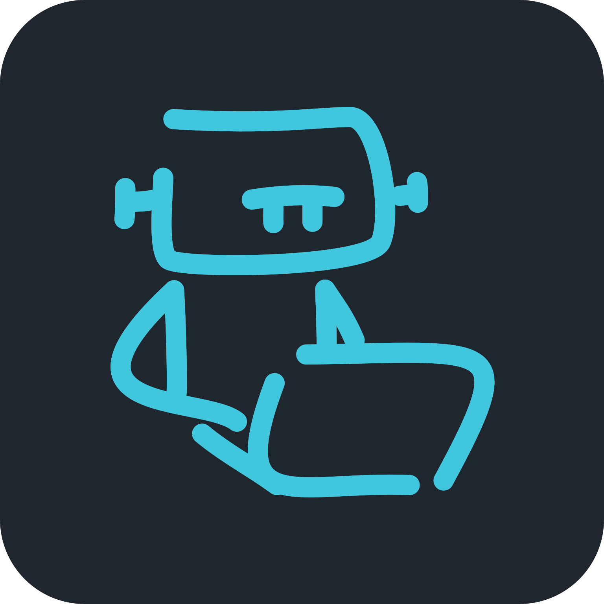

<p align="center">
  <picture>
    <source media="(prefers-color-scheme: dark)" srcset="assets/logo-light.svg" />
    <source media="(prefers-color-scheme: light)" srcset="assets/logo.svg" />
    
  </picture>
</p>

# CoAgent8 - Cooperating coding agents

[](https://github.com/oktawianwybieralski/coagent8/actions/workflows/ci.yml)
[](https://www.npmjs.com/package/coagent8?activeTab=versions)
[](#status)
[](LICENSE)

[](package.json)
[](.github/workflows/ci.yml)
[](https://modelcontextprotocol.io)
[](#backends-and-read-only-profiles)

[](tsconfig.json)
[](package.json)
[](https://www.conventionalcommits.org)

[API reference](https://oktawianwybieralski.github.io/coagent8/)

CoAgent8 lets the coding agent you work with ask another one. It is an MCP
server that puts Codex, Claude Code and Antigravity (`agy`, which runs Gemini and
other models) behind the same six tools: your agent requests a second opinion or
an independent review of your Git changes, and gets the other agent's answer
back in the chat. The other agent runs in a read-only profile, on your own
installed and signed-in CLI.

**Contents:**
[Status](#status) |
[Quick start](#quick-start) |
[Features](#features) |
[Tools](#tools) |
[Skills](#skills) |
[VS Code extension](#vs-code-extension) |
[Configuration](#configuration) |
[Known limitations](#known-limitations) |
[Reporting problems](#reporting-problems) |
[Contributing](#building-and-contributing)

## Status

`0.6.0` is the first release for testers. Every version below 1.0.0 is a
**preview**: a GitHub pre-release, a VS Code pre-release and npm
`coagent8@next`, all with the same version number.

What works today: consultations and reviews by another agent in a read-only
profile, model selection by price with your approval for expensive models,
continuable sessions with history, diagnostics, skills and the VS Code
extension. Not yet available: letting the other agent write changes, run
checks or coordinate several agents. These are the next steps in the
[roadmap](docs/ROADMAP.md#full-coagent-direction).

## Quick start

You need **Node.js 24 or later** and at least one of these CLIs, installed and
signed in:

| CLI | Notes |
| --- | --- |
| [Codex CLI](https://github.com/openai/codex) | Also found inside the OpenAI VS Code extension |
| [Claude Code](https://docs.anthropic.com/en/docs/claude-code) | 2.1.289 or later; subscription login or API key |
| Antigravity CLI (`agy`) | Also installed by the Google Antigravity VS Code extension (`~/.gemini/bin`) |

### VS Code

Install **CoAgent8** (`okidev.coagent8-mcp`) as a pre-release from the
[VS Code Marketplace](https://marketplace.visualstudio.com/items?itemName=okidev.coagent8-mcp),
or download `coagent8-mcp-0.6.0.vsix` from the
[GitHub release](https://github.com/oktawianwybieralski/coagent8/releases/tag/v0.6.0)
and run **Extensions: Install from VSIX...**. Then:

1. The first start shows one notice with the CLIs it found, or an offer to set
   them up. **CoAgent8: Manage Coding CLIs** installs or signs in a CLI at any
   time.
2. CoAgent8 appears in **MCP: List Servers**. Enable its tools in your chat.
3. Ask your agent, for example: *"Use CoAgent8 doctor with scope health"*, *"Ask CoAgent8 for a
   second opinion on this plan"* or *"Have CoAgent8 review my uncommitted
   changes"*.

To use CoAgent8 also inside the CLIs' own chats, choose **Add CoAgent8 to All
CLI Chats** (or **Add CoAgent8 to Its Chat** in one CLI's menu) in
**CoAgent8: Manage Coding CLIs**.

### Codex, Claude Code and Antigravity CLIs

One command registers CoAgent8 in the chats of the CLIs you choose and installs
its [skills](#skills):

```bash
npx -y coagent8@next setup --clients=codex,claude,agy
```

Setup copies the server to `~/.coagent8/runtime/`, so the registration does
not depend on the npx cache, and keeps a private backup of every file it
changes. `status` checks the CLIs. `repair` checks the registrations and updates the
ones setup wrote and you did not change; an entry you edited is kept.
`cleanup` shows what it would remove; run it again with the
`--apply=<token>` it prints to remove the registrations and skills setup added.
npm runs no script on uninstall, so run `cleanup` before `npm uninstall -g
coagent8`.

### Any other MCP host

Add a stdio server to the host's MCP configuration:

```json
{
  "mcpServers": {
    "coagent8": {
      "command": "npx",
      "args": ["-y", "coagent8@next"]
    }
  }
}
```

On Windows, a host that starts commands without a shell may need
`"command": "cmd"` and `"args": ["/c", "npx", "-y", "coagent8@next"]`. Both
`coagent8` and `coagent8-mcp` start the server when run without arguments;
`coagent8@0.6.0` pins a version. Plain `coagent8` (npm `latest`) is not a
supported channel before 1.0.0.

A host with its own tool deadline can stop a long review early. For Codex, set
`tool_timeout_sec = 1800` in `[mcp_servers.coagent8]` (setup does this). Continue
supports stdio MCP in Agent mode through the same definition, following
[Continue's MCP guide](https://docs.continue.dev/customize/deep-dives/mcp).

## Features

- **One MCP server, three coding CLIs.** Codex, Claude Code and Antigravity
  behind the same six tools, for any stdio MCP host.
- **Read-only profiles.** Every backend runs in a read-only profile; for Codex
  and Claude Code CoAgent8 verifies it and refuses a turn it cannot confirm.
- **Second opinion and independent review.** `consult` answers a question;
  `review` checks Git changes and derives a `READY` or `BLOCKED` verdict itself
  instead of trusting the model's word.
- **You decide on expensive models.** A model priced high or unknown runs only
  after you approve it in a form; the calling agent cannot approve it for you.
  A call can also set a strict price limit.
- **Sessions you can continue.** A follow-up with the session handle keeps the
  other agent's context; history is paged and scoped to the workspace.
- **Quiet, bounded processes.** No shell, no console windows, only processes
  CoAgent8 started, bounded buffers and one deadline for the whole call.
- **Self-diagnosing.** `doctor` lists models, efforts and prices and checks
  installation, sign-in and quota; `issue` prepares a sanitized bug report.
- **Skills and editor integration.** One skill per function for each CLI's
  chat; the VS Code extension manages CLIs, skills and model approvals.

### Backends and read-only profiles

| Backend | Execution profile |
| --- | --- |
| **Codex** | `app-server` with `sandbox_mode="read-only"` and `approval_policy="never"`; the thread's read-only state is verified, every inherited MCP server is disabled and verified per thread, server approval requests are rejected, interrupt via `turn/interrupt` |
| **Claude Code** (2.1.289+) | `-p --restricted --tools Read,Glob,Grep --permission-mode dontAsk`, hooks disabled, strict empty MCP configuration; startup tools, MCP and permission mode verified before any content; native session resume and control interrupt |
| **Antigravity** (`agy`) | Headless `--sandbox --output-format stream-json`, prompt on stdin, explicit model, native `--conversation` resume; inherits your agy MCP servers and plugins (see [known limitations](#known-limitations)), recursion into CoAgent8 refused |

### Routing

- `backend`: `auto` (default), `codex`, `claude`, `agy` or `smart_quota`.
  A model name alone also chooses its backend.
- `config.json` can fix a default backend or select the `smart_quota` strategy,
  limited by `allowedBackends`.
- `auto` uses the configured default backend when it is eligible. Otherwise it
  skips backends with an observed rate limit, prefers a CLI other than the one
  calling, and ranks the rest by measured quota headroom. A measurement
  older than 15 minutes counts as unmeasured; `doctor` with `scope: "health"`
  refreshes it.
- A failed turn is never silently retried on another backend.

### Models, prices and approval

- A turn uses the call's `model`, then the session's model, then
  `backends.<id>.defaultModel`, then the CLI's own default. CoAgent8 itself
  names no model.
- `reasoning_effort`: `none`, `minimal`, `low`, `medium`, `high`, `xhigh` or
  `max`, checked against the model's accepted efforts where the CLI lists them.
- Prices come from OpenRouter's public model list (no key, no user data) or
  from `coagent8_PRICES_URL`. They decide whether to ask; they are not a bill.
- Your rules in `governance.models` come first: `deny` never runs a model,
  `ask` asks before every turn, `allow` runs it without asking (`deny` wins over
  `ask`, `ask` over `allow`). Any other model asks when its price is unknown or
  approximate, at or above `governance.askAbovePrice` (default 20 USD per
  million output tokens), or at least `governance.priceMultiplier` (default 2)
  times the backend's default.

### Review gate

- Scopes: uncommitted (default), staged, a commit, a branch or a range, with
  optional review instructions. Git context is bounded (4 MiB per Git command,
  3 MiB snapshot).
- The reviewing agent answers in a fixed format: snapshot, coverage, verdict,
  findings as `[P1|P2|P3] file:line`, and the checks it ran.
- CoAgent8 derives the verdict: an incomplete answer, partial coverage,
  truncated input, another snapshot, a `[P1]` or `[P2]` finding, or a failed
  check makes it `BLOCKED (reason)`.
- A review of unchanged code with the same scope, backend and model starts no
  new turn and returns the earlier verdict.
- Staged, commit and range scopes are reviewed only when their files match the
  current workspace; otherwise review the uncommitted changes.

### Sessions and history

- Sessions belong to one workspace and one backend; a follow-up through
  `session_handle` keeps the session's model and effort.
- History pages hold up to 100 events and 240 KiB. MCP resources
  `coagent8://sessions` and `coagent8://sessions/{id}/history` show the
  connection's workspace only.
- A session handle expires after two hours without use. The history archive is
  best effort: up to 10 MiB per session and 100 MiB in total, old archives
  removed after seven days.
  `coagent8_HISTORY=off` turns archive files off. Private reasoning and raw tool
  output are never archived or returned.

### Safety and bounds

- `shell: false`; prompts go through stdin, at most 4 MiB.
- Cancellation and deadlines interrupt Codex and Claude Code through their own
  protocol, then stop only the process CoAgent8 started (Windows: its handle;
  POSIX: its process group). Nothing is selected by process ID or name.
- Output is bounded: 512 KiB per backend stream, 1 MiB per answer.
- `timeout_ms` from 100 ms to 30 minutes (default 15 minutes) covers Git,
  preparation, approval, the turn and teardown, with progress notifications.
- Answers and archives are redacted for credential formats; diagnostics also
  hide keyword values and home-directory paths. Errors carry a typed code such
  as `CLI_NOT_FOUND`, `AUTH_REQUIRED`, `MODEL_UNAVAILABLE`, `RATE_LIMITED`,
  `TIMEOUT`, `POLICY_DENIED` or `PRICE_LIMIT`.

## Tools

| Tool | Purpose |
| --- | --- |
| `consult` | A second opinion on a question, design, plan or bug; optional architecture, debugging or implementation analysis |
| `review` | An independent review of Git changes with a verdict CoAgent8 derives |
| `doctor` | Models, efforts, output prices, defaults and approval per backend; `scope: "health"` checks installation, versions, sign-in and quota; `detail: "full"` returns data |
| `session` | List sessions, page a session's history or close a session |
| `cancel` | Cancel the running turn of a session |
| `issue` | Prepare a sanitized bug report and a prefilled GitHub issue link |

A consultation can be as small as:

```json
{
  "proposal": "Is this retry loop safe with concurrent writers? <code>",
  "backend": "codex"
}
```

`context_files` passes paths for the other agent to read, not file contents.
Results are Markdown: the answer or a typed error, then the backend, model,
duration and `session_handle=<handle> (<state>)`. Pass that handle for a
follow-up on the same topic; a call without it starts a fresh agent that
rereads everything. `review` adds its verdict.

The deprecated `analyze`, `debug` and `implement` aliases and the `run` gateway
still work but are not listed. Every client receives the same six tools.

### Approving expensive models

The approval is a form CoAgent8 sends through MCP elicitation; your client must
show it to you. Clients that cannot show MCP forms cancel it: headless clients,
Codex 0.160.1 and the Antigravity chat did so when measured. CoAgent8 never
accepts an approval relayed by the calling agent, so there the turn fails with
`POLICY_DENIED`. To use such a model anyway, allow it with **CoAgent8: Manage
Model Approvals** in VS Code or in `governance.models.allow`, or call it from a
client that shows MCP forms.

### Choosing a model under a price limit

Pass the user's limit as `output_price_below`, in USD per million output
tokens. It is strict: `5` means below 5. Without `model`, CoAgent8 chooses the
backend's default if it qualifies, otherwise the highest-priced qualifying
model:

```json
{
  "proposal": "Calculate 17 * 23. Reply only with the result.",
  "output_price_below": 5
}
```

Only an exact price from a list younger than seven days qualifies. If no model
qualifies, the call fails with `PRICE_LIMIT` and each backend's reason instead
of running another model; an explicit model over the limit is never replaced.
The footer states the price, its list and date. A model within the limit may
still need your approval.

To choose yourself, call `doctor`: it lists each backend's models with their
accepted efforts, output price (`~` approximate, `?` unknown), default and
approval tag (`ask: <rule>`, `deny` or `allow`). `coagent8 models` prints the
same list in a terminal. Then name the model and an accepted effort:

```json
{
  "proposal": "Calculate 17 * 23. Reply only with the result.",
  "model": "<model ID from doctor>",
  "reasoning_effort": "low",
  "output_price_below": 5
}
```

## Skills

Setup and the VS Code extension install one skill per function into each CLI
where CoAgent8 is registered. Codex lists them in `/skills` and runs them as
`$coagent8-review`; Claude Code and the Antigravity CLI offer them as
`/coagent8-review` commands.

| Skill | Use it to |
| --- | --- |
| `coagent8-consult` | Ask another agent for a second opinion on a question, design, plan or bug |
| `coagent8-review` | Have another agent review Git changes and read the verdict |
| `coagent8-doctor` | See models, efforts and prices, apply a price limit, check backend health |
| `coagent8-session` | List, read, continue, cancel or close sessions |
| `coagent8-issue` | Prepare a sanitized CoAgent8 bug report |
| `coagent8-loop` | Plan, get the plan reviewed, implement, run checks and get an independent review |

| Client | Skill directory |
| --- | --- |
| Claude Code | `~/.claude/skills/` |
| Codex | `~/.agents/skills/` |
| Antigravity | `~/.gemini/config/skills/` |

**CoAgent8: Manage Skills** in VS Code and `coagent8 skills` in a terminal
install, update, uninstall, enable or disable one or all skills per client.
Your choices are kept, so repair does not bring back a skill you removed.
Disabled skills move to `~/.coagent8/disabled-skills/<client>/`. A skill you
edited is never overwritten. Start a new chat to see changes. VS Code chat also
reads `~/.claude/skills/` and `~/.agents/skills/`, so with both Claude Code and
Codex set up it lists each skill twice.

```sh
coagent8 skills status --clients=agy
coagent8 skills install --clients=agy --skills=coagent8-review
```

Changes are shown as a preview first; repeat the command for one client with
`--apply=<token>` to apply them.

## VS Code extension

Press `F1` (or `Ctrl+Shift+P`, `Cmd+Shift+P` on macOS), type `CoAgent8` and
choose a command:

| Command | What it does |
| --- | --- |
| `CoAgent8: Manage Coding CLIs` | Shows each CLI's state and chat entry. Installs a CLI (VS Code extension or official standalone), signs in, chooses the installation CoAgent8 uses, adds, updates or removes CoAgent8 in a CLI's chat, manages its skills, and removes what CoAgent8 installed |
| `CoAgent8: Manage Model Approvals` | Allows, asks for or denies individual models, and sets the price rules for asking |
| `CoAgent8: Manage Skills` | Installs, updates, uninstalls, enables or disables skills per client |
| `CoAgent8: Open Settings` | Opens CoAgent8's backend, model, configuration path and Node.js settings |
| `CoAgent8: Open Configuration (config.json)` | Opens the configuration file (`~/.coagent8/config.json` unless `coagent8.configPath` or `coagent8_CONFIG` names another), creating it with defaults if missing, with completion and validation (a file in another location needs a `$schema` entry, which new files get) |
| `CoAgent8: Reset Configuration (config.json)` | Replaces the file with the defaults after a confirmation, keeping the previous one as `config.json.backup` |
| `CoAgent8: Show MCP Servers` | Opens **MCP: List Servers**, where VS Code starts, stops and restarts CoAgent8 and shows its output |

The extension changes only what you choose, keeps private backups of the CLIs'
configuration files, and removes only entries it wrote and that you did not
change. When VS Code offers **Restart Extensions** after an install, update or
chat change, use it. VS Code restarts the CoAgent8 server by itself when its
settings or bundle change. Settings you save in VS Code take precedence over
`config.json`, except an empty model, which keeps the file's model; the CLIs
and other hosts read only the file.

Uninstalling the extension removes what it added: its chat entries, skills,
runtime copies and storage, including its sessions and history. Your shared
`~/.coagent8/config.json`, credentials and the CLIs stay.

## Configuration

`~/.coagent8/config.json` is shared by every host, the CLI and the VS Code
extension. Without the file the defaults apply. An unreadable or invalid file
stops execution with `POLICY_DENIED` while `doctor` keeps working.

```json
{
  "schemaVersion": 1,
  "defaultBackend": null,
  "routing": {
    "strategy": "fixed",
    "allowedBackends": ["codex", "claude", "agy"]
  },
  "backends": {
    "agy": { "executable": "vscode-extension", "defaultModel": "<model the first doctor recorded>" }
  },
  "governance": {
    "priceMultiplier": 2,
    "askAbovePrice": 20,
    "models": { "allow": [], "ask": [], "deny": [] }
  }
}
```

A backend's CLI is `backends.<id>.executable` when it is set (an absolute
path, `~/...`, or `vscode-extension` for the vendor extension's copy); a
configured CLI that is missing fails instead of falling back. Without it, the
CLI is found on PATH, then in the vendor's VS Code extension. The workspace comes from
`workspace_path`, the client's roots, or the server's working directory.

| Variable | Effect |
| --- | --- |
| `coagent8_CONFIG` | Configuration file path |
| `coagent8_DIR` | Storage root for sessions, history and caches (default `~/.coagent8`) |
| `coagent8_HISTORY` | `off` turns archive files off |
| `coagent8_PRICES_URL` | Price list URL or local file instead of OpenRouter |
| `coagent8_QUOTA_CACHE` | Quota cache file |
| `CODEX_PATH`, `CLAUDE_PATH`, `AGY_PATH` | Backend executables; they override `backends.<id>.executable` |
| `CODEX_HOME`, `CODEX_CONFIG_PATH`, `CLAUDE_CONFIG_DIR`, `GEMINI_CLI_HOME` | Backend configuration locations; setup and cleanup support only the defaults |

The [architecture](docs/ARCHITECTURE.md) states every contract, bound and
error.

## Known limitations

- **Antigravity's own tools.** agy gives the other agent your agy MCP servers
  and plugins, which CoAgent8 cannot turn off; `doctor` lists them. Calls back
  into CoAgent8 are refused.
- **Leftover agy processes on Windows.** Cancelling or timing out an agy turn
  stops agy itself, but a process agy started outside it, such as one of its MCP
  servers, can keep running until it exits or the CoAgent8 server stops.
- **Parent crash on macOS and Linux.** If the host dies unexpectedly, the
  processes CoAgent8 started are not cleaned up.
- **Approval forms.** Clients that cannot show MCP forms cannot approve an
  expensive model (see [approving expensive models](#approving-expensive-models)).
- **Host deadlines.** A host can stop a tool call before CoAgent8's own deadline;
  a headless agy client stopped calls after 180 seconds.
- **Sessions on disk.** Every call keeps a session record, even with archives
  turned off, and the session handle arrives with the result.
- **Reviews of another tree.** A staged, commit or range review whose files do
  not match the current workspace is refused rather than reviewed.

## Reporting problems

Ask your agent to run the `issue` tool: it prepares a sanitized report with
your OS, Node and CLI versions and a link that opens a new GitHub issue with it.
Add the steps and what you expected, and check the text for private data
before you submit it. You can also use the
[bug-report form](https://github.com/oktawianwybieralski/coagent8/issues/new?template=bug_report.yml)
directly.

## Building and contributing

Building from source needs Node.js 24.11+ or 26+:

```bash
npm ci
npm run build
```

The server is then `node <checkout>/dist/index.cjs`; `npm pack` produces the
installable package. A checkout of `develop` is a development build, not a
release. Restart a running MCP server after rebuilding.

| Need | Document |
| --- | --- |
| Priorities and acceptance | [Roadmap](docs/ROADMAP.md) |
| Contracts, limitations and design | [Architecture](docs/ARCHITECTURE.md) |
| Current work and evidence | [Handoff](docs/HANDOFF.md) |
| Contributor rules | [AGENTS.md](AGENTS.md) |
| Branches, pull requests and releases | [Git workflow](.agents/rules/02-git-workflow.md) |
| Checks by scope | [Quality gate](.agents/rules/04-quality-gate.md) |
| Release history | [Changelog](CHANGELOG.md) |
| API reference | [oktawianwybieralski.github.io/coagent8](https://oktawianwybieralski.github.io/coagent8/) |

The npm package does not include `docs/` or the contributor rules; these links
work in the repository.

## License

Copyright (c) 2026 Oktawian Wybieralski (oki.dev).

Licensed under the [GNU General Public License, version 3 only](LICENSE)
(`GPL-3.0-only`). Distributed derivative works must comply with GPLv3 and its
source-distribution requirements. See LICENSE for the full terms and warranty
disclaimer. Copies previously distributed under MIT retain those terms.

Created by [Oktawian Wybieralski](https://oki.dev) ·
[GitHub repository](https://github.com/oktawianwybieralski/coagent8)
