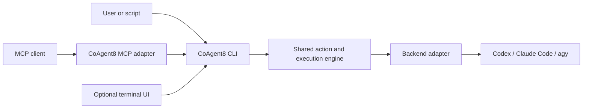

# CLI-first CoAgent8 with an MCP adapter

**Status:** Planned feature; no runtime implementation in this change.
**Owner decision recorded:** 2026-10-07.
**Release target:** Implement and accept `CLI-FIRST-001` before `v1.0.0-rc.1`.
**Source inspected:** `47c6c10`, local development stack, not release acceptance.
**Plan owner:** [ROADMAP.md](ROADMAP.md#cli-first-001---public-cli-and-mcp-to-cli-adapter).

This document specifies the feature and records its research. The roadmap owns
priorities, completion and release gates. Examples describe the proposed interface;
they are not commands supported by the current package.

## 1. Decision and scope

Make CoAgent8's own CLI the common execution interface for people, scripts and
the MCP server. A person requests a consultation or review from a terminal. An
MCP client requests the same action through an adapter that starts the packaged
CoAgent8 CLI and translates its result back to MCP.

```powershell
coagent8 consult "Check the retry loop" -b claude -m opus
```

`-b` means `--backend`; `-m` means `--model`. Provider and model stay separate.
`opus` is a Claude Code alias whose concrete model depends on provider and
configuration. Resolve it before consent, rather than embedding a versioned
model list in CoAgent8.
[Claude Code model configuration](https://code.claude.com/docs/en/model-config)



Required before RC 1: public execution commands and command/PATH support on
Windows, Linux and macOS, the MCP-to-CLI adapter, model validation and safe
control/lifecycle behavior.
TUI is an optional extension; research does not make a full-screen UI mandatory.
This feature follows existing audit blockers and does not enlarge the beta.2 gate.

The CLI exposes CoAgent8 actions, not arbitrary shell execution. Existing
read-only profiles, redaction, cost policy and session/process ownership remain
mandatory. Implementation analysis still does not grant writes. MCP remains the
client protocol; the new boundary changes internal execution.

## 2. Inspected implementation

| Area | Current source | Feature work |
| --- | --- | --- |
| Commands | [package.json](../package.json) maps `coagent8` and `coagent8-mcp` to `dist/index.cjs`; [index.ts](../src/index.ts) handles setup/repair/status/cleanup/help, otherwise stdio | Add execution subcommands and explicit `mcp`; preserve existing launches |
| Actions | [Controller](../src/execution/controller.ts) runs through tool handlers inside the MCP process | Extract an application interface, called by the CLI |
| Results | [Formatter](../src/tools/result.ts) produces MCP Markdown, without public execution JSON | Typed result with separate CLI/MCP renderers |
| Backend | [Codex adapter](../src/backends/codex/adapter.ts) runs `app-server` with protocol initialization and verification | Reuse adapters and native protocols |
| Models | [Runtime contract](RUNTIME_CONTRACT.md#model-and-effort-selection) defines catalogs, aliases and persisted observations | Discovery/suggestions without an invented complete catalog |
| Consent | [Server](../src/server.ts) supplies the controller's MCP elicitation callback | Controlled child channel; reviewed terminal-consent design |
| Cancellation | [Controller](../src/execution/controller.ts) stores abort callbacks in memory; [sessions](../src/sessions/session.ts) reject cancelling a live foreign process | Parent routes cancellation to its owned action child |
| Windows | [Process runner](../src/execution/process.ts) hides launches; [resolver](../src/execution/cli-resolver.ts) resolves supported shims without a shell | Extend supervision to the additional CoAgent8 process |

Current Codex execution is more than `codex.exe -m ...` and text capture: it
initializes a protocol session, verifies restrictions and interrupts turns.
The public command hides that complexity while retaining it internally.

## 3. Public commands and options

| Proposed command | Contract |
| --- | --- |
| `consult <question>` / `consult -` | Plain consultation; `-` reads one UTF-8 question from stdin until EOF |
| `review` | Uncommitted changes by default; `--scope` accepts staged, commit, branch and range forms from the existing tool |
| `doctor` | Existing diagnostics/detail/quota behavior |
| `models -b <backend>` | Known models/aliases, default, efforts, source, freshness and catalog completeness |
| `session list` / `session history <handle>` / `session close <handle>` | Workspace-scoped management; history pagination and explicit deletion |
| `cancel <handle>` | Stop an owned turn; refuse a live foreign execution |
| `issue` | Prepare a sanitized report/link; never submit it |
| `mcp` | Explicit stdio server startup |
| `path status` / `path add` / `path remove` | Diagnose or explicitly manage eligible user PATH entries |
| `setup`, `repair`, `status`, `cleanup` | Preserve existing registration/cleanup contracts |
| `tui` | Optional entry, advertised only after implementation and acceptance |

Keep singular `session` to match MCP. `models` is a metadata view, not a separate
registry. Do not invent a `review --base` meaning when `--scope` already matches
the implemented Git contract.

| Long option | Short | Meaning |
| --- | --- | --- |
| `--backend` | `-b` | Existing backend selection; `agy` can be a documented CLI alias for `gemini` |
| `--model` | `-m` | Provider identifier or supported provider alias |
| `--workspace` | `-w` | `workspace_path`; direct CLI defaults to an eligible current directory |
| `--session` | `-s` | Explicit continuation with workspace/provider checks |
| `--effort` | `-e` | `reasoning_effort`, validated per provider/model |
| `--timeout-ms` | - | Existing bounded timeout; help specifies which phases it covers |
| `--file` | - | Repeatable context-file path, mapped to `context_files` |
| `--json` / `--jsonl` | - | Single terminal result / progress events plus terminal result |
| `--no-interactive` | - | No terminal questions; required consent fails closed |
| `--help` / `--version` | `-h` / `-V` | Exit without probes, model calls, session writes or installer loading |

Backend values otherwise remain `auto`, `codex`, `claude`, `gemini`, `smart_quota`.
Omitting `--model` preserves the existing model selection order, including the
continued session and configuration. Add task-type/question options for consult
and instructions/scope options for review without duplicating their schemas.

Examples of the proposed interface:

```powershell
coagent8 consult "Check the retry loop" --backend claude --model opus
coagent8 consult "Check the retry loop" -b claude -m opus --json
Get-Content -Raw ./question.txt | coagent8 consult - -b codex --json
coagent8 review --scope staged -b codex --json
coagent8 review --scope release/v1.0.0...HEAD -b claude
coagent8 models -b claude
coagent8 session history <session-handle> --limit 20
```

Start with strict `node:util.parseArgs`, which supports typed options, short
aliases and tokens. Inspect tokens to reject repeated singleton flags.
[Node 24 argument parsing](https://nodejs.org/docs/latest-v24.x/api/util.html#utilparseargsconfig)

Reject unknown flags, missing values, duplicate singleton options, conflicting
input sources and incompatible output modes. Support the `--` terminator and
validate numeric ranges after parsing. Read stdin only when explicitly requested;
ordinary terminal use must not wait for EOF. Enforce the 4 MiB input limit while
reading. Public arguments are data: no backend-flag passthrough, shell fragments,
sandbox override or approval boolean.

## 4. Output and exit codes

Human mode prints the public answer to stdout; progress, warnings and errors go
to stderr. Avoid color/spinners on redirected streams. Help explains aliases,
examples, continuation and model discovery, distinguishing execution from setup.
These conventions serve people and pipelines.
[CLI design guidelines](https://clig.dev/#guidelines)

`--json` writes exactly one versioned result, including errors after parsing,
without banners or progress on stdout. A closed output pipe cancels the owned
execution. Await cleanup and output drain before terminating.

Illustrative execution result, not a measurement:

```json
{
  "schemaVersion": 1,
  "command": "consult",
  "ok": true,
  "status": "completed",
  "answer": "The retry loop can race with concurrent writers.",
  "backend": "claude",
  "model": "<resolved-concrete-model>",
  "durationMs": 1200,
  "sessionHandle": "<handle-or-null>",
  "continuationAvailable": true,
  "truncated": false,
  "warnings": [],
  "error": null
}
```

Use documented nulls for unavailable fields. Errors include typed code, sanitized
message and retryability; model validation can add bounded suggestions. Only
reviews add verdict and input-completeness/snapshot evidence. A completed process
is not evidence that a review is READY. Management commands wrap their typed data
in the CLI envelope. Freeze the exact fields and status mapping with contract tests.

CLI JSON does not add `structuredContent` to MCP consult/review. Preserve existing
Markdown-only execution answers, schemas and model-visible tool budgets. Render
both surfaces from typed results, never parse metadata back out of Markdown.

`--jsonl` reuses sanitized application events with identity/ordering, ending in
exactly one `result` event. No raw native events, internal reasoning or unbounded
commentary. Protect secrets split across chunks, validate shapes, honor
backpressure and bound frames/queues. Report clipping without cutting JSON into
invalid syntax. Keep session handles even with archival history disabled.

| Proposed exit code | Meaning |
| --- | --- |
| `0` | Successful action; review is READY where applicable |
| `1` | Backend/execution/session failure, including `MODEL_UNAVAILABLE` |
| `2` | CLI syntax or request-schema error |
| `3` | Required approval unavailable, declined or invalid |
| `10` | Review completed with BLOCKED/incomplete verdict |
| `124` | Execution timeout |
| `130` | User/caller cancellation |

Detailed typed errors remain in JSON. Callers do not parse stderr or rely on
native provider exit codes. Review completeness remains subject to `CUR-001`;
successful CLI execution cannot establish release approval.

## 5. Model validation and suggestions

Validate backend, identifier syntax and provider model/effort evidence before a
billable turn. Resolve the concrete model before price governance. Metadata
probes may run first. When provider evidence definitively rejects a name:

```text
Error [MODEL_UNAVAILABLE]: Unknown model "opuss" for backend "claude".
Did you mean "opus"?
Run: coagent8 models -b claude
```

This example is conditional on provider evidence. Claude currently has no complete
catalog; its resolver and known aliases are different evidence. Do not reject full
model identifiers merely because they are absent from an alias list. If catalog
data is unavailable, report that and let native validation decide where supported;
instant rejection is not guaranteed. Never claim account entitlement from a name.

Suggest only known names from the selected provider, using deterministic matching,
a conservative threshold and a small candidate limit. Refresh stale metadata at
most once before a definitive negative decision and bound that refresh. Weak
evidence means no guessed suggestion. Never auto-correct or switch provider/model.
`opus-5-5` in the discussion is an example spelling, not an approved CoAgent8 alias.
Use fixtures instead of paid turns to test guessed identifiers.

## 6. MCP adapter and application boundary

The MCP parent retains transport, discovery, roots/resources, capability
negotiation and human elicitation. Resolve the workspace through current MCP
rules and pass that exact workspace to the CLI. Move common request validation,
action dispatch and typed results behind an application interface. Controller,
adapters, sessions and redaction remain single owners.

Candidate owners are `src/application/` for actions/results, `src/cli/` for
parsing/rendering and `src/mcp/` for integration; exact moves are implementation
decisions. The adapter launches the matching sibling CLI bundle with the current
Node executable and an argument array. Do not resolve a mutable `coagent8` through
PATH or launch a shell. Send bounded questions/requests through a pipe, not argv;
keep private contents and consent out of command-line/process listings.

Node supports a separate parent/child IPC channel alongside stdio. Use that as
the initial control-channel candidate; shell-free spawning and hidden Windows
launches remain required. Child processes have separate memory and startup cost.
[Node 24 child processes](https://github.com/nodejs/node/blob/v24.x/doc/api/child_process.md)

Internal controls need versioned, validated messages for consent challenges and
responses, cancellation/acknowledgement, acquired session identity, completion
and parent disconnection. Keep them separate from question input, JSON/JSONL and
stderr. Reject unknown versions, wrong identities and unexpected/replayed messages.
Public input is never a control channel; an internal-mode flag alone is never
authorization. Require an owned launch/channel context and independently review
the consent trust boundary. IPC does not isolate a malicious same-user process.
An inadequate trust design blocks migration rather than weakening consent.

Use persistent metadata caches across fresh CLI processes. Measure cold/warm
latency, helper/probe counts, memory and Defender behavior against today's
in-process path. Do not add a daemon by default. A persistent worker is an option
only after measurements justify it. An in-process MCP adapter to the same engine
is a simpler fallback, but adopting it changes the selected subprocess design and
requires an explicit roadmap decision.

## 7. Consent and normative policy

Current [security policy](../.agents/rules/01-security-and-sandboxes.md#2-model-cost-governance)
requires human consent through MCP elicitation. Direct terminal consent is a
proposed extension requiring a reviewed design and rule update. This document
does not grant that exception. Until accepted, direct CLI runs models needing no
new approval and refuses the others.

For MCP, the child resolves the effective model/policy and pauses with a challenge.
The parent asks the host's user through negotiated form elicitation. Accept only
an accepted form with explicit boolean `approve: true`. Preserve decline, cancel,
missing capability, timeout and remember semantics; unsupported elicitation does
not open a terminal.
[MCP form elicitation, 2025-11-25](https://modelcontextprotocol.io/specification/2025-11-25/client/elicitation)

Bind each response to its concrete backend/model/turn/challenge and expire it on
cancel, timeout, change or disconnect. No reusable approval in argv, environment,
history or public results. No `--approve`, `--yes`, stdin `yes` or tool argument
bypasses policy. Preserve the user's remembered configuration semantics.

CLI/TUI consent must show the concrete model and reason. A TTY does not prove a
human answered: agents can drive terminals. Define a trusted interaction/broker
and its assumptions in the security rule before enabling terminal approval.
Automation cannot grant consent by asking for interactive mode. Public `--json`,
`--jsonl` and `--no-interactive` never prompt in the terminal; MCP's internal
channel can still carry the host user's response. Required consent without a
trusted provider fails closed. Sandbox and inherited-MCP isolation rules remain.

Research returned newer MCP flows too. This is not a protocol-version upgrade:
implement against the shipped SDK and negotiated capabilities; review any upgrade
separately. Do not copy newer wire examples into the current implementation.

## 8. Cancellation, sessions and bounds

The MCP parent owns CoAgent8 children; each child owns its backend. Forward
cancellation to the child's existing interrupt/cleanup path before forcing any
owned process to stop. Handle cancellation during selection, consent and output,
plus parent EOF/disconnect/crash, child crash and broken pipes.

Map active session/turn identities to children in the MCP parent. Route `cancel`
and active-session close to the owner and await release; a new CLI process cannot
find today's in-memory abort callbacks. A separately invoked `cancel <handle>`
must honestly refuse a live foreign execution and direct the user to its owning
terminal/host. Only safely abandoned state may be reclaimed. A general
cross-process cancellation endpoint needs a separate identity design; do not
substitute PID/name-based killing.

Direct CLI `Ctrl+C` cancels, awaits owned cleanup and returns `130`. Raw-mode TUI
must handle that key explicitly: Node documents that it does not generate SIGINT
there. Windows signal behavior differs from POSIX; child controls should use
protocol cancellation first.
[Node TTY behavior](https://github.com/nodejs/node/blob/v24.x/doc/api/tty.md),
[Node process signals](https://nodejs.org/docs/latest-v24.x/api/process.html#signal-events)

Preserve [cross-platform rules](../.agents/rules/05-cross-platform.md): owned
handles/groups, hidden Windows helpers, interrupt before force-stop and bounded
drain. Keep 512 KiB execution buffers and 4 MiB inputs; separately bound serialized
frames/queues/diagnostics, accounting for JSON escaping. Redact before truncation.
Validate parent-death cleanup with the extra process on all supported platforms;
neither successful cancellation nor IPC proves crash cleanup. Preserve disk
sessions, workspace isolation, leases and native resume. Archive-off does not
imply session-free execution.

## 9. Installation, PATH and cross-platform CI

Keep npm as initial distribution. A Node-backed command suffices; a native
`coagent8.exe` is optional future packaging. Existing `bin` mappings are the base.
npm creates Windows command shims; global executables live directly in its prefix
on Windows and in `{prefix}/bin` on Unix.
[npm executable mappings](https://docs.npmjs.com/cli/v11/configuring-npm/package-json/#bin),
[npm executable locations](https://docs.npmjs.com/cli/v11/configuring-npm/folders/#executables)

Document accepted package/artifact installation, global command discovery and
invocation when PATH is missing. Do not assume the checkout version is published
or promote the placeholder. Discover the actual prefix with `npm prefix -g`;
never hardcode AppData or extension version directories. This change installs nothing.

Command discovery, PATH diagnosis and explicit user-scoped repair are required on
Windows, Linux and macOS. Windows-specific registry handling is one platform
implementation, not the product's support boundary. Never require administrator
privileges or `sudo` for ordinary user installation/repair.

### 9.1 Windows

`path status` distinguishes a missing command/entry, stale terminal environment
and a different CoAgent8 earlier in PATH. `path add` explicitly edits user scope.
Windows supports persistent user/machine environment scopes; a child's changes
cannot update the parent terminal's environment.
[Microsoft environment variables](https://learn.microsoft.com/en-us/powershell/module/microsoft.powershell.core/about/about_environment_variables?view=powershell-7.5)

Read persisted user PATH, not the merged process PATH. Preserve order, spelling
and variable references; normalize only for duplicate comparison. Add a verified
command directory, record rollback/ownership and explain any terminal restart.
Do not edit Machine PATH, truncate entries or use a postinstall hook. If the
command is unavailable, document the installed Node entry to invoke explicit repair.

`path remove` removes only an eligible unchanged owned entry. Never remove a
shared npm prefix on CoAgent8 uninstall; other commands may need it. Preserve
conflicts and existing registration/cleanup backups. Verify PowerShell, Windows
PowerShell and CMD, paths with spaces, redirected I/O, updates and uninstall.
Do not weaken execution policy; document `.cmd` when a script shim is blocked.

### 9.2 Linux and macOS

Verify npm executable links, executable permissions, shebangs, symlink resolution
and `{prefix}/bin` discovery. Support both a global install into an isolated
user-owned prefix and local package invocation; never assume `/usr/local/bin`,
a Homebrew location or the developer's own Node installation. Diagnose a missing
directory and command shadowing, preserving the platform's path/case semantics.

Persistent user PATH is shell configuration, not the Windows environment store.
For Bash, interactive non-login shells read `.bashrc`; login shells select the
first readable `.bash_profile`, `.bash_login` or `.profile`. For Zsh, login and
interactive startup use `.zprofile` and `.zshrc` respectively, under `ZDOTDIR`
when configured. One blindly appended line cannot cover every shell startup mode.
[Bash startup files](https://www.gnu.org/software/bash/manual/html_node/Bash-Startup-Files.html),
[Zsh startup files](https://zsh.sourceforge.io/Doc/Release/Files.html)

Start with documented Bash and Zsh support. `path status` identifies the selected
shell/profile; do not assume Bash just because the OS is Linux or Zsh because it
is macOS. Explicit repair must name/select its target and explain which new shell
sessions load it. Unsupported/custom configurations get a correctly quoted manual
snippet and no guessed edit. Do not execute the user's profile during discovery.

Manage only marked owned snippets, with backup, duplicate detection, atomic update
and conflict-aware rollback/removal. Preserve custom startup content, comments,
existing PATH order and shared npm directories. Do not rewrite system profiles,
`/etc/paths`, `/etc/profile` or a version manager's configuration. Quote paths with
spaces or shell metacharacters as data. An invoked CLI cannot update its parent
shell; tell the user how to start a session with the new environment.

### 9.3 CI coverage and release evidence

The inspected [CI workflow](../.github/workflows/ci.yml) already defines six jobs:
`ubuntu-latest`, `macos-latest`, `windows-latest`, each on Node 24.x and 26.x.
It builds, checks types/coverage/package contents and installs a tarball for
consumer verification. These existing jobs do not yet prove the proposed CLI.
Extend their behavioral coverage when implementing the feature, rather than
marking future commands tested by today's MCP checks.

GitHub-hosted macOS runners can execute native macOS jobs without the owner
having a Mac. Record actual OS image, CPU architecture, Node/npm/shell versions
and artifact hash. Runner labels and architectures vary; a single `macos-latest`
job is not evidence for both Intel and Apple Silicon. Add targeted native jobs
for additional advertised architectures/OS baselines and record unsupported or
unmeasured combinations explicitly.
[GitHub-hosted runners](https://docs.github.com/en/actions/reference/runners/github-hosted-runners)

Required automated coverage on the existing six-job matrix:

| Layer | Checks |
| --- | --- |
| Fresh artifact | Build once for the job, hash the packed tarball, install that exact artifact in isolated local/global prefixes; reject stale bundles or mismatched CLI/MCP versions |
| Commands and shells | Help/version, long/short flags, stdin/EOF, JSON/JSONL, exit codes, Unicode and spaced paths; Windows CMD/PowerShell plus Bash on Linux/macOS and Zsh on macOS |
| PATH lifecycle | Clean profiles/environment stores, discovery, explicit add twice, reopen selected login/non-login shells, shadowing, conflict-aware removal, shared entries, updates and uninstall |
| MCP compatibility | Fixture-backed discovery, roots, execution, elicitation, session resources and cancellation through the packaged CLI child |
| Native process lifecycle | Owned fixture processes for interrupt, timeout, EOF, parent/child crash, broken pipe, concurrency, lock release and zero survivors; run applicable POSIX checks on both Linux and macOS |
| Optional terminal UI | Owned PTY tests for input, Ctrl+C, resize and terminal restoration when implemented; distinguish those tests from interactive host/user acceptance |

Use disposable profile directories, installation prefixes and backend fixtures,
not the runner's shared shell configuration or authenticated real coding CLIs.
Do not skip macOS lifecycle tests merely because the developer works on Windows.
Upload sanitized failure logs and manifests even after a failed job; successful
retries without root-cause evidence do not establish reliability.

CI can establish native platform behavior under its tested conditions. It does
not by itself verify live backend authentication/subscriptions, desktop window
visibility or the appearance and human approval flow in every real terminal.
Record macOS evidence as CI/PTY acceptance when that is all that was measured;
any claim requiring a real user's terminal needs a tester or separate acceptance.
Lack of the owner's Mac is not a reason to drop macOS CLI support.

CD keeps the existing release gates: accepted snapshot, exact artifact checksums,
six required checks and independent hash-bound review precede distribution.
Optional release automation must publish the artifact that passed acceptance,
not silently rebuild different contents. Recording this plan changes no workflow
and authorizes no push, release or publication; the owner retains those actions.

## 10. Optional TUI

Use the same CLI result/event contract for backend/model selection, question
entry, public answers/history, continuation, progress, cancellation and trusted
consent. Keep backend internals out of ordinary conversation.

Ink is a candidate, not a dependency decision. Its docs provide raw-mode support
checks and exit/unmount hooks. The inspected repository manifest is ESM with
React peers, while our core is CJS. Evaluate compatibility, license notices,
bundle size and startup; repository state is not a pinned published release.
[Ink input/lifecycle](https://github.com/vadimdemedes/ink/blob/master/readme.md),
[Ink manifest](https://github.com/vadimdemedes/ink/blob/master/package.json)

Compare a terminal prototype on supported systems with a small line-oriented
interface using Node built-ins. Load UI only on an explicit command and keep UI dependencies off MCP
startup. Redirected/non-TTY invocation must return clear help/error without raw
mode. Restore input, cursor and screen state on resize, failure, cancellation
and exit. RC 1 requires a recorded TUI choice/deferment and a separate UI boundary;
full-screen TUI stays optional unless the owner adds it before freeze. Any shipped
UI requires native terminal acceptance.

## 11. Implementation stages and acceptance

`CLI-FIRST-001` follows audit blockers and precedes RC 1 freeze. It is distinct
from `CLI-INTERACT-001`, which concerns native backend activity/failure modes.
The roadmap owns the authoritative implementation checklist. Suggested stages:

1. Extract typed requests/results and actions; preserve MCP behavior and storage.
2. Add commands, aliases, stdin, JSON/JSONL, help, models and suggestions with fixtures.
3. Review consent design/rules, add controls and switch MCP execution with session routing.
4. Verify installation/PATH on Windows/Linux/macOS, native CI, exact tarball
   behavior and extra-process cost.
5. Record the TUI decision and run migration/release acceptance on the exact candidate.

| Acceptance area | Required evidence before RC 1 |
| --- | --- |
| CLI/input | Long/short aliases agree; duplicates/invalid flags, `--`, spaces, UTF-8, missing questions and limits |
| Models | Catalog hit/miss/stale/unavailable, aliases, deterministic suggestions, resolved-model policy and no auto-substitution |
| Results | Single JSON, bounded ordered JSONL, clean stdout/stderr, typed failures/partial answers and review completeness |
| MCP | Discovery, six tools, roots/resources, Markdown execution results, deprecated aliases and context budgets preserved |
| Policy | Accept/decline/cancel/missing approval; mismatched/expired/replayed challenge rejection; no public approval bypass; terminal behavior matches reviewed rules |
| Lifecycle | Ctrl+C, MCP cancellation, consent timeout, parent/child crash, EOF, broken pipe, concurrent sessions and resume; no owned survivor or unowned termination |
| Windows | No visible helper windows; command shims; idempotent user PATH operations preserving unrelated entries and registrations |
| Linux/macOS | Executable links/permissions, Bash/Zsh startup and user PATH repair/removal; native CI process-group/crash checks and recorded CPU architecture |
| Package/performance | Fresh exact artifact, matching sibling versions, installer/UI separation, cold/warm measurements and bounded probe counts |
| Release | Full local gate, six OS/Node jobs and independent hash-bound review; no unresolved P1/P2 findings |

Automated tests use hermetic CLI fixtures, without real model quota. Native
terminal acceptance is distinct from fixture evidence. Planning-only verification
is content/link review and `git diff --check`, not builds/runtime tests.

Keep no-argument MCP startup for both command names. Add explicit `mcp`; a bare
invocation never opens TUI. Known new commands parse strictly; preserve today's
unknown-host-argument fallback during migration and document it separately from
the public subcommand contract. Changing that fallback later requires host
evidence. Preserve configuration, caches, session/history formats and registrations
or define migration. The owner retains integration and publication responsibilities.

Rollback may restore in-process MCP execution while keeping additive CLI commands
on the same engine. It never restores weaker consent/sandbox settings or discards
stored data; a replacement release artifact requires renewed approval.

## 12. Research record

Sources were fetched on 2026-10-07 using Context7 and primary documentation pages.
Node 24 was used for parser/process research. Newer MCP results were cross-checked
against current elicitation code. Inline links support documentation findings;
commands, schemas, exit mappings and acceptance above are CoAgent8 proposals.
No backend model turn, installation, PATH edit, build or runtime test was run.
Older baseline documents do not provide fresh evidence for this feature.
