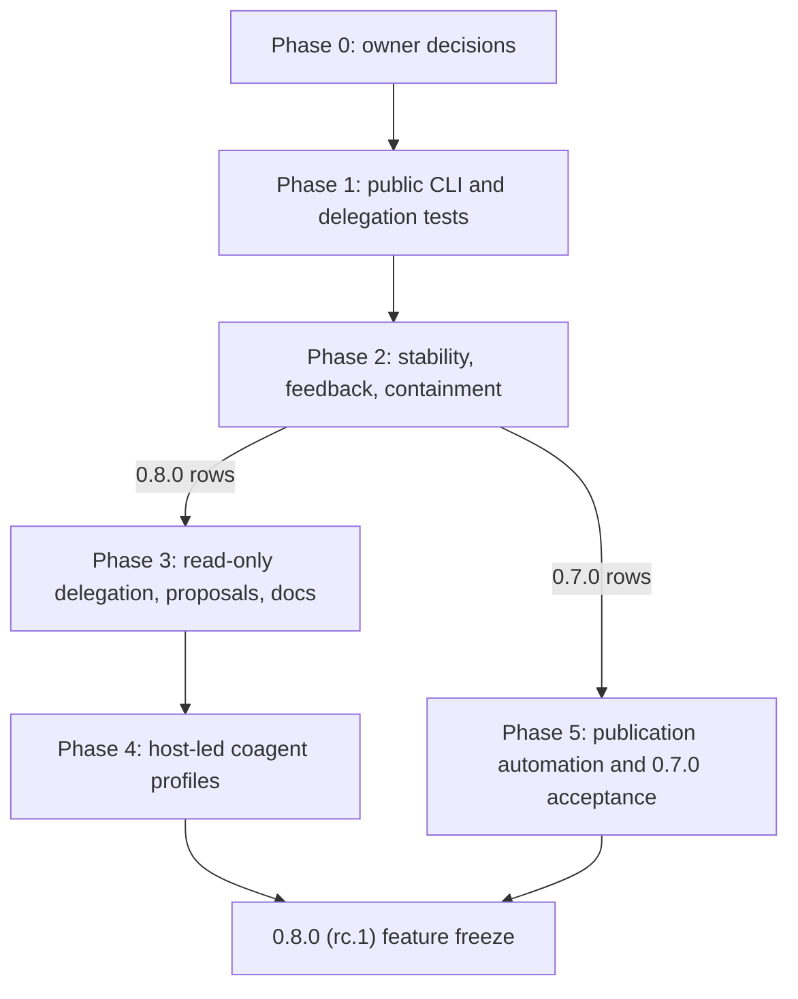

# CoAgent8 roadmap

Updated 2026-10-19. This is the single active plan. CoAgent8 is becoming a
client-independent MCP system for orchestrating complete agent tasks. Roles,
models and providers are independent. Read-only consultation is one execution
profile, not the product boundary. The current runtime still exposes the
read-only bridge; writing and delegated coordination are not implemented.

[ARCHITECTURE.md](ARCHITECTURE.md) owns current contracts and target design;
[HANDOFF.md](HANDOFF.md) owns current work and evidence. README owns getting
started; [AGENTS.md](../AGENTS.md) owns contributor rules.

## Current snapshot status

`0.6.1`, the fix-only patch after the beta.2 stage `0.6.0` (numbered by
[REPO-003](#repo-003-one-numeric-version-for-npm-vsix-and-tags)), is released:
tag `v0.6.1` on `develop`, GitHub Release, npm and the VS Code Marketplace
([evidence](HANDOFF.md#061-release-evidence)). Before the next tag, publication
becomes fully automated ([RELEASE-001](#release-001-automated-publication));
the `0.6.1` acceptance findings are
[FEEDBACK-061](#feedback-061-findings-of-the-061-native-acceptance). The owner
handles merges, tags and publication approvals.

| Area | Present locally | Remaining |
| --- | --- | --- |
| Execution | Six tools, three CLI adapters, plain consult, explicit model/effort | Full tasks, write/execute profiles, bounded orchestration |
| Safety | Owned cleanup, hidden Windows launches, redaction, explicit model consent, Codex/Claude inherited-tool controls | POSIX parent-death cleanup; native acceptance |
| Review | Completeness, snapshot/check gate, post-turn recheck, other-tree mismatch rejection | Other-tree review; independently observed checks and release hashes |
| Storage/routing | Leases, best-effort bounded archives, cached catalogs/prices, optional quota-cache writes | Ephemeral calls, early handles, end-to-end deadlines |
| Agent usability | Cached model view with CLI catalogs (Claude included), per-model prices, model-based routing, strict output price limit, result footer | Measured usage and estimates, effective config, consent transport, native first-use acceptance |
| Integrations | Shared config, optional setup, VSIX, owned registration/uninstall, client skills installed and removed with registrations | Fresh lifecycle and skill discovery acceptance, workflow skills for writes, public execution CLI |

### Beta.2 issue-link acceptance

Single-line issue titles, encoded Markdown delimiters in URL parameters, angle-bracketed link destinations and copyable URLs with plain Markdown previews shipped in `0.6.0` (5,800-byte tool-definition budget). Native verification in the Antigravity chat UI in `0.6.1` found that its renderer rewrites the clickable link ([`FEEDBACK-061c`](#feedback-061-findings-of-the-061-native-acceptance)); the copyable URL stays correct.

## Agent usability gaps

The 2026-10-08 trials, in which Codex, Claude and Gemini each asked CoAgent8 for a
simple calculation with a model below USD 5 per million output tokens, showed
that an agent with only MCP tools cannot select a model by price. Evidence and
its limits are recorded in [HANDOFF.md](HANDOFF.md#what-the-trials-establish).

- Doctor exposed the price list's source, date and size, not per-model prices,
  and no request accepted a price limit. Doctor now lists each model's output
  price, match, freshness and approval need, and `output_price_below` enforces a
  strict limit separate from consent (`AX-001/002`); native fresh-client
  acceptance remains (`AX-006`).
- Trials exposed misleading fallback advice after unanswered approval. Refusal
  messages were corrected locally; form-less recovery and native acceptance
  remain (`AX-003`).
- Older registrations can point at a different config file than the default the
  agent edits. Doctor separates cached models from explicit health checks and
  reports effective config provenance (`AX-004`).
- agy can report not-ready and then execute successfully (`AX-005`).
- Model/price-limit/effort descriptions were corrected locally; fresh-client
  first-attempt acceptance remains (`AX-006`).
- A plain `consult` through `auto` can run an expensive default model. A
  per-call `output_price_below` limit bounds a constrained call; a call without
  one still runs the default (`AX-002`).
- Under a price limit the server takes the highest-priced qualifying model when
  the default does not qualify, which can prefer an older model over a newer,
  cheaper one; doctor shows no release dates, and an agent picked an older model
  by hand instead of passing the limit (`AX-002d-i`).
- Repeated `review` rounds without `session_handle` can start fresh, expensive
  reviewers. Labelled continuation handles and repeat-review refusal shipped in
  `0.6.0` (`AX-007a-c`); abandoned-session warnings (`AX-007d`) and handle
  retention on unchanged review refusals (`FEEDBACK-060f4`) remain.

## Execution order

### 0.7.0 (beta.3) plan

Implementing agents work from the [0.7.0 task queue](#tasks-070-070-task-queue),
which splits these phases into implementation and acceptance steps, grouped into
coherent PR results with a fixed procedure.

**Release split (owner decision 2026-10-15).** The queue ships in two releases,
and its row numbers stay:

- `0.7.0` (beta.3) is a stability release: the merged public CLI and
  `FEEDBACK-061` rows, 2.12e (`ENVELOPE-001`), 2.13 and 2.14, the acceptance runner
  2.15-2.17 (WSL 2.18 and its 2.12d POSIX checks move to `0.8.0`, owner
  decision 2026-10-19), native acceptance of the
  shipped skills and CLI management 2.36, the proposal rows 3.0, 3.9, 3.10,
  3.10b, 3.11, 3.13 and 3.13b (3.10b joined `0.7.0` by owner decision
  2026-10-18), publication automation 5.1-5.4, 5.6-5.8 and the release rows 5.9-5.12.
  Phase 5 follows these rows, not all of Phases 3 and 4.
- `0.8.0` is the first release candidate (rc.1, the start of the `1.0.x` line
  at feature freeze) and carries delegation and orchestration: 1.14, the open
  rows 2.18-2.35, 3.1-3.8, 3.12, 3.14-3.20, Phase 4, 5.5, 5.13 and the
  delegated coordination listed under [After 0.7.0](#after-070). Delegation
  and the write profiles therefore reach testers first in a release
  candidate; no beta between `0.7.0` and `0.8.0` is planned unless the owner
  adds one.
- Until `0.7.0` the owner registers the working-tree build
  (`dist/index.cjs mcp`) as the MCP server in the local clients and uses it
  daily to find defects. It is a development build and is never distributed
  (rule 02 section 4).

Owner direction 2026-10-13: the public CLI comes first and publication
automation (`RELEASE-001`) comes last, before the `0.7.0` tag. Phases run in
order; cards inside a phase follow their own `After` dependencies. After the
release split, Phase 5 needs only the `0.7.0` rows of Phases 1-3; the `0.8.0`
rows of Phases 2-4 continue toward the `0.8.0` feature freeze and never block
the `0.7.0` tag. Each card
still lands as one topic PR into `develop` (rule 02). A phase is complete when
its cards are merged with green CI, not when code exists locally. Writing code
is not the bottleneck (several agent subscriptions are available): inside a
phase, cards that touch disjoint files run as parallel streams, merged in the
order of their dependencies; review, CI, native acceptance and owner decisions
set the pace.

**Phase 0 - owner decisions (decided 2026-10-13).** Each decision is also
recorded in the card it changes:

- Host-led writes (`COAGENT-002` to `005`) ship with `0.8.0` (decided for
  `0.7.0`; moved by the release split of 2026-10-15).
- Asynchronous delegation with caller wake-up is a headline of `0.8.0`
  (decided for `0.7.0`; moved by the release split of 2026-10-15)
  ([`DELEGATE-001`](#delegate-001-asynchronous-delegation-and-caller-wake-up)):
  read-only delegation lands early, delegation with writes follows the write
  profiles.
- npm publishes directly to `next` through trusted publishing with provenance;
  publishing the verified GitHub Release draft is the approval, with no staging
  or npmjs.com 2FA approval (superseded by owner decision 2026-10-19,
  `RELEASE-001b`); GitHub releases and the Marketplace use normal, not
  pre-release, channels for `0.x` (`RELEASE-001c`).
- `RELEASE-001` stays in Phase 5, but `RELEASE-001a` (command fix and dry
  run) lands early.
- Bare `coagent8` follows option D from a Codex consultation
  (`gpt-6.1-sol`, session `syn_sess_dbbaad3b7fd79cadbb8e15dc`): see
  `CLI-FIRST-001a`.
- The VS Code extension asks the user whether to add `coagent8` to PATH
  (`CLI-FIRST-001h`).
- `issue` follows the combination from a second Codex consultation (session
  `syn_sess_f381a4e0ed3ad1dd51d32cea`): see `FEEDBACK-061c/d`. The server
  owns the review turn number (`FEEDBACK-061e`); reports remind reporters to
  attach `doctor` health output (`FEEDBACK-061f`).
- No paid code-signing certificate: `WINDOWS-001d` uses a free option.
- `PROPOSALS-001`: recommendations accepted (a, b, d to i); c and j deferred.

**Phase 1 - public CLI ([`CLI-FIRST-001a-e`](#cli-first-001-public-cli-and-mcp-adapter))
and delegation tests.** Specify the syntax first (`001a`), then dispatch, help
and version (`001b`), `models` (`001c`), session inspection (`001d`) and
`doctor` (`001e`). In parallel, `DELEGATE-001a` tests the wake-up mechanisms
natively (no product code), so the contract in Phase 2 rests on evidence.
`coagent8 --help` and `coagent8 models` already exist in `src/index.ts`;
`001a` keeps or replaces them explicitly. Design inputs for `001a`:

- The command stays `coagent8` from the existing `bin` entry
  (`dist/index.cjs`), which already serves `setup`, `status`, `repair`,
  `skills` and `cleanup`; no second entry file.
- Bare `coagent8` (option D): when stdin and stdout are both terminals it
  prints help (later it may open an optional TUI); otherwise it starts the
  MCP server over stdio as today, so existing registrations keep working.
  `coagent8 mcp` always starts the server and new registrations use it. A
  future `coagent8 tui` uses the shared engine in-process, not an MCP server.
- Information commands (`--help`, `--version`, `models`, `doctor`, `session`)
  never start the MCP server, a backend turn or eager setup loading.
- Human-readable output by default and `--json` for scripts and agents, both
  bounded and redacted like the MCP results.
- Exit codes are part of the contract; proposal: 0 success, 1 invalid request
  or refused operation, 2 environment or configuration error. Cancellation
  and timeouts get their own codes if `001a` needs them.
- PATH: `npm install -g coagent8` provides the shim; inside a project,
  `npx coagent8 <command>` works without PATH changes. The VS Code extension
  asks VSIX-only users whether to add `coagent8` to their PATH and removes it
  on uninstall; CoAgent8 never edits PATH without that answer
  (`CLI-FIRST-001h`).

**Phase 2 - stability, feedback and containment.**
[`FEEDBACK-061a-k`](#feedback-061-findings-of-the-061-native-acceptance)
(runtime version in `doctor`, shared registrations, issue links, Codex buffer
limit, retry of unsuccessful reviews, Codex read denials; `061j` and `061k`
block the 0.7.0 release, owner decision 2026-10-15), `AX-002d-i` (recency under a price limit; retiring models ignored),
`AX-007d` and the remaining `AX-001` to `AX-006` cards,
[`AUDIT-001-A08` to `A21`](#audit-001-corrected-analysis-follow-up),
`SKILLS-001e`, `SKILLS-002c`, `CLIMGMT-001e`,
[`ACCEPT-001`](#accept-001-automated-native-acceptance) (automated native
acceptance and a WSL lane), `DELEGATE-001b/c` (caller identity and the
delegation contract, with early handles from `SESSION-001`), and
[`WINDOWS-001b-e`](#windows-001-per-call-process-containment) per-call process
containment, which must land before any write or command profile.

**Phase 3 - read-only delegation, accepted proposals, documentation and
package hygiene.** `DELEGATE-001e` (working `delegate` for consult and
review turns) and `DELEGATE-001d` (wake-up adapters for the clients whose
`001a` tests passed); the
`PROPOSALS-001` items accepted in Phase 0,
[`DOCS-003`](#docs-003-documentation-site) (the GitHub Pages site and the
human-facing documentation), `DOCS-002c/e`, and
[`SUPPLY-001c-e`](#supply-001-socket-package-scores).

**Phase 4 - host-led coagent profiles.** Contract cards first
([`COAGENT-001a` to `005b`, `007a`](#coagent-contract-cards), `Check: P`), then
implementation cards created from the accepted contracts for host-led
write/check/review/fix profiles, role configuration and multi-file skills;
`CLI-FIRST-001f` (one execution path through the CLI) after the profiles;
`FAILOVER-001a`; [`PLUGIN-001a-e`, `001g`](#plugin-001-native-plugin-in-every-supported-client)
(`PLUGIN-001f` follows publication in Phase 5);
`DELEGATE-001f` (delegation of write tasks through the accepted profiles).

**Phase 5 - publication automation and 0.7.0 acceptance.**
[`RELEASE-001a-g`](#release-001-automated-publication), then the release PR
per rule 02 with native acceptance that includes the `PATCH-061` tasks that
did not run for `0.6.1` (N1, N4, N6, N7, the Claude backend in N2, the rest of
N3, consent in N5), `EXEC-001-T12c/d`, the acceptance procedure from
`FEEDBACK-061h`, the fixed `FEEDBACK-061j` and `061k` with native check
2.12d on Windows (the POSIX run in 2.18 moves to `0.8.0`, owner decision
2026-10-19), and the Socket and license checks (`SUPPLY-001f`,
`LIC-001d`). `RELEASE-001a` (dry-run of the publish commands) is independent
and may land earlier without changing this order.

### After 0.7.0

Both items complete before the `0.8.0` feature freeze (rc.1, `RC-001`).

1. Add delegated coordination and parallel work (`COAGENT-006`: a
   task-scoped gateway, fan-out and depth limits, tree cancellation), building
   on `DELEGATE-001`, with root limits, writer ownership and recoverable task
   state.
2. Accept CLI execution, supported clients/platforms and benchmarks
   (`CLI-FIRST-001g-i`, `COAGENT-008`, `FAILOVER-001b/c`, `REPO-002f`), then
   complete the release-candidate gates.

Known limitations carried from `0.6.0` and `0.6.1` (agy's not-ready report before its first
turn is now "sign-in unverified", `AX-005`): plain `auto` consult without a price
limit may run an expensive default (`AX-002`), and a cancelled or expired agy turn on Windows can leave
native child processes outside its job, such as MCP servers, running until they
exit or the server stops (`WINDOWS-001a`; fixed by `WINDOWS-001b-e` before write
profiles).

### Verification shorthand and test groups

Select local checks by change scope using the [quality gate](../.agents/rules/04-quality-gate.md) (the single source of truth). In task cards below:

- **P** means prose/contract review against source, local link checks and `git diff --check`.
- **R** adds `npm run typecheck`, `npm run check:dependencies` and the listed test groups passed to `node tests/run.cjs <files>`. Source-comment changes also require `npm run lint:docs` and `npm run docs`.

| Group | Existing files under `tests/` |
| --- | --- |
| CONFIG | `config.test.js`, `config-editor-settings.test.js` |
| SELECT | `execution/routing.test.js`, `execution/model-routing.test.js`, `models/selection.test.js` |
| POLICY | `models/governance.test.js`, `execution/price-limit.test.js` |
| CACHE | `backends/probe-cache.test.js`, `models/prices.test.js`, `backends/availability.test.js` |
| LIFE | `execution/controller-history.test.js`, `execution/controller-cooldown.test.js`, `execution/pipeline.test.js` |
| SESSION | `sessions/session.test.js`, `sessions/history.test.js`, `sessions/history-capacity.test.js` |
| LOCK | `storage/lock.test.js` |
| PROCESS | `execution/process.test.js`, `execution/progress.test.js` |
| REVIEW | `workspace/git.test.js`, `workspace/git-fixture.test.js`, `review/gate.test.js`, `mcp/tools/review.test.js` |
| MCP | `mcp/server.test.js`, `mcp/result.test.js`, `mcp/surface.test.js` |
| DOCTOR | `diagnostics/doctor.test.js` |
| E2E | `e2e/mcp.test.js`, `e2e/stdio.test.js` |
| CODEX | `backends/codex/adapter.test.js`, `backends/codex/collector.test.js` |
| CLAUDE | `backends/claude/adapter.test.js`, `backends/claude/collector.test.js`, `backends/claude/usage.test.js` |
| AGY | `backends/agy/adapter.test.js` |
| REDACT | `security/redaction.test.js` |
| SETUP | `integrations/setup.test.js`, `integrations/cleanup.test.js`, `integrations/skills.test.js`, `integrations/vscode-extension.test.js`, `package.test.js` |

## SIMPLIFY-001: module boundary migration

Completed in `0.6.0` (`S0` through `S6`: contract and storage extraction, MCP presentation separation, model policy vs. provider discovery separation, session history split, consumer layout cleanup, and automated dependency-graph enforcement in `npm run check:dependencies`). Use the [target ownership map](ARCHITECTURE.md#dependency-boundaries) and [P0 boundary rules](../.agents/rules/00-core-invariants.md#dependency-and-responsibility-boundaries). Evidence: [S0](HANDOFF.md#simplify-001-s0-baseline), [S1](HANDOFF.md#simplify-001-s1-implementation), [S2](HANDOFF.md#simplify-001-s2-implementation), [S3](HANDOFF.md#simplify-001-s3-implementation), [S4](HANDOFF.md#simplify-001-s4-implementation), [S5](HANDOFF.md#simplify-001-s5-implementation), [S6](HANDOFF.md#simplify-001-s6-implementation).

### Execution checkpoints

Slices `S0` through `S6` are complete and enforced by `check:dependencies`; details of individual slice moves remain in Git history and `HANDOFF.md`.

## EXEC-001: measured preparation and complete call lifecycle

Stages `EXEC-001-T01` through `EXEC-001-T11` and `T12a`/`T12b` are implemented in `0.6.0`:

- **Completed stages (`EXEC-001-T01`–`T12b`):** baseline harness and measurements (`T01a`–`T01c`), monotonic phase timing (`T02a`–`T02c`), effective configuration with redacted provenance (`T03a`–`T03d`), cohesive task preparation (`T04a`–`T04b`), catalog and default-model observation reuse (`T05a`–`T05c`), guaranteed finalization and cancellation settlement (`T06a`–`T06c`), complete-call budget contract and centralized timeout defaults (`T07a`–`T07c`), cancellable shared native reads and price fetches (`T08a`–`T08f`), bounded review Git collection and lock/session acquisition (`T09a`–`T09c`), budget-bound consent and pre-acquisition revalidation (`T10a`–`T10c`), end-to-end budget activation and phase timing output (`T11a`–`T11c`), and baseline repetition plus local package validation (`T12a`–`T12b`). Evidence: [HANDOFF.md](HANDOFF.md#exec-001-t01a-call-and-wait-map) through [T12b](HANDOFF.md#exec-001-t12b-local-candidate-package-validation).

### EXEC-001-T12: compare results and bind independent acceptance

- [ ] **T12c - collect native/remote acceptance.** Validate the required six OS/Node CI jobs and applicable native client scenarios one scenario at a time, recording CLI/host versions and quiet-desktop/no-survivor evidence. Initial `0.6.0` native acceptance is recorded in [FEEDBACK-060](HANDOFF.md#feedback-060-native-acceptance-of-060) and [T12c first run](HANDOFF.md#exec-001-t12c-native-vs-code-acceptance-first-run-2026-10-10); remaining `0.6.1` native scenarios run under [`PATCH-061-N1` through `N7`](#patch-061-061-task-queue).
- [ ] **T12d - bind independent review.** Review the committed release candidate through `review`, recording base/candidate/tree SHAs, reviewer session/reference, commands/exits/logs and artifact SHA-256 digests (`PATCH-061-R6` for `0.6.1`). Acceptance: no unresolved P1/P2 and evidence matches the candidate; any content change invalidates approval. Depends on `T12c`.

## SKILLS-002: independent skill management

Independent skill management extends `SKILLS-001`'s catalog and setup ownership across the CLI and VS Code extension (`SKILLS-002a` and `SKILLS-002b` implemented in `0.6.0`; [evidence](HANDOFF.md#skills-002-complete-independent-skill-management)). Multi-file skill packages remain `COAGENT-005`.

VS Code entry: **CoAgent8: Manage Skills** (choose client, action: Install / Update, Uninstall, Enable or Disable, then packages, with Back navigation and step counts). CLI entry: `coagent8 skills status|install|uninstall|enable|disable`. Applying a change leaves CLI installation and MCP entries intact and starts no backend.

Contract summary (`SKILLS-002a/b`):
- `backends.<client>.skills = { installed, disabled }` is persisted in user configuration, separate from actual ownership/digests in `setup.json`. Absent preference defaults to installing the catalog; an explicit empty selection installs none.
- Setup, repair and update honor user preferences; explicit selections do not silently add new catalog packages.
- Update/removal conflicts preserve edited or foreign packages and report actual vs. desired state.
- Disabled packages live in `~/.coagent8/disabled-skills/<client>/<name>/SKILL.md` outside client discovery; enable restores them. Client-native visibility overrides (`[[skills.config]]` in Codex, `skillOverrides` in Claude Code) are never cleared.
- Per-package origins distinguish CLI and extension ownership. Writes use the setup lease, digest checks and bounded journal with rollback and crash recovery.
- Shared-directory changes (`~/.agents/skills`, `~/.claude/skills`, `~/.gemini/config/skills`) can affect other consumers that scan those directories.

- [ ] **SKILLS-002c - native acceptance.** Verify discovery and disappearance in new chats for each supported client/version, shared-directory effects, refresh instructions, repair/update persistence and subsequent CoAgent8 uninstall (`PATCH-061-N6`). Bind evidence to the installed VSIX and retain `SKILLS-001e`'s loader-path verification.

## CLIMGMT-001: manage coding CLIs

**CoAgent8: Manage Coding CLIs** (`coagent8.manageClis`) replaces `coagent8.setup` and `coagent8.uninstall` (`CLIMGMT-001a` through `CLIMGMT-001d` implemented in `0.6.0`; [evidence](HANDOFF.md#climgmt-001-manage-coding-clis)). Vendor extensions installed by CoAgent8 use `donotSync: true` (machine-scoped, avoiding VS Code's sync prompt), and extension uninstall uses `extension.open` plus the `vscode:uninstall` hook.

Menu structure and rules (`CLIMGMT-001a-d`):
- Lists all three supported CLIs (`codex`, `claude`, `agy`), showing state, chat registration and the installation in use (`listInstallations`, `configuredExecutable`, `checkExecutable`), plus bulk actions (`Add CoAgent8 to All CLI Chats`, `Update CoAgent8 in All CLI Chats`).
- Per-CLI menu sections: `Installations` (switch active installation or `Use Automatic Discovery`), `Install` (`Install VS Code Extension`, `Install Standalone CLI`, `Choose Executable`), `Chat` (`Sign In`, `Add / Update CoAgent8 in Its Chat`), `Skills` (`Manage Skills`), and `Remove` (`Remove CoAgent8 from Its Chat`, `Uninstall VS Code Extension`, `Uninstall Standalone CLI` for CoAgent8-owned installs recorded in `installs.json`).
- A chosen executable is written to `backends.<id>.executable` in `config.json` only after passing compatibility verification. Removing the installation in use switches to another known installation or clears the setting. Foreign installations are never uninstalled.

- [ ] **CLIMGMT-001e - native acceptance.** Verify in the installed VSIX on Windows (`PATCH-061-N1`/`N6`): both Codex installations and switching, `Choose Executable` with accepted and refused files, installer folders outside the window's `PATH`, removal of the installation in use, no Sync prompt when installing a vendor extension, and Extensions-view uninstall with hook cleanup.

## PLUGIN-001: native plugin in every supported client

Each supported client (Codex, Claude Code, Antigravity) will be able to load CoAgent8 as a native plugin managed by the client's own plugin commands, while the npm package and VS Code extension remain independent installers. Target stage: `0.8.0` (rc.1; moved from `0.7.0` by the release split of 2026-10-15).

Installation paths:

| Path | Registration owner | Skills | Update and removal |
| --- | --- | --- | --- |
| Native plugin (per client) | Client plugin manager | Bundled in the plugin | Client plugin update, disable and uninstall |
| npm (`npm install -g coagent8@<version>`, `coagent8 setup`) | CoAgent8 setup state | Copied by setup (`SKILLS-001/002`) | `coagent8 repair`; `coagent8 cleanup` before `npm uninstall -g` |
| Manual MCP entry (any stdio host) | User | None | User |
| VS Code extension | Extension | Manage Skills | Manage Coding CLIs; extension uninstall |

Principles:

- **One payload.** The npm tarball is the plugin payload for every client, with bundled runtime dependencies, `skills/` and `assets/`. Marketplace entries reference the npm package at an exact version (`PACKAGE-001`).
- **One owner per client.** A client uses either the native plugin or a setup/VS Code registration, never both. Setup refuses duplicate registration when an enabled CoAgent8 plugin is detected, `status` and `doctor` report the plugin, and cleanup never removes plugin directories.
- **Pinned versions.** Marketplace entries pin the exact release version alongside `package.json` (`REPO-003`).
- **Evidence before claims.** README documents a client's plugin installation only after `PLUGIN-001f` passes in that client.

Client plugin formats (native behavior unverified until `PLUGIN-001a`):

| Client | Manifest | MCP declaration | Root variable | Distribution and install | Open questions |
| --- | --- | --- | --- | --- | --- |
| Claude Code | `.claude-plugin/plugin.json`; `skills/` at plugin root | `.mcp.json` or inline `mcpServers` | `${CLAUDE_PLUGIN_ROOT}` in stdio `command`, `args`, `env` | `.claude-plugin/marketplace.json` (`source: { "source": "npm", "package": "coagent8", "version": "<exact>" }`); `/plugin marketplace add oktawianwybieralski/coagent8`, `/plugin install coagent8@coagent8` | Verify namespaced tool names with skills and calling-client detection; `claude plugin validate --strict` |
| Codex | Root `plugin.json` (`extensions.com.openai`), `.codex-plugin/plugin.json` fallback | Root `mcp.json` | `PLUGIN_ROOT` documented for hooks; verify `${PLUGIN_ROOT}` in `args` | `.agents/plugins/marketplace.json`; `codex plugin marketplace add oktawianwybieralski/coagent8` | Verify stdio servers, root expansion and installation in Codex CLI 0.160+ |
| Antigravity | Root `plugin.json` with `name` | Root `mcp_config.json` | None documented | `agy plugin install <GitHub URL or local path>`; stages under `~/.gemini/antigravity-cli/plugins/<name>/` | Verify resolvable entry point against installed npm package directory while keeping root `plugin.json` compatible with Codex |

If a client cannot resolve the bundle path inside its plugin directory, `npx -y coagent8@<exact>` is the per-client fallback only if required by `PLUGIN-001a` evidence.

- [ ] **PLUGIN-001a - loader evidence.** Using a local plugin directory unpacked from `npm pack` in an isolated profile per client: verify manifest validation, stdio server startup from the plugin bundle (recording root-variable expansion), six tools and six skills listed, explicit skill invocation reaching CoAgent8, disable/uninstall cleanup, and Windows paths with spaces. Check: native, per client.
- [ ] **PLUGIN-001b - ownership contract.** Depends: `001a`. Document in [ARCHITECTURE optional integrations](ARCHITECTURE.md#optional-integrations) how setup, status, doctor, cleanup and the VS Code extension detect an installed or enabled plugin per client, the refusal message, and removal boundaries. Check: P.
- [ ] **PLUGIN-001c - manifests in the package.** Depends: `001a`. Update `plugin.json`, `mcp.json`, `.claude-plugin/plugin.json` and `mcp_config.json` as required by `001a`, `package.json` `files`, `scripts/package-artifacts.cjs` (`verifyPlugin`), and `tests/consumer/smoke.cjs`. Synchronize descriptions and exact versions with `package.json`. Check: R, package scope from rule 04, client validators.
- [ ] **PLUGIN-001d - marketplaces.** Depends: `001c`. Add `.claude-plugin/marketplace.json` and `.agents/plugins/marketplace.json` pinned to the published version, with a test enforcing version agreement with `package.json` and release-PR updates under rule 02 section 5. Check: R, `claude plugin validate`.
- [ ] **PLUGIN-001e - setup coexistence.** Depends: `001b`. Update `src/integrations/setup.ts`, `setup-storage.ts`, `cleanup.ts`, `skills.ts` and the extension CLI menu to detect the plugin per client, refuse duplicate registration and skills, and report it in `status`. Check: R, SETUP, VS Code scope from rule 04.
- [ ] **PLUGIN-001f - native acceptance and documentation.** Depends: `001c-e` and a published package. Verify install, use, update, disable, uninstall and setup refusal while enabled for each client, then document accepted client plugin paths in README and release notes. Check: native, P.
- [ ] **PLUGIN-001g - VS Code installed-server entry.** The extension maintains a `CoAgent8` entry in the profile `mcp.json` ([ARCHITECTURE optional integrations](ARCHITECTURE.md#optional-integrations)) so CoAgent8 appears under "User" and "MCP Servers - Installed" in VS Code, with the provider as fallback (implemented locally; [evidence](HANDOFF.md#plugin-001g-vs-code-installed-server-entry)). Remaining: native verification in stable VS Code (`PATCH-061-N1`: listed, starts, toggles, shows output, restarts on setting change, respects user removal, clean update/uninstall). Check: native, VS Code scope from rule 04.

## Agent usability acceptance

Each parent requirement closes only after its dependent cards pass. Extend existing owners rather than duplicating selection or governance policy per client.

### AX-001: prices before execution

Implemented in `0.6.0`: `doctor` (3,900-byte summary/selection view from `listModelCandidates`) and `coagent8 models [--backend] [--json]` expose per-model output prices, accepted efforts, default sources, match types/freshness and approval requirements from cached CLI catalogs and daily OpenRouter price refreshes; VS Code **Manage Model Approvals** edits `config.json` rules. Native verification of Manage Model Approvals in VS Code remains open under `PATCH-061-N1`.

- [x] **AX-001a - define usage evidence.** Start: `src/contracts/execution.ts`, `src/contracts/conversation.ts`, `src/models/prices.ts`. Specify measured input, cached input, output and reasoning tokens, source/availability and price-tier assumptions. Distinguish unit price, estimate, list-price equivalent, quota and actual billing. Acceptance: unknown is never reported as zero and absent provider fields have example payloads. Check: P; settle contract before adapter changes. Done: `TokenUsage` in `src/contracts/conversation.ts`; an absent field is unknown, never zero.
- [x] **AX-001b - parse Codex usage.** Start: `src/backends/codex/collector.ts`, `app-server.ts` and their tests. Implement `AX-001a` using recorded provider events after checking current protocol docs. Acceptance: missing, repeated or partial events neither fabricate nor double-count usage. Check: R, CODEX. Done: turn usage is the thread total minus the total before the turn, so a repeated update counts once; cached, cache-write and reasoning counts mapped.
- [x] **AX-001c - parse Claude usage.** Start: `src/backends/claude/collector.ts`, `adapter.ts` and Claude recordings. Implement `AX-001a`, verifying streamed versus terminal counters and cached-token semantics. Acceptance: fixture totals retain source and unknown fields. Check: R, CLAUDE. Done: cache reads, cache writes and `thinking_tokens` mapped from the result event.
- [x] **AX-001d - parse agy usage.** Start: `src/backends/agy/collector.ts`, `adapter.ts` and agy fixtures. Verify event semantics before mapping fields. Acceptance: unsupported fields remain unknown and repeated events do not inflate counts. Check: R, AGY. Done: agy reports input, output and total; each event replaces the last, so nothing inflates; other fields stay unknown.
- [ ] **AX-001e - define subscription-window observations.** Start: `src/backends/availability.ts`, Codex `account/rateLimits` and Claude/agy quota readers. Specify before/after evidence, freshness, read cost and concurrent-call effects. Acceptance: window deltas are not attributed as exact turn cost, and any native reads follow the bounded-read contract without adding live quota reads inside `execute`. Check: P first, then one provider card per accepted protocol.
- [x] **AX-001f - persist usage compatibly.** After `AX-001b-d`, start: `src/sessions/history/types.ts`, `writer.ts`, `reader.ts`. Add optional history fields and round-trip tests. Acceptance: older histories load cleanly and new records retain measured values/source without changing public answer bytes. Check: R, SESSION/LIFE. Done: `turn_finished` carries optional `usage`; invalid usage is refused like any invalid event; older histories load unchanged.
- [x] **AX-001g - present usage and list-price equivalents.** After `AX-001f`, start: `src/models/prices.ts`, `src/mcp/result.ts`. Calculate only from usable usage/price evidence and label billing versus list-price equivalent explicitly. Acceptance: cached/reasoning tokens are not double-counted, unknowns stay visible and the footer remains bounded. Check: R, MCP/CACHE with arithmetic fixtures. Done: a `Usage:` footer line with the list-price equivalent from an exact price match; reasoning and cached input are counted once, and an unknown count or price shows no amount.
- [ ] **AX-001h - specify the estimate policy.** After `AX-001g`, define grouping by backend/model/tool, minimum sample count, retention window and displayed assumptions. Acceptance: examples state when estimates remain unknown and how mixed/partial observations are excluded. Check: P.
- [ ] **AX-001i - calculate estimates from history.** Implement `AX-001h` in one owner consuming measured history and reuse it in presentation. Acceptance: empty history yields unknown and controlled samples produce the specified median. Check: R, focused history/estimate tests and MCP.

### AX-002: enforce the selection constraint

Implemented in `0.6.0`: `output_price_below` enforces a strict USD per million output token ceiling (`PRICE_LIMIT`), rechecked before execution and kept separate from `neverAsk` governance. `auto` selects the qualifying default model or the most recently released qualifying policy-allowed model (still prompting for consent when governance requires it); explicit over-limit or unpriced models fail without silent substitution.

- [ ] **AX-002a - accept the existing selection flow.** Use `AX-006`'s per-client cards for minimal unconstrained calls and constrained calls with at most one discovery plus one execution, without web or private config reads. Retain POLICY fixtures for boundary, no-match, resume and config-change cases.
- [ ] **AX-002b - choose the plain-consult default policy.** Compare a configured default price ceiling with the current unconstrained default using existing config, selection and governance owners. Document precedence, unavailable-price behavior and migration for existing users. Check: P.
- [ ] **AX-002c - implement the accepted default policy.** After `AX-002b`, update config validation, selection, schema and README together. Acceptance: explicit requests and consent remain binding, exact boundary behavior is tested, and no model is silently substituted. Check: R, CONFIG/SELECT/POLICY/MCP.

Price is not a proxy for capability (2026-10-14): asked for a model at USD 10-15, a calling agent picked `gpt-5.6-terra` (12, July 2026) by hand from the doctor list instead of passing the limit, although the newer default `gpt-6.1-sol` (10, September 2026) qualified. The server repeats that choice whenever the default does not qualify, because it takes the highest-priced qualifying model. OpenRouter's model list, already read for prices, states when each model was added (`created`); cards `AX-002d` to `AX-002h` rank by that date and show it, `AX-002i` covers retiring models.

- [x] **AX-002d - record the recency decision.** Start: [ARCHITECTURE.md](ARCHITECTURE.md) price-limit selection and its 2026-10-08 decision entry. Add a dated decision that replaces "highest-priced qualifying model": the qualifying default still comes first; otherwise the most recently released qualifying model, then the higher price, then catalog order; a model without a release date ranks after every dated one. The date is OpenRouter's `created`, the day the model was listed there, labelled as such. Model descriptions from the list are not stored or shown: they are third-party text that would reach the calling agent's context. Check: P.
- [x] **AX-002e - store release dates with prices.** After `AX-002d`, start: `src/models/prices.ts`, `src/models/store.ts`. `parsePriceList` reads `created` (Unix seconds) as `released: 'YYYY-MM-DD' | null`; a missing, non-finite or implausible value yields null without dropping the entry. `matchPrices` takes the date from the entry whose price it keeps, `PriceRecord` and `PriceEvidence` carry it, and `STORE_VERSION` rises to 3 so a stored list without dates is read again. Acceptance: fixtures with `created` round-trip through the store; a version 2 store is replaced quietly; a bad date leaves the price usable. Check: R, CACHE.
- [x] **AX-002f - rank qualifying models by recency.** After `AX-002e`, start: `src/models/selection.ts` (`choosePricedModel`). Implement the `AX-002d` order. Acceptance: with the default above the limit, a newer cheaper qualifying model beats an older dearer one; equal dates fall back to price, then catalog order; undated models lose to dated ones; denied models, effort filters and agy effort variants behave as before; a qualifying default is still kept. Check: R, SELECT/POLICY.
- [x] **AX-002g - show release dates in doctor.** After `AX-002e`, start: `src/diagnostics/doctor.ts`. Each model row shows its date after the price (`?` when unknown), and `detail: full` carries `released` in the price evidence. Acceptance: the bounded row trimming still drops whole rows within its limit; the summary and JSON agree. Check: R, DOCTOR/MCP.
- [x] **AX-002h - guide agents to the server's choice.** After `AX-002f`, start: `skills/coagent8-doctor`, `skills/coagent8-consult`, `skills/coagent8-review`, `src/mcp/schema.ts`. Skills state that a price range "X-Y" means `output_price_below: Y` and that the server, not the agent, picks the model; the `output_price_below` description names the recency order within the tool-definition byte budget. Update [README.md](../README.md), [ARCHITECTURE.md](ARCHITECTURE.md) and the implemented summary above to match. Acceptance: surface and schema snapshot tests pass; no current model-routing guidance still describes highest-price selection, while dated decisions and the price matcher's highest-price rule for several matching entries stay as they are. Check: R, MCP, plus P for prose.
- [x] **AX-002i - decide on retiring models.** OpenRouter also lists `expiration_date`. Decided 2026-10-14: ignored. The backend's catalog alone states which models it serves; the field is neither stored nor shown, does not affect selection or doctor, and a missing date therefore means nothing. A model that leaves OpenRouter's list loses its price and is treated as unknown-priced. No implementation card follows. Check: P.

### AX-003: consent across clients

- [ ] **AX-003a - classify current elicitation outcomes.** Start: `src/mcp/server.ts`, `src/execution/consent.ts`, `src/models/governance.ts`. Separate unsupported, advertised, declined and unanswered outcomes, claiming displayed/verified consent only from native observation. Acceptance: absent capability, cancelled form and false/missing checkbox fixtures retain the concrete model and actionable policy reason. Check: R, MCP/POLICY.
- [ ] **AX-003b - design form-less consent.** Specify request/model/scope binding, expiry/replay protection and a human-controlled approval flow compatible with `CLI-FIRST-001`. Acceptance: proposal identifies who can approve and how the server verifies approval; agent flags, guessed config edits and `models.allow` insertions cannot grant consent. Check: P.
- [ ] **AX-003c - split the accepted protocol into code cards.** After `AX-003b`, write separate implementation cards for server proof validation, client interaction and replay/expiry failures, reusing `EXEC-001-T10`'s cancellation and evidence binding. Check: P.

### AX-004: diagnostics and effective configuration

Effective configuration provenance and bounded diagnostics are implemented in `EXEC-001-T02/T03/T08/T11`. Remaining acceptance:

- [x] **AX-004a - accept config provenance in fixtures.** Extend CONFIG/DOCTOR and setup fixtures for legacy registration paths, paths with spaces, explicit editor/backend overrides and malformed files. Acceptance: effective source/location is accurate and redacted, and diagnostics never silently rewrite config. Check: R plus affected setup tests. Done: a path with spaces is reported accurately, an editor override over an unusable file is reported as attempted, and neither doctor view rewrites a malformed file (`tests/config-snapshot.test.js`); legacy registration shapes are covered by the setup tests.
- [x] **AX-004b - accept read effects and timings.** Compare cold and warm model and health views using DOCTOR/CACHE fixtures. Acceptance: measured native reads, optional cache writes and observed-default writes match documented contracts under missing caches and cancellation. Check: R and phase timing evidence. Done: health reads catalogs and quotas afresh each run, the models view reuses them; the test found doctor reading every catalog twice per run (selection re-read the fresh catalog), now fixed.
- [ ] **AX-004c - accept one live config change.** In an isolated client profile per supported client, record registration/config path, change an owned setting, perform any required restart and verify the effective value while preserving user state (`PATCH-061-N1`).

### AX-005: readiness with evidence

- [x] **AX-005a - define the readiness decision table.** Start: `src/diagnostics/doctor.ts`, `src/backends/types.ts`, `availability.ts`. Specify unknown, failed and verified states separately for installation, login, execution, quota freshness and sandbox profile evidence. Acceptance: quota disabled, expired login, rate limit and sandbox rejection produce distinct outcomes. Check: P. Done: the decision table is in `src/diagnostics/readiness.ts`; disabled quota, expired login, rate limit and sandbox rejection get distinct states.
- [x] **AX-005b - implement and render that evidence.** After `AX-005a`, implement the decision table in one diagnostic owner and update report and summary together. Acceptance: a successful turn is timestamped for its actual model/profile without implying universal isolation on cold agy runs. Check: R, DOCTOR/CACHE/MCP. Done: doctor reports `readiness` per backend and the summary its label; a completed turn is recorded for its model and CLI installation and counts as sign-in evidence for a day.

### AX-006: first-use contract

- [ ] **AX-006a - prepare the acceptance script.** Start: `src/mcp/schema.ts`, `src/mcp/constants.ts`, `tests/mcp/surface.test.js`. Define identical prompts and expected recorded fields in `HANDOFF.md` for plain consult, price ceiling, exact model/effort, continuation and a rejected request. Acceptance: tool schemas alone provide sufficient guidance and fixtures pass. Check: R, MCP/POLICY.
- [ ] **AX-006b - run fresh Codex acceptance.** Execute `AX-006a` in an isolated Codex client, recording calls, model/effort, price source, retries, phase/total time and consent rendering without source or private config reads. Native cards do not authorize paid escalation, live config changes or installation changes.
- [ ] **AX-006c - run fresh Claude acceptance.** Execute `AX-006a` in an isolated Claude client and record the same fields, under the same native-card safeguards.
- [ ] **AX-006d - run fresh agy acceptance.** Execute `AX-006a` in an isolated agy client, additionally recording host timeout and inline-result behavior, under the same native-card safeguards.

### AX-007: bounded review and continuation cost

Implemented in `0.6.0` (`AX-007a` through `AX-007c`; [evidence](HANDOFF.md#ax-007a-state-when-another-review-cannot-help)):
- `AX-007a`: read-only reviewer `NOT_RUN` checks do not block `READY`; the footer names unrun checks so the author and CI verify them.
- `AX-007b`: result footers label `session_handle=<handle> (<state>)` and tool schemas explain continuation vs. fresh turns.
- `AX-007c`: an unchanged repeat review in the same workspace returns the prior server verdict without starting a new model turn (retaining the handle in the refusal footer remains open under `FEEDBACK-060f4`). `FEEDBACK-061j` limits reuse to complete reviews: a partial review must not block a retry.

- [ ] **AX-007d - warn about an abandoned ready session.** After `SESSION-001` mode design: when the same connection and workspace start a new session while a recent session is `ready`, emit one `Warning:` naming that handle without continuing it implicitly. Check: R, SESSION/MCP.

### SKILLS-001: client skills installed with the registration

Implemented in `0.6.0` (`SKILLS-001a` through `SKILLS-001d`; [evidence](HANDOFF.md#skills-001-client-skills)): six single-file skills (`consult`, `review`, `doctor`, `session`, `issue`, `loop`) ship in `skills/`, install/update with `coagent8 setup` and the VS Code extension, record per-client digests and origin in `setup.json`, and remove unchanged owned copies during `coagent8 cleanup` and extension uninstall while preserving edited or foreign files.

Client discovery directories:
- **Claude Code:** `~/.claude/skills/<name>/SKILL.md` (`/coagent8-review`)
- **Codex:** `~/.agents/skills/<name>/SKILL.md` (`$coagent8-review` or `/skills`)
- **Antigravity:** `~/.gemini/config/skills/<name>/SKILL.md` (`/coagent8-review`; native loader path unverified against web docs' `~/.gemini/antigravity-cli/skills/<name>/SKILL.md` until `SKILLS-001e`)

- [ ] **SKILLS-001e - native discovery acceptance.** In an isolated profile per client after setup (`PATCH-061-N6`), verify the six skills are listed, explicit invocation loads the skill and reaches CoAgent8, settle the Antigravity skill directory from native evidence (a mismatch produces a fix card rather than a second installed copy), and record VS Code chat's shared-directory listing.

## Full coagent direction

All milestones are pending. Start with the contract design cards below (`Check: P`), recording proposals in [ARCHITECTURE.md](ARCHITECTURE.md) (labelled unimplemented) and open decisions in [HANDOFF.md](HANDOFF.md), before adding implementation cards. Roles do not grant capabilities or imply model size; any supported provider/model may plan, implement, verify or review, and independent review must use a separate session from the implementation author.

| Milestone | Deliverable and acceptance |
| --- | --- |
| `COAGENT-001` Task contract | Start/inspect/continue/cancel; stable task/root/parent IDs, role, objective, scope, acceptance, profile, context and optional model/effort. Validated status, actual identity, changes/evidence and usage availability. Test transitions, repeats, truncation and legacy calls. Worker success is not root acceptance. |
| `COAGENT-002` Profiles | Verify read-only, workspace-write and bounded commands per backend/version/OS. One writer per canonical workspace; baseline dirty files, prevent path escapes/conflicts, preserve partial work. Parallel writers need authorized separate workspaces or verified disjoint ownership. No automatic worktree/reset/cleanup. Native containment/failure tests precede claims. |
| `COAGENT-003` Routing/limits | Role/task defaults independent of provider/model/effort; explicit choices and opt-in cost/latency/quality/quota preferences. Open question: whether external benchmark scores may inform an opt-in quality preference; they lag new releases, measure models through APIs rather than CLI harnesses, and could enter only as validated numbers, never as text in tool descriptions. Atomic root reservations for calls/concurrency/time/depth shared by children/retries. No silent explicit-model fallback, fabricated monetary cap or self-approved escalation. Reconcile request identity before replaying writers; test contention/lost replies. |
| `COAGENT-004` Lifecycle/evidence | Minimal durable state/leases independent of transcript archival or a daemon. Early handles, progress, inspect/cancel, recovery; disconnect cancels by default. Detached execution requires verified supervision. Preserve original requirements, bounded context/omissions. Capture checks in the actual candidate with commands/exits/logs; separate observed from reported evidence. Test interruption, stale evidence and root-incomplete results. |
| `COAGENT-005` Skills | Builds on `SKILLS-001/002` ownership records. Composable coordination/planning/work/verification/review/recovery `SKILL.md` packages; catalog/install/update/uninstall through shared integration logic. Owned manifests/digests, atomic rollback, conflict/path-traversal checks; preserve custom instructions and execute no bundled scripts. Verify discovery/use per advertised client. |
| `COAGENT-006` Delegation | After host-led execution, add a task-scoped gateway with verified root/parent identity, capabilities and shared limits. Keep nested refusal until accepted. Bound fan-out/depth, reject cycles/replay, propagate cancellation and recover partial launches. Account for or disable unobservable native subagents where limits require it. Test forged delegation/restarts/launch races. |
| `COAGENT-007` Migration | Update schemas/profiles/security rules/README/skills together before writes. Preserve compatible config, sessions, registrations and legacy read-only calls. Commit/push/merge/deploy/publication need task/user authority; skills cannot grant it. Reuse owners, not a parallel orchestration stack. |
| `COAGENT-008` Acceptance | Compare direct/host-led/delegated runs on identical starting trees: feature, bug, refactor, docs, investigation, failed-test repair, ambiguous plan, interruption. Cover strong/small, small/strong, peers and one worker. Measure correctness, regressions, time, calls, overhead, repairs and available usage, including failures. Native evidence, exact-package six-job CI and independent boundary review before RC. |

### Coagent contract cards

- [ ] **COAGENT-001a - task payload examples.** Read `src/contracts/execution.ts`, `src/mcp/schema.ts` and the target task contract in ARCHITECTURE. Specify valid and invalid start/inspect/continue/cancel payloads; distinguish task/root/parent identity, role, profile and actual provider/model while preserving legacy `consult`/`review`.
- [ ] **COAGENT-001b - task transitions.** After `001a`, define allowed status transitions and outcomes for repeated requests, lost replies, cancellation and restart (`src/sessions/types.ts`, `session.ts`). Acceptance: duplicate starts cannot create duplicate writers and worker completion cannot finish the root task.
- [ ] **COAGENT-002a - profile evidence inventory.** Read all three adapters and `.agents/rules/01-security-and-sandboxes.md`. Record verified vs. unknown capabilities per backend/version/OS and the agy inherited-tool limitation, keeping read-only evidence separate from planned write/command profiles.
- [ ] **COAGENT-002b - writer ownership design.** After `001b`/`002a`, start from `src/workspace/identity.ts`, `src/storage/lock.ts`, `src/sessions/session.ts`. Specify dirty-baseline ownership, conflict detection, path-escape prevention, partial-work preservation and restart recovery, rejecting concurrent writers to one canonical workspace.
- [ ] **COAGENT-003a - role/route precedence.** After `001a`, read config, routing and model selection. Specify request vs. role vs. configured defaults with examples for explicit models and optional preferences, keeping roles provider-independent and preserving explicit-model refusal.
- [ ] **COAGENT-003b - root reservation protocol.** After `001b`, specify atomic reservation/release/recovery for calls, concurrency, time and depth across children and retries using existing storage/lease owners.
- [ ] **COAGENT-004a1 - read-only lifecycle contract.** After `SESSION-001a`, read session/history owners and `EXEC-001-T06` finalization. Specify a minimal task record, early handle publication, inspect/cancel and restart recovery for read-only turns that outlive the calling request (needed by `DELEGATE-001`), independent of transcript archives.
- [ ] **COAGENT-004a2 - writer lifecycle contract.** After `004a1`, `001b` and `002b`, extend the record and recovery to write tasks and writer ownership.
- [ ] **COAGENT-004b - observed evidence and compact handoff.** After `004a2`, read `src/review/input.ts`, `gate.ts` and Git snapshot logic. Specify candidate-bound command/exit/log evidence and `HANDOFF-001` fields, distinguishing observed PASS from agent-reported PASS.
- [ ] **COAGENT-005a - multi-file skill ownership.** Read `src/integrations/skills.ts`, `setup-storage.ts`, `cleanup.ts`. Specify manifests and digests for multi-file skill packages with references, conflict/traversal rejection and rollback, without executing bundled scripts.
- [ ] **COAGENT-005b - remote and workspace loader scope.** After `005a`, extend `SKILLS-001`'s user-scope loader evidence per client to workspace and remote paths.
- [ ] **COAGENT-006a - delegation failure protocol.** After accepted `001-005/007` host-led execution, read `src/execution/nested-turn.ts` and root reservations. Specify capability-bound parent/root requests, fan-out/depth bounds, replay/cycle refusal, partial launch recovery and tree cancellation while keeping the existing nested guard enabled until replacement acceptance.
- [ ] **COAGENT-007a - compatibility inventory.** Alongside the relevant contract, list affected MCP schemas, config/history formats, registrations, README, skills and security rules, pairing each changed contract with a legacy fixture and migration owner.
- [ ] **COAGENT-008a - benchmark cases.** After task/evidence contracts are accepted, define one starting-tree fixture per task category in the milestone table, specifying expected changes/checks, interruption recovery and role/model combinations.

`HANDOFF-001` joins `COAGENT-004/005`: versioned compact handoffs carry task/role/profile, branch/target, base/candidate/diff identity, objective, scope, acceptance, context and `PASS`/`FAIL`/`NOT_RUN` evidence so fresh agents can operate without prior chat transcripts.

### FAILOVER-001: continue a task after quota exhaustion

When a subscription backend hits a usage window limit during a task, routing records a cooldown so `auto` avoids that backend, while existing session continuations stay bound to their original backend. `FAILOVER-001` adds explicit or configuration-authorized cross-backend handoff without automatic silent retries or seeding independent review sessions from author history:

- [ ] **FAILOVER-001a - report the way forward.** Start: `RATE_LIMITED` in `src/contracts/error.ts`, cooldown recording in `src/execution/controller.ts` and error formatting in `src/mcp/server.ts`. Report the reset time when native quota evidence provides it (otherwise unknown) and state the explicit continuation choices (wait, or hand off with the session handle and another backend) without starting a fallback turn. Check: R, LIFE/CACHE/MCP.
- [ ] **FAILOVER-001b - seeded fork contract.** After `COAGENT-001a` and `004a1`; check: P. Specify creating a new session on another backend from a bounded quoted-data seed (task record or original objective, latest turns within a byte cap, and any interrupted partial answer labelled incomplete), linking the source handle while re-evaluating cross-provider history consent, model selection, price limits and expensive-model approval.
- [ ] **FAILOVER-001c - configuration-authorized failover.** After `001b` and `COAGENT-003a`; check: P. Specify user configuration naming eligible backends and an output price limit for automatic handoff after quota exhaustion (configurable only by the user, never by a calling agent).

### DELEGATE-001: asynchronous delegation and caller wake-up

Owner request 2026-10-12: a calling agent hands a task to another CLI and is
woken when it finishes, without the user typing. Plain MCP cannot start a
model turn (notifications, sampling, elicitation and MCP tasks do not), and
resuming the caller's session from another process forks its history. A local
research note (2026-10-12, docs from that date plus Codex and agy
consultations) found per-client mechanisms to test: Claude Code channels
(research preview) and plugin monitors, `codex queue --thread <id>` (present
in Codex CLI 0.162), and agy background `run_command` re-invocation
(claimed). No client lets a plugin subagent run on another vendor's CLI, so a
plugin is packaging, not the integration; a cheap-model proxy subagent that
only calls CoAgent8 is the fallback. Owner decision 2026-10-13: a headline of
the next minor, `0.8.0` after the release split of 2026-10-15. Read-only delegation does not depend on write profiles or
`WINDOWS-001`, so it lands early (Phases 1-3 of the
[0.7.0 plan](#070-beta3-plan)); delegation of write tasks follows the
profiles (Phase 4).

- [ ] **DELEGATE-001a - native tests of the wake-up mechanisms.** Owner
  decision 2026-10-13: delegation must work in every client, so try the
  mechanisms in this order and stop at the first that works:
  1. The client's own background tasks: the agent starts
     `coagent8 wait <id>` in the background and the client wakes it when the
     process exits. Observed in Claude Code (VS Code extension) on
     2026-10-13: background task and monitor completions started new turns
     without user input. To test: agy `run_command` in the background.
  2. Documented push or injection surfaces: Claude Code plugin monitors and
     channels; Codex `codex queue --thread` against an idle, busy and
     unloaded thread and whether the IDE shows it; client hooks.
  3. Documented host protocols the client already exposes (for example
     Codex `app-server` threads and turns, Claude Code SDK sessions).
  4. Last resort, only as an owner-approved experiment for a client where 1-3
     fail: attaching to the client's own process or its private protocol
     (such as the extension-to-CLI stream or console input). It breaks with
     client updates, resembles malware to security tools and conflicts with
     the no-hacks invariant, so it never ships without a separate decision.

  Also record which MCP protocol revision CoAgent8 negotiates. Check: native,
  per client.
- [ ] **DELEGATE-001b - caller identity label.** Learn how the caller's own
  session or thread id reaches CoAgent8 (for example an inherited
  `CLAUDE_CODE_SESSION_ID`, or an explicit argument) and record it on
  sessions, so `session list` can show "my sessions" and wake-ups reach the
  right caller. The label filters only; it never authorizes cancel or close
  (`turnToken` and `activePid` keep that role). Check: P, then R.
- [ ] **DELEGATE-001c - portable core contract.** `delegate` returns a task
  id at once; `session` reads status and result; `cancel` stops it; a bounded
  `wait`. The result is written to the session store before any wake-up;
  completion, notification sent and result fetched are separate, deduplicated
  states, with no wake-up after cancel. Record in ARCHITECTURE as
  unimplemented. Check: P.
- [ ] **DELEGATE-001d - wake-up adapters.** After `001a-c` and the CLI
  (`CLI-FIRST-001b`): per-client adapters for the clients whose `001a` tests
  passed (Claude Code monitor `coagent8 watch`, later a channel; Codex
  `codex queue`; agy background `coagent8 wait`), or the proxy subagent in
  each client's plugin where adapters prove fragile. A client without a
  working adapter still gets the result through `session` and `wait`.
  Check: R, native per client.
- [ ] **DELEGATE-001e - read-only delegate.** After `001c`: `delegate` starts
  a consult or review turn in the background and returns its handle at once
  (early handle publication, `SESSION-001`); the turn runs under owned
  supervision independent of the calling MCP request (`COAGENT-004`), keeps
  price limits, model approval and the read-only profiles, writes its result
  before any wake-up, and is stopped by `cancel` or server shutdown without
  survivors. Check: R, LIFE/PROCESS/SESSION, MCP/E2E, native per backend.
- [ ] **DELEGATE-001f - delegation of write tasks.** After `COAGENT-002` to
  `005` and `WINDOWS-001b-e`: the same `delegate` runs host-led write, check
  and fix tasks through the accepted profiles and task records. Check: R,
  native.

## Remaining foundation work

Retain these foundation IDs for candidate acceptance and follow-up cards. Use the [AUDIT-001 follow-up cards](#audit-001-corrected-analysis-follow-up) for source-analysis items rather than creating duplicate tasks.

| Owner | Scope and remaining acceptance |
| --- | --- |
| `AUDIT-001` | Rerun process, redaction, history, cooldown, error, config, lease and resource reproductions on the release candidate. `CUR-001/003/004/005/006/010/012` and `AUDIT-001-A01` through `A07` are fixed locally; `A08` through `A21` remain below. |
| `WINDOWS-001` | `CUR-011`: POSIX parent-death cleanup and Windows per-call descendant containment ([`WINDOWS-001b-e`](#windows-001-per-call-process-containment)) before write/command profiles, plus native no-survivor/quiet-desktop evidence. Never select teardown targets by PID, PPID or process name. |
| `REDACTION-002` | Preserve credential-only answers, diagnostic home-path redaction and split-stream secret boundaries across all execution paths. |
| `EXEC-001`, `CLI-INTERACT-001` | `CUR-007`: `T01`–`T12b` implemented; complete native/remote acceptance (`T12c`) and independent review binding (`T12d`). |
| `SESSION-001`, `HISTORY-002` | `CUR-008`: early handle publication before turn completion and ephemeral (`none`) / `auto` / `new` session modes (distinct from `coagent8_HISTORY=off`). Opt-in `auto` reuses a same-workspace/provider session used within 15 minutes and starts fresh when that session is busy; only a native expiry proven before execution allows one fresh retry within the original budget. Preserve fail-closed busy/invalid handle checks, retention, pagination and history compatibility. |
| `LOCKS-001`, `ROUTING-MIGRATE-001`, `QUOTA-001` | Preserve renewed token leases, single cooldown recording, accurate quota reporting and concurrency-safe caches (`EXEC-001-T08/T09`, `AUDIT-001-A01`–`A07`). |
| `SURFACE-001`, `CONSULT-001`, `CONTEXT-001`, `MCP-001`, `STARTUP-001` | Preserve six tools, plain consult, client roots/resources and probe-free startup; deduplicate review prompt/description wording and verify tool-definition byte budgets across native clients (`AX-006`). |
| `CLAUDE-BACKEND-001`, `DIAGNOSTICS-001` | `CUR-009`: auth evidence, bounded cancellable native quota reads, real client approval acceptance and restricted-review hook/plugin/skill verification. |
| `INSTALL-001`, `MIGRATION-001`, `ONBOARDING-002`, `UNINSTALL-002` | Clean-environment setup, shared-config migration and native install/update/repair/restart/uninstall acceptance across supported clients while preserving manual registrations, credentials and histories. |
| `ANTIGRAVITY-HUB-001` | Verify configured managed CLI and quiet launches; revisit private hub integration only with a supported versioned API and verified sandbox isolation. |
| `ERRORS-001`, `SIMPLIFY-001`, `DOCS-001` | Keep actionable I/O error classification, typed auth/quota/context-length/crash errors, centralized timeout defaults (`EXEC-001-T07c`) and enforced module boundaries (`SIMPLIFY-001`). |
| `PACKAGE-001`, `TESTS-001`, `VERIFY-SCOPE-001`, `VERIFY-001` | Keep `dist/` untracked, derive VSIX/plugin payloads from the npm tarball, verify hermetic test cleanup and report source, bundle, exact-artifact and native-host evidence separately. |
| `CHANGELOG-001`, `REPO-001`, `REPO-002` | Maintain `git-cliff` changelog generation (`npm run changelog`, `npm run changelog:check`), pre-push/PR-title checks, third-party license notices and the `develop` + `X.Y.x` release workflow ([`REPO-002`](#repo-002-branch-model-and-release-workflow)). |

### WINDOWS-001: per-call process containment

libuv places non-detached server children into one server-wide `KILL_ON_JOB_CLOSE` job, so server termination leaves no survivors (`AUD-P2-14`), but per-call cancellation or timeout stops only the owned root process (`src/execution/process.ts`). While Codex and Claude stop their children after a protocol interrupt, Antigravity has no headless interrupt and launches the user's MCP servers on every turn. `WINDOWS-001a` reproduced per-call survivor processes outside the root job ([evidence](HANDOFF.md#windows-001a-per-call-descendant-survivors)); this is a documented known limitation for read-only `0.6.0`/`0.6.1` and must be resolved by `WINDOWS-001b-e` before enabling any `COAGENT-002` write or command profile.

- [ ] **WINDOWS-001b - launcher contract.** Check: P. Specify a hidden launcher helper (**new**, `coagent8-job.exe`) that creates a per-call Job Object with `KILL_ON_JOB_CLOSE` (and optional memory/process limits), starts the CLI with `CREATE_SUSPENDED`, assigns and resumes it, inherits standard streams directly for protocol interrupts, and closes the job when stopped via its owned handle or when the server exits. `process.ts` remains the single owner with zero PID-based selection. Define `CREATE_BREAKAWAY_FROM_JOB` policy (tested with npm, Git and a browser), JSON launch specification over an extra descriptor, post-root-exit descendant handling (default: stopped; exceptions only by explicit task policy), missing-helper behavior (write/command profiles fail closed; read-only retains current behavior) and a platform-neutral interface reusable for `CUR-011`.
- [ ] **WINDOWS-001c - implement the helper.** After `001b`. Implement the static Rust (`windows-sys`) helper binary and measure first-launch overhead. Acceptance: fixture trees, breakaway requests, root exit and helper teardown match the contract. Check: R, PROCESS/LIFE plus helper tests.
- [ ] **WINDOWS-001d - package and verify the helper.** After `001c`. Build reproducible `x64` and `arm64` binaries in CI, ship them in the npm tarball and VSIX, and verify SHA-256 digests before launch. Owner decision 2026-10-13: no paid code-signing certificate. Apply to SignPath Foundation's free signing for open-source projects first; if it is not available, ship unsigned binaries verified by SHA-256 and measure whether SmartScreen or Defender react (files extracted by npm or VS Code normally carry no Mark-of-the-Web). An intermediate signed `node.exe` cannot replace the helper: libuv's job allows silent breakaway, so grandchildren escape (`WINDOWS-001a`). Acceptance: package inspection and consumer smoke verify the helper and refuse tampered binaries.
- [ ] **WINDOWS-001e - native acceptance.** After `001d`. Verify per backend on Windows that cancel/expiry leaves no surviving descendants, preserves quiet desktop operation and keeps the cold agy updater disabled.

## AUDIT-001: corrected analysis follow-up

Source-analysis triage against the codebase (`b1dbd99`, 2026-10-09). Cards `A01`
through `A07` shipped in `0.6.0`; `A08` through `A21` remain open below.

### Triage and preserved contracts

| Claim | Disposition |
| --- | --- |
| Unlocked configuration read-modify-write | Plausible lost-update defect; reproduce before changing signatures. |
| Quota read errors become an empty merge base | Plausible persisted cooldown loss; distinguish missing data from unreadable existing data. |
| Synchronous rename without retry | Reliability hypothesis, not proof of a Windows incident; test each caller separately. |
| Unbounded observation map | Confirmed absence of entry eviction; determine reachable growth and a bounded policy. TTL already exists. |
| Whole-log read for torn-tail recovery | Confirmed extra full read; measure separately from the reader's existing load. |
| Diff redaction removes later diagnostics | Confirmed conservative behavior; any narrower boundary needs privacy evidence first. |
| AWS trailing "a" is a regex bug | Rejected. Partial prefixes are intentional; earlier authorization/AIza checks also match it. The caller is history persistence. |
| agy JSON parse escapes the process supervisor | Rejected. The supervisor catches callback errors and returns PROTOCOL_ERROR. |
| workspace importing process primitives violates layering | Rejected. The architecture and dependency checker explicitly allow these primitives. |
| Two price-limit checks are redundant | Rejected. Preserve checks before consent and immediately before session acquisition. |
| doctor health must never record a default | Rejected as a defect: health behavior is documented; models view is distinct. |
| Doctor tool has no final byte bound | Rejected. The MCP handler applies the bound after formatting. |
| Entry point needs ESM modernization | Rejected. The package/build is CommonJS with deliberate lazy setup loading. |
| Missing session barrel export, Node types, duplicate helpers, long modules | No demonstrated contract defect; no automatic cleanup task. |

Keep complete lease publication, token-aware reclamation, per-flush capacity
accounting, existing history formats/pagination, exact/approximate price
semantics and backend protocol compatibility. Do not replace lease publication
with open-then-write, delete a judged-stale lease without ownership validation,
remove a price check, weaken secret-prefix handling, replace price matching
with an alias table, or remove collector dialects under these cards.
Do not introduce a general utilities module or rename folders to satisfy style.

### Order and ownership

Completed for 0.6.0:

- `AUDIT-001-A01`, `AUDIT-001-A02`, `AUDIT-001-A03` (`QUOTA-001`/`ERRORS-001`):
  distinguished missing quota caches from unreadable existing caches and refused
  destructive quota merges on read failure
  ([evidence](HANDOFF.md#audit-001-a01-a03-quota-cache-read-failure)).
- `AUDIT-001-A04`, `AUDIT-001-A05` (`LOCKS-001`/config): serialized configuration
  read-modify-write under the file lease across all callers
  ([evidence](HANDOFF.md#audit-001-a04-a05-serialize-configuration-writers)).
- `AUDIT-001-A06`, `AUDIT-001-A07` (configuration write reliability): routed
  configuration updates through `atomicWrite` inside the lease
  ([evidence](HANDOFF.md#audit-001-a06-a07-atomic-configuration-writes)).

Remaining tracks: A08-A09 (`SESSION-001`) and A10-A12 (`INSTALL-001`) are
separate conditional write-reliability tracks; A13-A15 (`EXEC-001` cache) and
A16-A18 (`HISTORY-002`) are measured optimizations; A19-A20
(`REDACTION-002`/diagnostic privacy) are conditional; A21 reconciles batch
evidence. These cards remain subordinate to existing foundation owners (`EXEC-001`)
and reuse implemented cache, retry and timeout contracts. Each reproduction uses
isolated fixture state and deterministic synchronization; if a reproduction does
not establish a defect, its fix is skipped.

### Write reliability: separate each caller's contract

- [x] **AUDIT-001-A08 - check initial session publication separately.**
  Depends: none. Start: `src/sessions/session.ts:saveSessionFile`, createSession,
  acquireAndResolveSession, resolveSession; `tests/sessions/session.test.js`.
  Change: fixture/reproduction only for initial creation, failed publication and
  temporary cleanup. Inventory all synchronous callers before proposing async work.
  Done: establish whether a real reachable failure exists; a new UUID destination
  is not the same case as overwriting an existing configuration.
  Checks: focused session test and P; label native Windows cases NOT_RUN if absent.
  Done: no defect; a failed publication returns no handle, acquires no turn and leaves no file.

- [x] **AUDIT-001-A09 - fix reproduced session publication failure.**
  Depends: A08 reproduces a defect. Start: the A08 call-site inventory.
  Change: use the existing storage owner for the identified failure; if creation
  becomes async, migrate all callers/tests together. No session-mode redesign.
  Done: no session handle is returned before durable publication, no turn is
  acquired after failed creation, and continuation/lease behavior is unchanged.
  Checks: R, `tests/sessions/session.test.js`, LIFE and affected callers.
  Preserve EXEC-001-T06's cleanup contract.
  Skipped: A08 found no defect.

- [x] **AUDIT-001-A10 - specify safe retries for setup writes.**
  Depends: none. Start: `src/integrations/setup-storage.ts:writeChecked`,
  `src/integrations/setup.ts`, `src/integrations/cleanup.ts`.
  Change: document the smallest write contract in ARCHITECTURE and caller inventory
  in HANDOFF: before-content checks, existing mode bits, new-file privacy,
  backups, rollback and error propagation.
  Done: identify which semantics plain atomicWrite lacks and where bounded retry
  belongs; record the residual external-editor race without promising universal
  compare-and-swap. No production edit.
  Checks: P. Reuse the storage owner; no second lease or generic I/O framework.
  Done: the contract is in the `writeChecked` TSDoc (re-check before every attempt, mode kept, residual race without compare-and-swap).

- [x] **AUDIT-001-A11 - reproduce setup sharing and conflict cases.**
  Depends: A10. Start: `tests/integrations/setup.test.js`,
  `tests/integrations/cleanup.test.js`, A10's contract.
  Change: isolated fixtures for transient replacement failure, an external edit
  during the wait, permanent failure and rollback. Scope mode assertions to
  platforms that support them.
  Done: expected before/after bytes, permissions and rollback state are explicit;
  manual registrations and unrelated entries survive.
  Checks: these two focused files; P for native/simulated evidence limits.
  Done: `tests/integrations/setup-write.test.js` reproduced a transient EPERM aborting setup.

- [x] **AUDIT-001-A12 - implement only the verified setup write contract.**
  Depends: A11 reproduces a defect and A10 has no unresolved design decision.
  Start: writeChecked and its setup/cleanup callers.
  Change: implement the bounded retry contract while preserving content checks,
  permissions, backups and rollback. Migrate async callers together if needed.
  Done: all A11 cases pass; permanent errors remain actionable; unrelated edits
  observed before replacement are not overwritten. No unconditional atomicWrite swap.
  Checks: R, LOCK, both A11 test files; build/package checks per scope, building
  first if tests execute dist. Native acceptance remains separate.
  Done: bounded rename retry in `writeChecked`; edits made meanwhile are never overwritten.

### Observation cache: bound storage without stale decisions

- [x] **AUDIT-001-A13 - establish reachable observation growth.**
  Depends: none; align with EXEC-001-T05/T08 before editing shared files.
  Start: `src/backends/probe-cache.ts:readObservedModel`,
  `tests/backends/probe-cache.test.js`, model selection callers.
  Change: fixture-only sequence of distinct valid requested names using the
  existing adapter seam. Record hit/miss counts and retained-entry evidence.
  Done: establish reachable cardinality without launching real CLIs; distinguish
  observations from provider-keyed probe/catalog maps and in-flight promises.
  Checks: focused probe-cache test; P. No timing-only memory-leak claim.
  Done: any distinct requested name was kept forever; Claude Code accepts unlisted names.

- [x] **AUDIT-001-A14 - bound the observation map.**
  Depends: A13 establishes growth. Start: `src/backends/probe-cache.ts`.
  Change: a named maximum of 100 retained observations with least-recently-used
  eviction; remove stale entries when encountered. Keep current freshness and
  executable/config/environment stamps and separate in-flight work.
  Done: retained entries never exceed the cap; an evicted name is safely reread;
  repeated hits remain cached; an active shared request is not evicted/cancelled.
  Checks: R, `tests/backends/probe-cache.test.js`, SELECT, POLICY.
  Do not delay stamp checks until TTL expiry.
  Done: `MAX_OBSERVATIONS` (100), least recently used first, stale entries dropped when met.

- [x] **AUDIT-001-A15 - verify cache invalidation and coalescing.**
  Depends: A14. Start: existing probe-cache tests and EXEC-001-T08 evidence.
  Change: reuse existing tests; add only missing boundary cases for cap+1 names,
  expiry, environment/config/executable changes, failed reads and shared requests.
  Done: eviction changes resource bounds without stale routing/consent, poisoned
  in-flight entries or extra launches on a shared miss.
  Checks: R, CACHE, SELECT, POLICY; record observed counters, not speed estimates.
  Done: cap+1 names, re-read of an evicted name, recent hits and a shared in-flight read tested.

### History tail: measure before changing recovery

- [x] **AUDIT-001-A16 - measure the extra history read.**
  Depends: none. Start: `src/sessions/history/writer.ts`,
  `src/sessions/history/reader.ts`, `tests/sessions/history.test.js`.
  Change: isolated fixture measurement near SESSION_LIMIT, separating load(handle)
  from the additional torn-tail read. Record bytes read, elapsed samples and
  fixture size; mark unavailable counters NOT_MEASURED.
  Done: quantify the targeted extra read; no claim that changing it eliminates
  all full-history reads or snapshot writes.
  Checks: focused measurement and existing history tests; P for evidence.
  Done: the check read the whole log (up to 10 MiB) again; now 8 KiB on an 800 KiB log.

- [x] **AUDIT-001-A17 - specify bounded tail recovery cases.**
  Depends: A16 shows useful work to remove.
  Start: writer tail-recovery block and existing history/capacity fixtures.
  Change: specify recovery in ARCHITECTURE and prepare behavioral cases for
  empty logs, trailing blank lines, valid final JSON without newline, invalid
  suffix, records larger than 8 KiB, UTF-8 boundaries and header-only logs.
  Done: algorithm reads backward in bounded blocks until a complete record or
  file start; records have no assumed 4-8 KiB maximum. Define exact truncation
  offsets, sequence continuity and capacity-byte adjustment.
  Checks: P and focused fixture cases; preserve valid historical bytes.
  Done: edge cases and 200 generated logs agree with the former scan byte for byte.

- [x] **AUDIT-001-A18 - replace only the extra tail scan.**
  Depends: A17's cases and algorithm are settled.
  Start: `src/sessions/history/writer.ts`; a history-owned helper only if needed.
  Change: implement descriptor-based tail scanning under the existing lock,
  closing the descriptor on all paths. Keep load, snapshot, retention and paging.
  Done: A17 cases pass; capacity tracks actual removed bytes; complete records
  survive; A16 measurement reports actual before/after work and any worst case.
  Checks: R, `tests/sessions/history.test.js`,
  `tests/sessions/history-capacity.test.js`,
  `tests/execution/controller-history.test.js`, REDACT.
  No compaction or deferred capacity reservation in this task.
  Done: `tornTailOffset` reads backward in 8 KiB blocks under the existing lock.

### Diagnostic diff privacy: conditional improvement

- [x] **AUDIT-001-A19 - establish safe diagnostic boundaries.**
  Depends: none. Start: `src/diagnostics/issue.ts:sanitizeText`,
  `tests/diagnostics/issue.test.js`, `tests/mcp/tools/issue.test.js`.
  Change: fixtures demonstrate useful text lost after diffs, including multiple
  files, hunks, blank lines, misleading headings, fences and secret-looking text.
  Done: identify an unambiguous boundary supplied by structured input or framing;
  blank lines and arbitrary headings alone are not trusted delimiters.
  Record whether an improvement is possible without changing the public contract.
  Checks: focused issue tests and P. If not, retain conservative redaction and skip A20.
  Done: free text has no safe boundary after a diff; conservative redaction stays.

- [x] **AUDIT-001-A20 - preserve diagnostics only at proven boundaries.**
  Depends: A19 establishes a safe compatible improvement.
  Start: `src/diagnostics/issue.ts` and the A19 fixtures.
  Change: implement that boundary, retaining conservative removal for ambiguous
  input. Do not use a shorter greedy regex as the acceptance criterion.
  Done: actual report text/URL retains intended diagnostics and contains neither
  private diff payload nor credentials; byte limits remain enforced.
  Checks: R, both A19 test files and REDACT.
  Skipped: A19 found no safe boundary.

### Batch acceptance

- [x] **AUDIT-001-A21 - reconcile evidence and request independent review.**
  Depends: all preceding cards have PASS, documented skip, or explicit open status.
  Start: this section, HANDOFF and the actual diff.
  Change: document implemented behavior, source identity, reproducible checks,
  skipped hypotheses and remaining native/platform work. Reuse valid checks;
  run only missing checks required by the final combined scope.
  Done: no discarded recommendation was implemented; no expected-red test is
  represented as green; all affected caller migrations are complete. Independent
  review is a separate reviewer activity bound to the candidate and required
  before merge; author evidence cannot mark release READY.
  Checks: P plus the scope-based combined gate; release/package/native/CI evidence
  remains distinct. No automatic commit, push, merge or publication.
  Done: HANDOFF records the outcomes; one review of the combined branch.

### Audit traceability

Historical audit findings map to their owning roadmap tracks below; ownership
mappings do not imply that fixed findings remain open.

| Historical findings | Owner |
| --- | --- |
| AUD-P0-1, AUD-P2-14 | WINDOWS-001 |
| AUD-P0-2, AUD-P2-13 | REDACTION-002 |
| AUD-P0-3, AUD-P1-3, AUD-P2-12 | HISTORY-002 |
| AUD-P1-1, AUD-P2-1/2 | ROUTING-MIGRATE-001, DIAGNOSTICS-001 |
| AUD-P1-2, AUD-P2-7 | ERRORS-001 |
| AUD-P1-4/6/7/11 | EXEC-001, WINDOWS-001 |
| AUD-P1-5/8/9/10 | CLI-INTERACT-001, SESSION-001, LOCKS-001, PACKAGE-001, respectively |
| AUD-P2-9/11, AUD-P2-10, AUD-P2-15 | MCP-001, INSTALL-001, VERIFY-SCOPE-001, respectively |
| AUD-P2-3/4/5/6/8, P3 | SIMPLIFY-001 |

### CLI-FIRST-001: public CLI and MCP adapter

These cards follow the accepted task/profile contracts and preserve the public
MCP bridge until the CLI replacement is accepted. CLI-first precedes rc.1 (owner
decision 2026-10-09). Cards 001a-001e do not depend on execution profiles and
may proceed in the beta.3 window; 001f waits for accepted profiles.

- [x] **CLI-FIRST-001a - specify syntax and outcomes.** Start: `src/index.ts`,
  `src/mcp/schema.ts`, neutral execution contracts and COAGENT-001. Define
  commands, backend/model aliases, bounded stdin/JSON/JSONL, help/version,
  error/exit mapping and consent transport. Done: invocation examples cover
  success, invalid input and cancel while preserving setup/cleanup. Owner
  decision 2026-10-13 (option D): bare `coagent8` prints help when stdin and
  stdout are both terminals and otherwise starts MCP stdio; `coagent8 mcp`
  always starts MCP and new registrations (setup, the VS Code extension,
  shipped `mcp.json`, `npx -y coagent8@x mcp`) use it. Migration: runtime-path
  extraction in `setup-storage.ts`/`setup.ts` assumes the runtime is the last
  argument and must accept both shapes; owned entries migrate on setup/repair
  and extension update, manual entries get guidance; pinned runtime copies stay
  unchanged. Define the policy for unknown arguments, which fall through to
  MCP today. Check: P; final syntax requires review before code cards.
- [x] **CLI-FIRST-001b - add dispatch/help/version.** After 001a, change the
  existing root dispatch and lazy setup boundary. Done: explicit MCP startup
  and accepted help/version routes work without eager provider/setup loading;
  old invocations still work. Check: R, MCP/E2E and package consumer smoke.
- [x] **CLI-FIRST-001c - expose models.** After 001b, consume
  `src/diagnostics/doctor.ts:runModelReport` using the accepted CLI output format.
  Done: model/price/approval data agree with MCP and output stays bounded.
  Check: R, DOCTOR/MCP and an installed-bin models fixture.
- [x] **CLI-FIRST-001d - expose session inspection.** After 001c, consume
  session/history owners for list and history using the accepted parser.
  Done: workspace isolation, invalid handles and pagination match existing
  behavior. Check: R, SESSION plus installed-bin fixtures. Plan close/delete
  as a separate mutation card with the accepted ownership/authority contract.
- [x] **CLI-FIRST-001e - expose diagnostics.** After 001d, consume `runDoctor`
  and its T11b context. Done: diagnostics create no sessions, preserve redaction,
  report errors with accepted exit codes and remain cancellable. Check: R,
  DOCTOR/REDACT and an installed-bin diagnostics fixture.
- [ ] **CLI-FIRST-001f - expose one execution path.** After accepted profiles,
  route CLI execution through the shared engine. Done: bounded input/output,
  continuation, expiry, EOF and broken-pipe cases settle owned work; neither
  flags nor TTY detection can grant consent. Check: R, LIFE/PROCESS/E2E with
  exact installed-bin fixtures. Add separate code cards for additional commands.
  Target use: review in CI, where the CLI runs required checks in the candidate
  and records them as observed evidence (COAGENT-004b), so READY for code is
  reachable without trusting agent-reported checks.
- [ ] **CLI-FIRST-001g - make MCP invoke the packaged CLI (conditional).** Before
  code, measure a prototype of the extra per-call process against first-launch
  and teardown budgets (the 001i method). If rejected, MCP and the CLI share the
  engine in-process and this card closes as not adopted. Start: MCP dispatch,
  `src/execution/process.ts`, `scripts/build.cjs`, consumer fixtures. Resolve
  the matching packaged sibling directly without shell/PATH lookup; bind
  request/consent/cancel to its owned child. Done: concurrent/resumed turns,
  EOF and crash preserve identity and package version. Check: R, MCP/E2E,
  build/package inspection and exact-artifact smoke.
- [ ] **CLI-FIRST-001h - accept PATH behavior per OS.** First produce separate
  Windows, Linux and macOS cards for read-only diagnosis, then owned change/
  rollback scenarios. Start from `src/execution/cli-resolver.ts` and its tests.
  Done: native shims/links/permissions and Bash/Zsh startup are observed; shared
  PATH entries are preserved and no machine-wide/execution-policy edit is
  silently made. Fixtures cannot approve a native platform cell. Owner
  decision 2026-10-13: the VS Code extension asks the user whether to add
  `coagent8` to the user PATH (a shim to its runtime copy), never adds it
  without that answer, and removes it on uninstall. Rows 1.12 (`CLI-FIRST-001h1`)
  and 1.13 (`CLI-FIRST-001h2`) are complete on Windows; the owner verified the
  prompt, PATH entry, shim and uninstall removal natively on 2026-10-13. macOS
  and Linux remain open.
- [ ] **CLI-FIRST-001i - measure and accept the CLI topology.** Compare cold/warm
  process count, memory and latency with identical tasks. Use T12's package,
  native six-job and independent evidence format. Done: sibling versions match,
  overhead is measured and limitations are explicit. A TUI/persistent worker
  remains deferred unless a separate bounded comparison justifies it.
- [ ] **CLI-FIRST-001j - make terminal output readable for people.** Owner
  installed the packed CLI globally on 2026-10-13: every 001b-e command
  worked, and these readability gaps remain (owner decision: later, not in the
  0.7.0 phases). `status` prints raw JSON without `--json`, while the other
  commands print text. `doctor` without `--scope` repeats the `models` view
  under a "CoAgent8 models" heading. `session list` prints a stray `> `
  prefix and does not name the workspace it searched. `status` shows
  `runtimeCallable`/`hostCallable: false` beside `ready: true` without
  explaining them. Help calls bare stdio MCP "legacy", and how a person is
  told apart from an MCP client needs a clear explanation. `--version` cannot
  tell a development build from a release. Start: `src/index.ts`,
  `src/sessions/session-cli.ts`, `src/diagnostics/doctor.ts`,
  `src/integrations/setup-cli.ts` and the 001a syntax spec in ARCHITECTURE. Done:
  each command prints readable text by default and stable JSON only with
  `--json`; help explains how a person and an MCP client are told apart;
  JSON shapes and exit codes are unchanged, and `status` keeps its JSON under
  `--json` for scripts. Check: R, CLI fixtures
  and an owner run of the packed CLI.

## REPO-002: branch model and release workflow

Branch model (owner decision 2026-10-10): `develop` is the
default and only integration branch, and each maintained release has a `X.Y.x`
line (`1.0.x` from the first release candidate). Every commit on a protected
branch is a GitHub-signed (Verified) squash commit `<PR title> (#N)`. CI tests
Node 24 and 26 across Ubuntu, macOS and Windows. Steady-state branching,
changelog generation and release phases are governed by
[rule 02](../.agents/rules/02-git-workflow.md).

Completed for `0.6.0`:

- `REPO-002a`, `REPO-002b`, `REPO-002c`, `REPO-002d`, `REPO-002e`: established
  rule 02, `ci.yml`, `release.yml`, `docs.yml` (TypeDoc API site on GitHub Pages)
  and the `0.6.0` release branch
  ([evidence](HANDOFF.md#repo-002cde-beta2-pull-request-branch-and-api-site)).
- `REPO-002g`: added build provenance attestation (`actions/attest-build-provenance`)
  for the tarball and VSIX in `release.yml` and added `npm-publish.yml`
  (now gated only by repository variable `NPM_TRUSTED_PUBLISHING`; the owner
  removes the unused `npm` environment, owner decision 2026-10-19).
- Owner migration steps 1-8: configured `develop` and branch/tag rulesets,
  released `v0.6.0` on GitHub, npm (`next`) and the VS Code Marketplace, and
  unpublished the `1.0.0-beta.1` placeholder ([evidence](HANDOFF.md#060-release-evidence)).

Open work:

- [ ] **REPO-002f - versioned API site.** With the first `X.Y.x` line, publish
  `develop` and each maintained line under their own path (for example through a
  `gh-pages` branch with one folder per line and a version switcher), because the
  official Pages deployment replaces the whole site. Not needed while every
  release is tagged on `develop`.
- [ ] **Owner step 9 - npm trusted publishing** (rule 02 section 8; the
  `0.6.1` attempt is recorded in [RELEASE-001b](#release-001-automated-publication)): on
  npmjs.com, package `coagent8` > Settings > Trusted publishing: GitHub Actions,
  repository `oktawianwybieralski/coagent8`, workflow `npm-publish.yml`,
  no environment, **Allow npm publish** enabled, **Allow npm dist-tag** disabled.
  Owner decision 2026-10-19: an unvalidated configuration expires after about
  48 hours, so create it on release day just before publishing the verified
  draft. `NPM_TRUSTED_PUBLISHING=true` already exists. The owner removes GitHub's
  unused `npm` environment and keeps `github-pages` for `docs.yml`. Until the
  variable is enabled, `npm-publish.yml` stays skipped.

## REPO-003: one numeric version for npm, VSIX and tags

Owner decision 2026-10-11: drop SemVer pre-release suffixes. VS Code accepts only
numeric `major.minor.patch` for an extension and offers Restart Extensions after
an update only when that number changes, and the Marketplace refuses a repeated
version. Each preview stage raises the minor, while a fix-only preview release
raises the patch (`0.6.1`). npm, the VSIX and the Git tag carry the same number.
Every version below `1.0.0` is a preview (at the time a VS Code pre-release, a
GitHub pre-release and npm `next`; since `RELEASE-001` the GitHub Release and the
Marketplace use normal channels and npm publishes every release directly to `next`):

| Preview | Version | Tag |
| --- | --- | --- |
| beta.1 (npm name placeholder) | 0.5.0, skipped | none; npm `1.0.0-beta.1` is withdrawn |
| beta.2 | 0.6.0 (released) | `v0.6.0` |
| Fix-only preview patch | 0.6.1 | `v0.6.1` |
| beta.3 | 0.7.0 | `v0.7.0` |
| rc.1, rc.2 if needed | 0.8.0 / 0.9.0 | `v0.8.0` / `v0.9.0` |
| release | 1.0.0 | `v1.0.0` |

Completed: `REPO-003a` synchronized manifests, VSIX packaging, workflows and
changelog rules ([evidence](HANDOFF.md#repo-003a-one-numeric-version)).

## ACCEPT-001: automated native acceptance

Owner request 2026-10-12: native acceptance should need as little human work
as possible and include WSL. The `0.6.1` acceptance was manual, ran a stale
runtime in its first round and let an isolated test instance rewrite the
user's real client registrations (`FEEDBACK-061a/b`).

- [x] **ACCEPT-001a - native acceptance runner (#67, #71).** `npm run acceptance:native`
  takes the CI tarball and VSIX, installs them in an isolated VS Code instance
  and a clean npm folder, drives the scenarios that need no chat UI (start with
  `PATCH-061-N2`, `N3` and `N4` through the real CLIs) and writes a JSON
  evidence file bound to the artifacts' SHA-256, the CLI and host versions and
  the runtime version actually started. People only do what cannot be
  automated, such as clicking in a chat. Check: R, one native run. Done: the
  runner drives 30 scenario steps per run (HANDOFF records the native run);
  the VSIX runtime, quiet execution and two separate client applications stay
  owner steps of the release acceptance.
- [x] **ACCEPT-001b - isolated user home (#67).** The runner and any isolated
  instance use their own `HOME`/`USERPROFILE` (or an equivalent override) so
  they never write the user's real client registrations or
  `~/.coagent8/config.json`. Check: R, native.
- [ ] **ACCEPT-001c - WSL lane.** Moved to `0.8.0` (owner decision
  2026-10-19), including the 2.12d POSIX recovery checks. In a WSL2 Ubuntu
  distribution with the real CLIs: POSIX process groups and parent-death cleanup (`CUR-011`), CLIs and
  workspaces on either side (`\\wsl.localhost\...` and `/mnt/c`), and
  redaction of `/home/<user>` and `/mnt/c/Users/<user>` paths. Hosted CI
  offers only WSL1, so the lane runs locally. Supporting VS Code Remote-WSL as
  a topology stays deferred (`PROPOSALS-001c`). The lane also runs the
  2.12d recovery checks with Codex (owner decision 2026-10-15): tracked docs
  are readable, denied required scope blocks READY, and an unchanged failed
  review is retried with and without `session_handle`. Check: native.

## ENVELOPE-001: server-owned review terminator

Owner decision 2026-10-18: in the 2.17 native runs `claude-haiku-5-5` returned a
well-formed envelope with a valid finding but without the final `END_REVIEW`, and the
gate rejected it as incomplete. The terminator only proved that the answer was not cut
off, which the backend's terminal event shows more reliably than the model's text, as
the server-owned review turn number (`FEEDBACK-061e`) already does. The design was
consulted (Codex `gpt-6.1-sol`, session `syn_sess_8bf51979b8095360e87ea4b0`).

- [x] **ENVELOPE-001a - completion evidence and the server terminator.** The prompt
  ends the envelope with `CHECKS` and asks for every finding before it; the gate
  accepts an envelope without `END_REVIEW` only when `CHECKS` is its last line, the
  turn completed, the output is untruncated and no length stop was reported, and the
  formatter then appends `END_REVIEW`. A model-written terminator is still accepted. A
  reported length stop (Claude Code `stop_reason: max_tokens`, `lengthLimited` on the
  execution result) blocks with either end and leaves the review unjudged. Check: R,
  gate, formatter, collector and prompt tests.
- [ ] **ENVELOPE-001b - length stops of Codex and agy.** Find whether their protocols
  report a stop at the output limit and report it as `lengthLimited`; until then
  `CHECKS` last and the terminal event are their only evidence. Check: R, native
  evidence of the protocol fields. Not a `0.7.0` blocker.

## RELEASE-001: automated publication

Goal (owner decision 2026-10-13): after the owner pushes a release tag, workflows
build, verify and publish every channel, so publication takes only owner
approvals and no manual command. `0.6.1` needed two settings fixes and was
published to npm and the Marketplace by hand
([evidence](HANDOFF.md#061-release-evidence)). Lands before the next tag; a
change to `npm-publish.yml` cannot be rehearsed, so every card below needs a
check that runs the real publish commands without publishing.

- [x] **RELEASE-001a - fix the npm publish command.** `npm-publish.yml` passes
  `release/coagent8-X.Y.Z.tgz`, which npm reads as a GitHub repository; use
  `./release/...`. Move the publish commands into a script that CI runs against
  a packed tarball in the same layout with `npm publish --dry-run`. Check: R,
  CI on the PR.
- [ ] **RELEASE-001b - npm trusted publisher.** `b1` (workflow) done; `b2`
  (owner configuration on release day) open. Owner decision 2026-10-19
  supersedes staging: `npm-publish.yml` publishes the verified tarball directly
  with `npm publish ./release/coagent8-X.Y.Z.tgz --tag next --access public --provenance`
  through OIDC. CI runs the same command with `--dry-run` instead
  of provenance; the staging-specific npm pin is removed. Publishing the verified
  GitHub Release draft is the owner's approval; there is no npmjs.com 2FA step
  or GitHub `npm` environment. The owner removes that environment and keeps
  `github-pages` for `docs.yml`. Create the trusted publisher on release day,
  immediately before publishing the draft: user `oktawianwybieralski`, repository
  `coagent8`, workflow `npm-publish.yml`, no environment, **Allow npm publish**
  enabled and **Allow npm dist-tag** disabled. Unvalidated configuration expires
  after approximately 48 hours. `NPM_TRUSTED_PUBLISHING=true` already exists.
  Check: first workflow publication with provenance, followed by Verify published.
  The owner later promotes a stable version with
  `npm dist-tag add coagent8@X.Y.Z latest`.
- [x] **RELEASE-001c - normal releases.** GitHub part done with `b1`; the
  Marketplace part with `RELEASE-001d`: the VSIX is built without the
  pre-release flag and the Marketplace job refuses a flagged one. Owner decision 2026-10-13: GitHub
  releases below `1.0.0` are not marked pre-release, because the flag hides the
  release from the repository page. `release.yml` creates a normal draft,
  `npm-publish.yml` drops the pre-release check. npm superseded by the owner
  decision of 2026-10-19 (`RELEASE-001b`): releases go to `next` and the owner
  promotes a stable one to `latest`. The
  Marketplace also uses the normal channel (no `--pre-release`, owner
  decision 2026-10-13). Update rule 02
  sections 4 and 5, AGENTS.md and README install text. Check: R, P.
- [x] **RELEASE-001d - Marketplace workflow.** Add a job on `release:
  published` with an owner-approved environment that downloads the release
  VSIX, verifies `SHA256SUMS` and the `release.yml` attestation and runs
  `vsce publish --packagePath` on that file. Authentication: a Marketplace
  personal access token secret, or keyless federation if the Marketplace
  supports it (verify first). Check: `vsce` in dry-run or package validation
  mode in CI, then the first real release. Done: `marketplace-publish.yml`
  verifies the checksum, the attestation, the version and the normal channel and
  runs `vsce@4.0.0 publish --packagePath --skip-duplicate` with the secret
  `VSCE_PAT`, gated by the variable `MARKETPLACE_PUBLISHING`. `vsce` 4.0.0 has no
  dry run; CI packages the VSIX with the same `vsce` and a test pins the normal
  channel. `--azure-credential` (Entra ID) exists but needs an Azure tenant, so
  the token is used. Publishing the GitHub Release is the approval; no GitHub
  environment. Later owner decision 2026-10-19: `0.7.0` uses manual upload of
  the exact verified VSIX through publisher `okidev`; leave the job disabled.
  This supersedes the `VSCE_PAT` and `MARKETPLACE_PUBLISHING=true` gate for
  release preparation. npm remains automated; Verify published runs after npm
  publication and the owner's Marketplace upload (row 5.4).
- [x] **RELEASE-001e - release notes from the repository.** The release PR adds
  `docs/releases/vX.Y.Z.md` with the tester header (what CoAgent8 is, install,
  changes, known limitations, upgrade notes), reviewed like code. `release.yml`
  puts it above the generated sections and fails without it, which removes
  rule 02 step 20. Show the generated changelog expanded instead of inside
  `
`, map scope names to product names ("Vscode" to "VS Code",
  "Mcp" to "MCP", "Agy" to "Antigravity (agy)") in `cliff.toml` and
  `cliff.release-notes.toml`, and give both the same layout. Check: R, CI on
  the PR. Done: `scripts/release-notes.cjs` composes the notes, `release.yml`
  fails early without the header, and both layouts map `vscode`, `mcp`, `agy`
  and `cli`.
- [x] **RELEASE-001f - published-package verification.** After the publish
  jobs, a job checks that the npm `dist.shasum`/`dist.integrity` and the
  Marketplace VSIX SHA-256 equal the release files and that dist-tags point to
  the version (done by hand for `0.6.1`). Check: R. Done: `verify-published.yml`
  (started by the owner after both publishing jobs finish) runs
  `scripts/verify-published.cjs`, which reads the public registry and Marketplace endpoints. Against the published `0.6.1` it matched; a
  locally packed `0.6.1` was refused on all three digests.
- [x] **RELEASE-001g - rule 02 and AGENTS.md.** Describe the automated phases:
  the owner merges, tags and approves. Remove `--delete-branch` from the merge
  commands (the repository deletes merged branches). Record whether the
  throwaway-repository rehearsal (rule 02 step 12) stays, given the owner's
  2026-10-13 decision to verify the tag's draft instead for `0.6.1`. Check: P. Done: rule 02 section 5 opens with
  the automated phases, the merge commands drop `--delete-branch` (rules 00 and 02,
  AGENTS.md), and step 12 stays mandatory when release tooling changed: the
  2026-10-13 decision is recorded as an exception for `0.6.1` only, since no
  broader owner decision exists.

## FEEDBACK-060: findings of the 0.6.0 native acceptance

Native acceptance on 2026-10-11 verified the `0.6.0` VSIX and tarball in an
isolated VS Code instance across Claude Code, Codex and Antigravity
([evidence](HANDOFF.md#feedback-060-native-acceptance-of-060)).

Completed before `0.6.0`:

- `FEEDBACK-060a`: `collectGitScope` in `src/workspace/git.ts` checks repository
  usability first and returns Git's own refusal reason (such as dubious
  ownership) without modifying `safe.directory`.
- `FEEDBACK-060b`: Manage Coding CLIs > Uninstall opens the extension page
  (`extension.open`) instead of a search query.

Completed on `develop` for `0.6.1`:

- `FEEDBACK-060c` (#4): `doctor` no longer caches a "not installed" probe when
  `backends.agy.executable` is `vscode-extension` and no CLI path is resolved yet.
- `FEEDBACK-060d`: post-turn review recheck reports a workspace change only when
  the snapshot or completeness changed, without duplicating the incomplete-input
  reason on untracked binaries.
- `FEEDBACK-060e`: same-workspace refused session handles report their actual
  state (`closed` with readable history, `invalidated`, `expired`), and `cancel`
  on a closed session reports that it is closed.
- `FEEDBACK-060j`: test files construct synthetic Stripe and Slack token
  prefixes at run time so tracked sources hold no literal push-protection tokens.
- `FEEDBACK-060s` (#2): `runCommand` preserves the call budget's `TIMEOUT` abort
  reason instead of reporting budget expiry as `ABORTED: Operation cancelled.`.

### Remaining 0.6.1 feedback tasks

- [x] **FEEDBACK-060f1 - scope session paging parameters.** Shipped in `0.6.1` (#24). Keep the current
  list behavior; describe `limit` and `cursor` as history-only in the tool
  schema and session skill. Start: `src/mcp/tools/session.tool.ts`,
  `skills/coagent8-session/SKILL.md`. Acceptance: callers can tell which action
  accepts paging; `history` still honors its limit/cursor and `list` remains
  workspace-scoped. Check: schema/content review and affected tests in
  `tests/mcp/tools/session.test.js`; no new list paging contract in this patch.
- [x] **FEEDBACK-060f2 - explain history sequence gaps.** Shipped in `0.6.1` (#24). Describe `sequence`
  as the stored event position: the public history filters/combines events,
  so gaps alone do not mean events were lost. Start:
  `src/sessions/history/reader.ts`, `src/sessions/history/page.ts`,
  `src/mcp/tools/session.tool.ts`, `skills/coagent8-session/SKILL.md`.
  Acceptance: documentation matches filtering and cursor behavior; existing
  sequence values and cursor semantics stay compatible. Check: content against
  the reader/page implementation; affected history tests if behavior changes.
- [x] **FEEDBACK-060f3 - identify the session owner's PID.** Shipped in `0.6.1` (#24). Explain that
  `activePid` identifies the CoAgent8 server owning the turn, not the backend
  CLI. Start: `src/sessions/types.ts`, `src/sessions/session.ts`,
  `src/mcp/tools/session.tool.ts` and the session contract in ARCHITECTURE.
  Acceptance: the public field has an accurate description; persisted field
  names, ownership checks and cancellation behavior stay compatible. Check:
  scope-based documentation checks; session/tool tests if output changes.
- [x] **FEEDBACK-060f4 - retain the handle on an unchanged review.** Shipped in `0.6.1` (#24). Include
  `session_handle` in the repeat-review refusal footer when a valid handle is
  available for the same workspace. Start: `src/mcp/tools/review.tool.ts`,
  `src/mcp/result.ts`, `tests/mcp/tools/review-repeat.test.js`.
  Acceptance: the caller can read history or continue using the returned handle,
  no backend turn starts, and another workspace's handle is not disclosed.
  Check: typecheck and repeat-review/result regressions.
- [x] **FEEDBACK-060g - issue report format.** Shipped in `0.6.1` (#25). The Codex version renders as
  `vcodex-cli 0.162...`; the "Detected CLIs" list is not nested; say what
  `include_doctor` attaches (versions only, no readiness or quota).
  Start: `src/diagnostics/issue.ts`, `src/mcp/tools/issue.tool.ts`,
  `tests/diagnostics/issue.test.js`, `tests/mcp/tools/issue.test.js`.
  Acceptance: one report shows the exact CLI version without the extra `v`,
  valid nested Markdown and accurate attachment wording; redaction and URL
  bounds remain intact. Check: typecheck and affected issue tests. Native link
  rendering belongs to PATCH-061-N5.
- [x] **FEEDBACK-060h - cancel acceptance for Claude.** Shipped in `0.6.1` (#26). Cancel of a running
  Claude turn stayed inconclusive (the turn ended first). Add a deterministic
  fixture that signals a running turn before the second client cancels it.
  Start: `tests/fixtures/claude-cli/claude.cjs`,
  `tests/backends/claude/adapter.test.js`, `tests/mcp/tools/session.test.js`.
  Acceptance: cancel reaches a live turn, reports cancellation, releases owned
  resources/lease and permits a later turn; natural completion cannot count as
  a cancellation pass. Check: affected lifecycle tests and typecheck. Native
  Claude confirmation is a separate release task (PATCH-061-N4).
- [x] **FEEDBACK-060i - VSIX users and the `coagent8` command.** Shipped in `0.6.1` (#27). Skills and
  messages name `coagent8 status`/`repair`, which a VSIX-only installation does
  not put on PATH; lead with the VS Code command there.
  Start: `skills/`, `extensions/vscode/src/extension.ts`,
  `extensions/vscode/README.md`; search user-facing status/repair guidance.
  Acceptance: a VSIX-only user can follow every affected instruction without
  installing the npm CLI; standalone instructions remain valid. Check: content
  against contributed commands, extension regressions if messages change;
  native verification belongs to PATCH-061-N1.

### DOCS-002: documentation cleanup after 0.6.0

Active project documents keep current contracts, open work and latest evidence
while older history remains in Git. Check edits against merged behavior using
prose-only checks per rule 04. PATCH-061 groups DOCS-002a with PUBLIC-001c,
DOCS-002b with PUBLIC-001b, and both README tasks with FEEDBACK-060i.

- [x] **DOCS-002a - ROADMAP.** Keep only open work, decisions still in force and
  acceptance; remove completed cards, superseded beta.1/beta.2 paths, the
  REPO-002 migration once its owner steps are done, and stale status.
- [x] **DOCS-002b - HANDOFF.** Shipped in `0.6.1` (#28). Reduce to the current state and the latest
  evidence; older session evidence stays in Git history.
- [ ] **DOCS-002c - ARCHITECTURE.** Verify contracts against the 0.6.0 code;
  keep the decision log, drop descriptions of removed mechanisms.
- [x] **DOCS-002d - README and extension README.** Shipped in `0.6.1` (#27). Install and first use from
  the published 0.6.0 packages; known limitations from the release notes.
  Keep two subtasks (DOCS-002d1 root, DOCS-002d2 extension) in the shared
  `fix/vsix-user-guidance` PR; finish d2 after FEEDBACK-060i, then d1.
  For 0.6.1, verify instructions and describe the fixes/known limitations;
  broader editorial cleanup remains separate. Check examples against available
  commands and the candidate; do not claim 0.6.1 is published before publication.
- [ ] **DOCS-002e - rules and skills.** Remove references to retired branches,
  versions and procedures; keep AGENTS.md as the index.

Versioning (owner decision 2026-10-11, rule 02 section 4): a fix-only release
of a preview raises the patch, so this batch ships as `0.6.1`; the planned stage
numbers (`0.7.0` beta.3, `0.8.0`/`0.9.0` release candidates) stay.

### PUBLIC-001: public repository content

Tracked-file audit (2026-10-12): no real secrets (token-shaped strings are
synthetic test inputs) and no unredacted home paths. The public-content updates
below ship with `0.6.1`, grouped into PRs by PATCH-061. Squashed history stays
as published.

- [x] **PUBLIC-001a - synthetic account data in Claude, Codex and Antigravity fixtures.** Shipped in `0.6.1` (#22).
  `tests/fixtures/claude-cli/recordings/usage-subscription.json` and the
  `.jsonl` recordings contain recorded account usage values (limit percentages,
  time zone, request and session counts, context and subagent shares, and
  `rate_limit_event` utilization/overage fields). Replace those values with
  synthetic ones that keep the exact recorded format (line anchors, middle-dot
  separators, the `11:49pm`-style reset times the parser reads) and update the
  expectations in `tests/backends/claude/usage.test.js` and users of
  `tests/fixtures/claude-cli/claude.cjs`. Check the Codex
  (`tests/fixtures/codex-cli/codex.cjs`) and Antigravity
  (`tests/fixtures/agy-cli/agy.cjs`) fixtures and quota tests the same way.
  Check: affected backend and doctor tests green, no recorded value comes from a
  real account.
  Execute as three subtasks in `test/synthetic-account-fixtures`:
  PUBLIC-001a1 replaces Claude account values and updates
  affected Claude fixture expectations; PUBLIC-001a2 audits Codex rate-limit/plan/credit
  fixtures (`tests/fixtures/codex-cli/codex.cjs` and `tests/backends/codex/adapter.test.js`)
  and replaces any real account values with synthetic data; PUBLIC-001a3
  replaces recorded Antigravity `/usage` fractions and reset timestamps in
  `tests/fixtures/agy-cli/agy.cjs`, `tests/backends/agy/adapter.test.js` and
  `tests/diagnostics/doctor.test.js`. Each records the inspected files and runs
  the affected tests; an audit finding no replacement needed is evidence, not a
  reason to fabricate changes.
- [x] **PUBLIC-001b - HANDOFF written for public readers.** Shipped in `0.6.1` (#28). With DOCS-002b,
  keep HANDOFF tracked as required by the active-document contract, reduce it in
  place to the current state and evidence, and preserve the rights inventory and
  release hashes/check results. Moving it to `/docs/.local/` would be a separate
  owner decision, not a prerequisite for this cleanup.
- [x] **PUBLIC-001c - ROADMAP tone.** Together with DOCS-002a, phrase the
  remaining cards for outside readers: decisions and acceptance instead of
  session notes and internal procedure.
- [x] **PUBLIC-001d - name and logo trademark notice.** Shipped in `0.6.1` (#27). Prepare a short
  separate trademark notice for README and the extension README reserving
  trademark rights to the CoAgent8 name and logo. Coordinate with LIC-001:
  trademark policy must not add restrictions to the standard MIT copyright
  grant or claim to revoke existing GPL permissions for artwork (SVG, PNG and
  Affinity source). GPL section 7(e) concerns trademark rights, not withdrawal
  of copyright permissions under section 2. The owner approves the wording
  before integration. Check: consistency with the approved artwork scope,
  approved LICENSE and the standard MIT text, link review and `git diff --check`.

### LIC-001: planned MIT relicensing

Standard MIT applies to owner-controlled source, documentation and artwork from
`0.6.1` (owner decision 2026-10-12). Published `0.6.0` and the withdrawn npm
`1.0.0-beta.1` retain their `GPL-3.0-only` permissions; do not rewrite tags,
published artifacts or generated historical changelog entries. Third-party
material keeps its own license and notices (`dist/THIRD_PARTY_NOTICES.txt`).
Trademark policy (`PUBLIC-001d`) remains separate from the copyright grant.
References: [standard MIT text](https://opensource.org/license/mit),
[GNU licensing FAQ](https://www.gnu.org/licenses/gpl-faq.html#HeardOtherLicense)
and [the 0.6.0 GPL license](https://github.com/oktawianwybieralski/coagent8/blob/v0.6.0/LICENSE)
sections 2 and 7(e).

Completed on `develop` in PR #19 (`fc76539`):

- `LIC-001a`: recorded the first-party rights inventory and third-party dependency
  notice audit in [HANDOFF](HANDOFF.md#lic-001-mit-candidate).
- `LIC-001b`: replaced root `LICENSE` with standard MIT terms and synchronized
  first-party package, plugin and extension metadata while retaining
  `THIRD_PARTY_NOTICES.txt`.
- `LIC-001c` (`LIC-001c1`): updated the README license sections, badges and
  contributor license guidance in `AGENTS.md` and `.agents/rules/02-git-workflow.md`.

Remaining verification:

- [ ] **LIC-001d - exact-artifact and publication verification.** PATCH-061-R3
  and R4 inspect the packaged npm/VSIX LICENSE, manifest license fields,
  README text, artwork scope and third-party notices against the approved
  inventory. PATCH-061-R7 checks the published copies and the 0.6.1 Socket
  license score/detected expression. Acceptance: MIT is the first-party license,
  legitimate MIT/BSD/etc. dependency notices are retained, any GPL detection
  has an investigated cause, and measured scores are recorded without a 100%
  guarantee. No extra implementation PR duplicates these release checks.
  Status 2026-10-13: the published `0.6.1` tarball and VSIX carry the MIT
  `LICENSE`, `"license": "MIT"` and `THIRD_PARTY_NOTICES.txt`; the Socket
  license score is not measured yet (`SUPPLY-001f`).

## FEEDBACK-061: findings of the 0.6.1 native acceptance

Native acceptance on 2026-10-13 ran Codex, Claude Code and Antigravity on the
`0.6.1` CI VSIX ([evidence](HANDOFF.md#061-release-evidence)). No finding
blocked the release; each card states whether it is a CoAgent8 defect, a host
behavior or a test-procedure lesson.

- [x] **FEEDBACK-061a - show which runtime a chat uses.** Implemented in #45. A chat keeps the
  MCP server it started with, so after an update chats started earlier still
  run the previous version; the first acceptance round tested `0.6.0` without
  noticing. Show the server version in `doctor` health (and consider the
  result footer), and make the update notice say that open chats must be
  restarted. Check: R, native.
- [x] **FEEDBACK-061b - shared client registrations across VS Code
  instances.** Client registrations (`~/.claude.json`, `~/.codex/config.toml`,
  agy `mcp_config.json`) and `~/.coagent8/config.json` are per user, but each
  VS Code instance or profile writes its own `coagent8_DIR` into them: an
  isolated test instance redirected the user's real chats to its temporary
  storage, and the last writer wins. The shared `vscode-extension` executable
  selection shows "Selected CLI not found" in a profile without the vendor
  extension. Also check that the update offer never proposes a downgrade when a
  registration points to a newer runtime, and whether "Update CoAgent8 in all
  CLI chats" rewrites clients the menu did not list.
  Policy (2026-10-14, FEEDBACK-061b1/b2):
  1. External CLI chat registrations (`~/.claude.json`, `~/.codex/config.toml`,
     agy `mcp_config.json`) omit `coagent8_DIR` from environment settings,
     allowing CLI chats to use the shared user directory `~/.coagent8`. Only
     VS Code profile `mcp.json` sets `coagent8_DIR: storage`. Setup for CLI
     clients migrates legacy profile-directed registrations by stripping
     `coagent8_DIR`.
  2. Downgrade prevention: Runtimes co-locate version metadata (`version.json`
     beside runtime bundle or extracted `SERVER_VERSION`). When a registered
     runtime is newer than the candidate runtime, `readRegistrations` flags
     `isNewer: true` and never marks it as outdated. Setup preserves newer
     registrations without overwriting. The VS Code extension never offers
     updates or downgrades for clients with newer runtimes, and "Update
     CoAgent8 in All CLI Chats" updates only genuinely outdated registrations.
  Check: R, VS Code scope.
- [x] **FEEDBACK-061c - issue reports that reach GitHub.** The agy chat
  renderer decodes `%26` to `&` (cutting `body` after "Description ") and
  re-encodes `%23` as `%2523`; the server URL and the copyable block are
  correct, and `src/diagnostics/issue.ts` has no final encoded-URL length
  check. Owner decision 2026-10-13 (Codex consultation): `issueUrl` becomes a
  short link to the existing form (`?template=bug_report.yml`); every client
  gets that link clickable and in a code block plus the full sanitized report
  in a separate copy block, with instructions to review it, paste it into the
  form's CoAgent8 output field, complete the required fields and submit. Keep
  dynamic data out of the URL, measure the encoded URL against a conservative
  ceiling and switch to paste mode instead of discarding content. Opening the
  browser happens only on explicit user action: a VS Code "Open bug report"
  action (`vscode.env.openExternal`) or `coagent8 issue --open`, never from
  the MCP server; `gh issue create --web` is optional. Check: R, native agy,
  Claude Code, Codex and VS Code.
- [x] **FEEDBACK-061d - issue result in Claude Code.** Implemented in #51. Claude Code passed the
  model the `structuredContent` JSON (`title`, `body`, `issueUrl`) instead of
  the text with the clickable link. Owner decision 2026-10-13: keep
  `structuredContent` (Codex uses it) and add `prompt` (exactly the text in
  `content[0].text`) and `pasteRequired`; update the output schema in
  `src/mcp/tools/issue.tool.ts` and the issue skill to show `prompt` and the
  copy block. Check: R, native Claude Code.
- [x] **FEEDBACK-061e - review envelope counter.** A turn-2 review returned
  `REVIEW: 1` with a `turn 2` footer; the counter is written by the model.
  Owner decision 2026-10-13: the server sets the turn number in the returned
  envelope and ignores the model's value. Check: R.
- [x] **FEEDBACK-061f - doctor reminder in issue reports.** Implemented in #51. No report tells
  the reporter to attach full `doctor` health output (`include_doctor` adds
  CLI versions only), although the issue form requires it. Owner decision
  2026-10-13: add one line, for example "For setup, sign-in or quota
  problems, paste the output of doctor (scope: health)." Check: R.
- [x] **FEEDBACK-061g - large Codex reviews.** `review` on Codex fails with
  `BUFFER_LIMIT` for prompts above 512 KB: the app server echoes the prompt in
  one JSON-RPC line, `maxLineBytes` is 512 KB and the diff snapshot allows
  3 MB (`src/backends/codex/adapter.ts`, `src/workspace/git.ts`). Align the
  limits or bound the prompt per backend. Check: R.
- [x] **FEEDBACK-061h - acceptance procedure.** Start every client test in a
  new chat and confirm the runtime version first (the `issue` report shows it);
  run clients one after another when they edit the same file; check the
  working tree after a client closes, because Antigravity re-applied a
  temporary edit after its report claimed a verified restore. Record this in
  [Native VS Code acceptance](#native-vs-code-acceptance). Check: P.
- [x] **FEEDBACK-061i - release review P3 findings.** In
  `src/backends/agy/adapter.ts`: confirm that `createRetryIdMapper` skips
  `final` on purpose (a recovery turn's `final` message may reuse the empty
  first turn's identifier in history) and document or fix it; add a fixture
  case for a resumed turn without a conversation id, which now keeps the
  requested id instead of failing as `SESSION_INVALID`. Check: R.

- [x] **FEEDBACK-061j - retry unsuccessful reviews (#48).** Blocks the
  0.7.0 release (owner decision 2026-10-15). A completed
  Codex review turn reported `COVERAGE: PARTIAL` and `BLOCKED` because the
  reviewer's file reads were denied; unchanged retries, with or without
  `session_handle`, returned that verdict without a model turn until an
  unrelated edit changed the snapshot. Cause (verified 2026-10-15):
  `src/execution/controller.ts` records every judged verdict as `lastReview`,
  and `findCompletedReview` in `src/sessions/session.ts` matches workspace,
  backend, snapshot, scope and model across sessions without checking
  coverage or verdict. Contract: only a judged review with `COVERAGE: COMPLETE`
  and complete collected input suppresses an unchanged repeat; a complete
  `BLOCKED` with findings still deduplicates, as `AX-007c` intends. The gate
  result carries the coverage so recording does not parse reason text; lookup
  ignores records without complete coverage, including records written by
  older runtimes. Regression cases: PARTIAL/BLOCKED, incomplete collected
  input, typed execution failure, retries with and without a handle, and
  unchanged complete READY and BLOCKED still deduplicating. Update the repeat
  guidance in the refusal text and the review skill. No public retry parameter;
  adding one needs an owner schema decision. Check: R, REVIEW, SESSION, native
  Codex.
- [x] **FEEDBACK-061k - Codex workspace read denials (#49).** Blocked the
  0.7.0 release (owner decision 2026-10-15). The original requirement to fix
  the cause rather than accept a limitation, and to report the upstream issue,
  is superseded by the closing decision at the end of this card. On Windows
  (codex-cli 0.162.0-alpha.17.2), the Codex reviewer was denied every tracked
  file under `docs/` and later Git commands, while other paths stayed
  readable and `doctor` reported ready; coverage stayed PARTIAL in every
  round, so the review gate could not reach READY. Attributed cause:
  `codex-windows-sandbox-setup.exe` grants read ACE `(OI)(CI)RX` to group
  `CodexSandboxUsers` only on the workspace root directory (`cwd`) and relies on
  standard DACL inheritance; when inheritance is blocked on subdirectories (such as `docs/`),
  sandbox users lose traversal/read permissions. In isolated `CODEX_HOME` configurations,
  Codex also fails closed by policy unless `windows.sandbox="elevated"` is configured. Split:
  `FEEDBACK-061k1` reproduces with tracked docs and sibling sources, an
  untracked file and a synthetic ignored `.env`, before and after its
  creation, in fresh and resumed threads, through CoAgent8 and plain
  `codex exec --sandbox read-only`, with inherited and isolated Codex
  configuration, on Windows and POSIX; HANDOFF records CLI versions, effective
  policy, actual denial events and attribution, without secret contents.
  `FEEDBACK-061k2` fixes a CoAgent8 defect if one is found; for an upstream
  cause it records the evidence and applies a verified remedy in CoAgent8 or
  its Codex launch configuration (the upstream report is superseded below);
  the review result reports denied paths and operations observed in tool
  events, separate from the reviewer's claims, and denied required scope
  keeps the review PARTIAL. `doctor` health keeps "ready" as backend readiness
  and must not imply workspace access; any access probe that starts a model
  turn or a new public parameter needs an owner decision. Check: R, CODEX,
  DOCTOR, REVIEW, native Windows and POSIX.
  Closed (owner decision 2026-10-15): the CoAgent8 part is fixed in 2.12c
  and verified natively on Windows in 2.12d. The remaining cause lies in the
  Codex Windows sandbox setup and is a documented known limitation (`CUR-014`)
  with the verified `icacls <dir> /reset /t` remedy; denied required scope
  keeps the review PARTIAL. The upstream report is no longer required:
  with the task-scoped coagent profiles (planned for `0.8.0`) the backend
  sandbox becomes one execution option, not the only way CoAgent8 runs an agent.
  The POSIX native check moves to 2.18.

## PROPOSALS-001: proposals awaiting an owner decision

Proposals made in earlier sessions that were never recorded. Each needs an
owner decision before it becomes a card with acceptance criteria. Owner
decision 2026-10-13 (Phase 0 of the [0.7.0 plan](#070-beta3-plan)): the
recommendations for a to j are accepted; c and j are deferred. Items k to n
were found later in the same review; owner decision 2026-10-18 (row 3.0): k,
l and n are accepted, l already for `0.7.0` together with d, and m is
deferred as research only.

| Item | Recommendation |
| --- | --- |
| a | Accept; prepare `server.json` in Phase 3, publish when the registry lists the server. |
| b | Accept after `RELEASE-001d`, publishing from the same verified VSIX. |
| c | Defer support; state in README that Remote and WSL are unsupported in `0.7.0`. |
| d | Accept; text-only change to tool descriptions and skills. |
| e | Accept by adding `required_signatures` to both rulesets (GitHub squash commits already satisfy it). |
| f | Accept. |
| g | Accept. |
| h | Accept. |
| i | Accept for `0.8.0` (decided for `0.7.0`; moved by the release split of 2026-10-15). |
| j | Defer; it grants new rights for published copies and is a legal choice, not a formality. |
| k | Accepted (2026-10-18). |
| l | Accepted for `0.7.0`, with d (2026-10-18). |
| m | Deferred; research only (2026-10-18). |
| n | Accepted, before `0.7.0` (2026-10-18). |

- [ ] **PROPOSALS-001a - MCP Registry entry.** Publish `server.json` (with
  `mcpName` in `package.json`) as `io.github.oktawianwybieralski/coagent8`, so
  VS Code can show details, README and icon in "MCP Servers - Installed"
  (today only Configuration). Deferred until the GitHub MCP registry lists
  the server; publication is an owner action. Prepared: `server.json`
  (schema `2025-12-11`, validated) and `mcpName` in `package.json`; the
  registry checks `mcpName` in the published package, so the first version it
  can list is `0.7.0`, and `mcp-publisher publish` after that release stays
  with the owner.
- [ ] **PROPOSALS-001b - Open VSX.** Moved to `0.8.0` (owner decision
  2026-10-19). Namespace `okidev` is created;
  [ownership request](https://github.com/EclipseFdn/open-vsx.org/issues/14422)
  is recorded. Publication of the same verified VSIX stays future work.
- [ ] **PROPOSALS-001c - VS Code Remote and WSL.** Decide whether Remote-WSL
  (and VS Code Remote in general) is a supported topology for `1.0`; the
  extension declares no `extensionKind`. If yes, add cards for the topology
  and for a native acceptance runner (separate Windows account, Windows
  Sandbox or VM).
- [x] **PROPOSALS-001d - paths instead of pasted content.** Check that tool
  descriptions and skills tell agents to pass file paths and short questions
  instead of pasting code, since arguments travel as escaped JSON. Done: the
  `consult` `proposal` description and the consult and review skills.
- [ ] **PROPOSALS-001e - signed-commit rule.** Rule 02 lists signed commits
  for `develop` and release lines, but the rulesets have no
  `required_signatures` rule (GitHub squash commits are Verified anyway). Add
  the rule or correct the text.
- [ ] **PROPOSALS-001f - changelog pre-push hook.** A versioned hook
  (`.githooks/`, `core.hooksPath`) that runs `npm run changelog:check` and
  blocks a push of a topic branch that fails it or changes `CHANGELOG.md`
  (regenerated only in release PRs, owner decision 2026-10-14), instead of
  relying on agents.
- [x] **PROPOSALS-001g - agent output outside `.artifacts/`.** A rule that
  agents keep their scripts and logs in their scratch directories, not in
  `.artifacts/`, which holds build output only. Done in
  [rule 04](../.agents/rules/04-quality-gate.md#source-bundle-and-artifact-provenance).
- [x] **PROPOSALS-001h - cancel description.** Say in the `cancel` tool
  description that it asks the backend to stop and then terminates its process
  if it does not exit, without renaming the tool. Done: the description says
  it interrupts where the CLI supports it (Codex, Claude Code), then ends the
  CLI process.
- [ ] **PROPOSALS-001i - documentation site cleanup.** Accepted; planned as
  [`DOCS-003`](#docs-003-documentation-site).
- [ ] **PROPOSALS-001j - MIT for older copies.** Optionally also permit use
  of `0.6.0` and `1.0.0-beta.1` under MIT, keeping their GPL-3.0-only
  permissions, after extending the rights check to those packages.
- [x] **PROPOSALS-001k - explicit force-with-lease.** Rule 02 allows
  `--force-with-lease` on the author's own topic branch; a bare lease is
  silently refreshed by a background `git fetch` (editor autofetch, another
  agent) and can overwrite unseen commits. Require
  `--force-with-lease=<branch>:<sha> --force-if-includes`. Done in
  [rule 02](../.agents/rules/02-git-workflow.md) section 1 and the `pr-merge`
  skill.
- [x] **PROPOSALS-001l - compact session resources.** The session and history
  MCP resources use `JSON.stringify(..., null, 2)` (`src/mcp/server.ts`);
  indentation costs tokens when a model reads them. Use compact JSON or
  concise text. Accepted for `0.7.0` (row 3.10b).
- [ ] **PROPOSALS-001m - connectome orchestration experiment.** An informal
  research idea (2026-10-09): test whether a circuit from the published fruit
  fly connectome could drive role, model or decomposition choices. No
  validated mapping exists; research only, no commitment. Deferred (owner
  decision 2026-10-18); no card.
- [x] **PROPOSALS-001n - neutral branch-model wording.** Rule 02, AGENTS.md,
  the ARCHITECTURE decision log and ROADMAP still name the external project
  the branch model was modeled on; describe the model on its own (owner
  decision 2026-10-12, before `0.7.0`). Done: rule 02, AGENTS.md,
  ARCHITECTURE and this roadmap describe the model without that name.

## DOCS-003: documentation site

The GitHub Pages site (https://oktawianwybieralski.github.io/coagent8/) is
generated by TypeDoc and works technically, but reads as a dump of internal
modules. Findings of 2026-10-12, measured on a local build:
`entryPointStrategy: "expand"` over all of `src/` produces 110 modules and 683
pages with a flat sidebar (`brand`, `paths`, `generated/server-icon`, `index`,
`default` references) and no `@category`/`@group`; 23 of 110 files have no
module comment, including `mcp/server.ts`, every `*.tool.ts`, the backend
adapters, `config.ts` and `index.ts`; the home page is the README with a link
to itself; HANDOFF and the Git workflow rule are published to readers; there
is no version, no GitHub/npm/Marketplace links and no favicon. The `0.6.1`
deployment fixed the mermaid diagrams and the site name. Accepted as
`PROPOSALS-001i`, Phase 3 of the [0.7.0 plan](#070-beta3-plan), shipping with `0.8.0` after the release split.

- [ ] **DOCS-003a - decide what the site is for.** The site serves users
  first: Quick start, Tools, Configuration, Architecture, then a smaller code
  reference. Record the page list and which documents are published (proposal:
  HANDOFF and the rules stay in the repository only; decide whether ROADMAP
  and CHANGELOG stay on the site). Check: P.
- [ ] **DOCS-003b - configuration.** In
  `tooling/documentation/typedoc.json`: `includeVersion`, `navigationLinks`
  (GitHub, npm, Marketplace), `favicon`, `hideGenerator`,
  `excludeReferences`; remove HANDOFF and the Git workflow rule from
  `projectDocuments`; exclude `generated/` and the entry file from the API
  reference. Check: `npm run docs` with warnings as errors, local preview.
- [ ] **DOCS-003c - code reference structure.** Group the reference with
  `@category` by the ARCHITECTURE layers (MCP, Execution, Backends, Sessions,
  Integrations and so on) and add the missing module comments, starting with
  the files listed above. Check: `npm run lint:docs`, `npm run docs`.
- [ ] **DOCS-003d - human documentation pages.** Write the Quick start, Tools
  and Configuration pages from the README and ARCHITECTURE without duplicating
  them (one owner per topic), and give the home page its own introduction.
  Check: P, link check.
- [ ] **DOCS-003e - publish and verify.** The site deploys from the `0.8.0`
  release (`docs.yml`); check the live pages, navigation, diagrams and links.
  A theme or a different generator is considered only after a-d. Check:
  native browser review of the published site.

## SUPPLY-001: Socket package scores

Goal (owner decision 2026-10-12): Socket's supply-chain score of the published
npm package at least 90 % and its license score as high as the license allows.
Baseline for `coagent8@0.6.0` from Socket's public firewall API
(`https://firewall-api.socket.dev/purl/pkg%3Anpm%2Fcoagent8%400.6.0`), read
2026-10-12: supply chain 0.76, license 0.70, quality 0.99, maintenance 0.88,
vulnerability 1.00, overall 0.70; detected license
`BSD-3-Clause AND GPL-3.0-only AND MIT`; 137 files, 4.5 MB unpacked. Socket
publishes no alert weights, so each step is measured after its publication.

Dependency alerts come from the installed tree, which exists only because
`package.json` declares the bundled `@modelcontextprotocol/sdk`, `jsonc-parser`
and `smol-toml` as `dependencies` (for example `express` > `qs` >
`es-define-property`; the stdio bundle contains no express): unmaintained (21
packages), new author (11), URL strings (11), AI-detected code anomaly (14 in
10), optimized override available (8), environment variable access (8),
network access (7), uses eval (6), filesystem access (5), debug access (3),
AI-detected security risk, shell access and dynamic require. SUPPLY-001b
removes the installed tree; code bundled from those packages stays in
`dist/` and is scanned as part of `coagent8`.

Alerts on `coagent8` itself:

| Alert | Cause | Card |
| --- | --- | --- |
| Uses eval (`Function`, two locations) | Bundled ajv compiles validators with `Function(...)`; zod's `allowsEval` probe (`zod/v4/core/util.js`) | SUPPLY-001c |
| Dynamic require | `src/index.ts` loads `setup.cjs` through `require(path.join(__dirname, 'setup.cjs'))` | SUPPLY-001d |
| Minified code | `scripts/build.cjs` minifies for first launch | SUPPLY-001e |
| Shell access, filesystem access, environment variable access | Inherent: the bridge runs coding CLIs and keeps configuration and histories | none |
| Network access, URL strings | Inherent: `src/models/prices.ts` fetches price lists; documentation and issue links | none |
| Unpopular package | Download count of a new package | none |
| Copyleft license, non-permissive license | Published 0.6.0 is `GPL-3.0-only` | LIC-001; remeasure after publication |

License baseline: the published 0.6.0 license alerts reflect GPL-3.0-only.
LIC-001 switches first-party terms to MIT for `0.6.1` after the rights audit;
SUPPLY-001f measures the published effect rather than assuming a score. The detected
`BSD-3-Clause` and `MIT` are accurate: the bundle contains MIT packages and
BSD-3-Clause `fast-uri` and `smol-toml`, whose notices in
`dist/THIRD_PARTY_NOTICES.txt` must stay.

- [x] **SUPPLY-001a - stop publishing source maps.** Shipped in `0.6.1` (#23). Build without maps for
  the npm tarball and the VSIX, or keep them out of `files`; if stack traces
  need them, attach them to the GitHub Release instead. `clean: false` in
  `scripts/build.cjs` leaves old maps in `dist/`: remove the owned stale
  outputs or exclude them explicitly. Update `tests/consumer/smoke.cjs` and
  `scripts/build-vscode.cjs`, which require the maps today, and keep the
  setup-separation assertion of `tests/package.test.js` with build-module
  evidence instead of the map. Check: the tarball and VSIX list no `.map`, the
  tarball drops about 2.8 MB, consumer smoke passes, notices unchanged.
- [x] **SUPPLY-001b - no runtime dependencies.** Shipped in `0.6.1` (#23). Move the three bundled
  packages to `devDependencies` and update the lockfile; builds keep installing
  development dependencies. The VSIX does not take its runtime from the root
  dependencies (`scripts/build-vscode.cjs` copies the bundles,
  `tooling/vscode/package.cjs` packs without dependencies). In
  `tests/consumer/smoke.cjs` replace the step that renames the installed
  dependencies with an assertion that the consumer tree contains only
  `coagent8`. Check: the packed `package.json` (not `npm pack --json`, which
  lists files) has no `dependencies`, consumer smoke passes.
- [ ] **SUPPLY-001c - no generated code at run time.** The SDK imports
  `AjvJsonSchemaValidator` statically (`server/index.js`) and uses it as the
  constructor default, so passing `CfWorkerJsonSchemaValidator`
  (`@modelcontextprotocol/sdk/validation/cfworker`, no code generation, optional
  peer `@cfworker/json-schema`) does not remove ajv from the bundle, and zod
  keeps its `Function` probe. Find an upstream-supported path that removes both
  (an SDK entry or release without the static ajv import, a zod build without
  the probe); never rewrite SDK or zod sources in the build. If none exists,
  record the alert as open with that reason and file the upstream request. If
  the validator changes, add checks for malformed approval and remember
  responses: it validates elicitation results, including the consent form in
  `src/mcp/server.ts`. Check: no `Function(` or `eval(` in `dist/`,
  schema-validation and consent tests green.
- [ ] **SUPPLY-001d - static setup require.** Use a literal
  `require('./setup.cjs')` inside the dispatch branch and add that exact
  specifier to `inputOptions.external` in `scripts/build.cjs`; rolldown does
  not resolve it otherwise. The external-import guard there reads
  `output.imports`, which omits CommonJS requires, so it cannot prove "no
  external packages": validate the emitted `require` calls instead, allowing
  builtins and exactly the setup sibling. Check: no computed `require` in
  `dist/`, `coagent8 setup`/`status` from the tarball and the VSIX work, server
  start does not load setup code.
- [ ] **SUPPLY-001e - minification against first launch.** Minification serves
  the first-launch priority ([ARCHITECTURE](ARCHITECTURE.md): remeasure cold
  starts before changing minification). Measure a readable build (whitespace
  and names kept, legal comments still stripped) on fresh-file first launch,
  warm start and the real VS Code host on Windows and Linux; the owner chooses
  with both numbers and the score after `0.6.1`.
- [ ] **SUPPLY-001f - acceptance per publication.** After `0.6.1`: the
  package page lists no dependency alerts; record the scores. After `0.8.0`:
  supply chain >= 0.90, or every remaining alert has a stated reason (inherent,
  upstream request, owner choice in e). Notices stay complete. Record scores
  and remaining alerts in HANDOFF.

Order: a and b are packaging fixes and ship with `0.6.1` (preview patch,
rule 02). c, d and e change the runtime bundle and ship with `0.8.0`; each
remeasures first launch (ARCHITECTURE). Checks for a/b/d: typecheck, dependency
check, fresh build, tarball and VSIX inspection, consumer smoke and affected
regressions.

## PATCH-061: 0.6.1 task queue

Goal: ship the remaining 0.6.0 corrections and packaging/public-content fixes
as the preview patch `0.6.1` on `develop`. Detailed implementation acceptance
belongs to the cards above; this queue owns ordering and release dependencies.
Completed corrections stay completed; splitting cards creates no new release
approval or claim that their work has run.

### Implementation queue

Eight working PR groups plus the release PR, executed in serial order from
fresh `develop` after each preceding PR merges (without stacking topic
branches). The dependency column distinguishes technical dependencies from the
chosen execution order. `LIC-001a/b/c1` and the README license sections are
already merged in PR #19 (`fc76539`). Complete the owning cards and their
scope-based checks, then independently review the whole branch and prepare its
PR evidence. Existing push/merge authorization rules, six CI jobs and sandbox
constraints remain in force.

| Group | Branch / one PR | Ordered subtasks | Dependency / acceptance |
| --- | --- | --- | --- |
| 1 (done on branch) | `docs/roadmap-current-state` | DOCS-002a + PUBLIC-001c: inventory retained decisions/anchors; remove obsolete history; rephrase remaining work; synchronize PATCH-061 and completed MIT status | No technical dependency; establish the current plan before implementation. |
| 2 | `test/synthetic-account-fixtures` | PUBLIC-001a1: synthetic Claude account values and expectations; PUBLIC-001a2: audit/synthesize Codex rate-limit/plan/credit fixtures; PUBLIC-001a3: synthetic Antigravity usage fixture and test values | No technical dependency; affected backend and doctor tests plus inspected-file inventory. |
| 3 | `build/package-distribution` | SUPPLY-001a: omit source maps with meaningful bundle-separation checks; SUPPLY-001b: move bundled dependencies to development dependencies | b after a within this branch; fresh packages, isolated consumer tree, MIT metadata and unchanged dependency notices verified. |
| 4 | `fix/session-feedback` | FEEDBACK-060f1: paging parameters; f2: sequence gaps; f3: server-owner PID; f4: handle on unchanged review | f2 after f1; f4 last with no-turn and workspace-isolation regressions. Preserve stored sequence/cursor/ownership contracts. |
| 5 | `fix/issue-report-format` | FEEDBACK-060g: exact Codex version; nested CLI Markdown; accurate attachment wording | No technical dependency; issue regressions preserve redaction and URL bounds. |
| 6 | `test/claude-cancel-fixture` | FEEDBACK-060h: running-turn handshake; second-client cancel; owned cleanup/lease checks; later turn reuse | After group 2 to avoid competing edits to Claude fixtures; no semantic dependency on synthetic account values. Native confirmation stays PATCH-061-N4. |
| 7 | `fix/vsix-user-guidance` | FEEDBACK-060i: VSIX-only guidance; DOCS-002d2: extension README; DOCS-002d1: root README; PUBLIC-001d only with approved wording | After groups 3-6 to describe merged behavior; d2 after i. Reuse completed MIT guidance and verify commands/examples. |
| 8 | `docs/handoff-current-state` | DOCS-002b + PUBLIC-001b: inventory retained evidence; remove historical reports; summarize current state and remaining release checks | After groups 1-7, before R1; keep HANDOFF tracked, rights inventory, required hashes/check results and valid links. |
| Release | `release/v0.6.1` | PATCH-061-R2: synchronized version fields and generated changelog only | After R1; release acceptance tasks below attach evidence to this candidate, without one PR per check. |

### Grouping and verification safeguards

Execute one subtask per focused commit with its applicable scope-based checks
(rule 04) and recorded PASS/FAIL/NOT_RUN evidence before advancing to the next
subtask on the branch. A parent card closes only when its child tasks complete.
Independently review the full branch diff before merge; any change to a
reviewed snapshot requires renewed review.

- Session feedback: finish f1-f3 before the behavioral f4 change. If f4 needs
  broader lifecycle/ownership changes, split it into
  `fix/review-repeat-session-handle` instead of expanding the contract PR.
- Cancellation: use a fixture handshake confirming a running turn, not sleeps
  as synchronization. Natural completion cannot count as a cancellation pass.
  Verify owned resource cleanup, released lease and later reuse; use bounded
  waits and deterministic teardown. Repeat checks only for new changes,
  failures or an unresolved stability concern. Keep production cancellation
  changes out of this test-only group.
- Trademark wording: include PUBLIC-001d as a separate final commit in group 7
  only if the owner approves the text before integration. Otherwise prepare
  `docs/trademark-notice` separately so README fixes can proceed. The card stays
  in 0.6.1 scope unless the owner explicitly defers it; it must be resolved at R1.
- Documentation: before deleting sections, inventory card IDs, active decisions,
  required evidence, anchors and incoming links. Work section by section with
  separate deletion and wording commits; describe retained/removed content in
  the PR. Keep open work, current decisions and release acceptance in ROADMAP,
  and the rights inventory plus required artifact/check evidence in HANDOFF.
  Preserve or repair referenced anchors. A deletion-heavy diff may exceed the
  preferred PR size with an explanation; split substantial unrelated rewriting.
- A discovered runtime defect gets a focused `fix/...` PR with reproduction
  evidence before continuing the affected group. Do not mix a cancellation
  defect into privacy-fixture changes or weaken checks to meet the PR count.

DOCS-002c (whole ARCHITECTURE cleanup) and DOCS-002e (whole rules/skills
cleanup) follow 0.6.1; corrections to contracts/instructions affected by this
patch remain part of their implementation PRs. SUPPLY-001c/d/e and full
coagent execution remain 0.8.0 work (release split of 2026-10-15). No 90% Socket score is promised for 0.6.1;
SUPPLY-001f measures the published result.

### Release preparation and acceptance tasks

These tasks record evidence in HANDOFF and the release PR rather than creating
one implementation PR per check. Follow rule 02 section 5 for the procedure;
this list does not grant push, merge, tag or publication authorization.
Mark PASS/FAIL/NOT_RUN against the actual snapshot and exact artifact digest.
Any defect gets its own fix PR into `develop`; a changed candidate invalidates
approval and requires renewed checks of the replacement candidate.

Status at the `0.6.1` release (2026-10-13,
[evidence](HANDOFF.md#061-release-evidence)): R1-R4, R6 and O1 are done; O1
published npm and the Marketplace by hand ([RELEASE-001](#release-001-automated-publication)).
R5 was replaced by verifying the tag's draft (owner decision). Native evidence
covers the three clients on the CI VSIX: N2 on the backends chosen by
`auto` (`codex` and `agy`), N3 for continuation, history paging, closed
sessions and idle `cancel`, and the agy issue link in N5. N1, N4, N6, N7, the
Claude backend in N2, workspace isolation, repeat review and `delete_history` in N3,
consent in N5 and the Socket scores in R7 did not run and move to `0.7.0`
acceptance. R7's npm and Marketplace artifact checks passed.

- [x] **PATCH-061-R1 - freeze the scope.** After working PR groups 1-8 and any
  necessary focused split/fix PRs, verify the linked cards are complete
  (including PUBLIC-001d or its explicit owner-approved deferral), required CI is green on `develop`,
  no P0/P1 issue is open and no P1/P2 finding remains unresolved. Record the
  previous tag/base SHA and agreed scope; unresolved work blocks preparation
  unless the owner explicitly changes the release scope in this roadmap.
- [x] **PATCH-061-R2 - prepare the version/changelog candidate.** After R1,
  create `release/v0.6.1` with only the four manifest version updates and the
  generated changelog, per rule 02. Acceptance: manifest agreement, valid
  generated changelog and recorded candidate/tree SHA; no implementation fix
  hidden in the release commit.
- [x] **PATCH-061-R3 - local package gate and notes.** After R2, run the full
  release gate in a clean checkout, including applicable dependency,
  documentation, coverage and VSIX checks. Inspect tarball/VSIX exclusions,
  notices and bundled startup; record platform/Node, candidate/tree and both
  SHA-256 digests. Prepare tester notes and upgrade/known-limit guidance.
  Include LIC-001d's license/artwork/third-party notice inspection.
- [x] **PATCH-061-R4 - release PR and CI artifacts.** After R3 and owner
  authorization, push/open the release PR. Acceptance: all six OS/Node jobs
  pass on its current head; download that run's tarball/VSIX and record hashes
  and provenance separately from locally built files. N1-N7 use these artifacts.
  Include LIC-001d's comparison of CI artifact licenses with the rights inventory.

Each native task below depends on R4 and uses an isolated VS Code profile or
clean npm folder. Record pre-state, operation, observed result, preservation
checks, host/CLI versions and the candidate/artifact identity. A fixture pass
does not complete a native task.

- [ ] **PATCH-061-N1 - install/update and VSIX-only first use.** Verify native
  restart, one provider, six tools and no persistent restart banner; follow the
  corrected status/repair guidance without a global npm CLI. Cover onboarding
  and configuration cases listed in Native VS Code acceptance below.
- [ ] **PATCH-061-N2 - backend tool smoke.** With the CI VSIX and tarball,
  verify health, consult and review on Codex, Claude and agy, quiet execution,
  model discovery after installation and accurate timeout reporting. Record
  each backend/package result separately.
- [ ] **PATCH-061-N3 - session and review behavior.** Verify continuation,
  history paging/sequence explanation, closed-session responses, workspace
  isolation and a repeat review with a usable handle and no new turn. Verify
  `close` with `delete_history` in an owned disposable session.
- [ ] **PATCH-061-N4 - native cancellation.** Use two clients and a confirmed
  running turn for each backend, including Claude; cancel it and observe owned
  cleanup and later reuse. Natural completion or an inconclusive run remains
  NOT_RUN for cancellation; do not substitute FEEDBACK-060h's fixture evidence.
- [ ] **PATCH-061-N5 - issue links and model consent.** In native agy chat,
  click the generated issue link and compare title/body with the sanitized
  preview, including CLI names/version formatting. Verify model consent in a
  client that displays the form, without a calling agent granting approval.
- [ ] **PATCH-061-N6 - skills and installation lifecycle.** Run the skills,
  uninstall/reinstall and preservation cases listed below with owned test
  registrations. Keep the owner's installation/configuration intact.
- [ ] **PATCH-061-N7 - soak and failure paths.** Verify concurrency, cancel,
  EOF/crashes, recovery, leases, histories and memory/resource bounds against
  the candidate. Record scenario results and logs; do not reuse 0.6.0 evidence
  as proof for the changed artifact.
- [ ] **PATCH-061-R5 - release workflow rehearsal.** After R4, rehearse the
  release workflow per rule 02 step 12 with the same candidate. Required for
  this scope because SUPPLY-001a/b change build/package tooling and manifests.
  External repository creation/push/deletion requires owner authorization;
  verify the draft, hashes and attestations, and record npm publication mode.
- [x] **PATCH-061-R6 - independent release approval.** After N1-N7 and R5,
  obtain the independent review required by rule 03, bound to Base SHA,
  Candidate SHA, Tree SHA and artifact SHA-256. Acceptance: verified scope and
  checks, READY, no unresolved P1/P2. The author cannot provide this approval.
- [x] **PATCH-061-O1 - owner merge/tag/publication.** After R6, follow rule 02
  phases B-E: owner merge, equal-tree/Verified/green-target checks, immutable
  annotated tag, draft artifact verification and publication to GitHub,
  npm and Marketplace with preview channels. Packaging changes after tagging
  ship in a later patch.
- [ ] **PATCH-061-R7 - published-package verification.** After O1, verify
  published version/channels, download hashes, attestations, npm integrity,
  Marketplace artifact and installed MCP startup. Complete the 0.6.1 portion
  of SUPPLY-001f with measured Socket scores/alerts; keep its next portion open (`0.8.0` after the release split).
  Complete LIC-001d's published-license checks and record the first MIT release.

## TASKS-070: 0.7.0 task queue

The [0.7.0 plan](#070-beta3-plan) split into implementation and acceptance steps.
Its [release split](#070-beta3-plan) assigns each open row to `0.7.0` or `0.8.0`.
Rows are checklist items, not automatic branch or PR boundaries. Group related
steps into one coherent result per [rule 02](../.agents/rules/02-git-workflow.md#3-pull-requests).
The linked card holds the full acceptance; the row says where the task stops.
A completed row is ticked `[x]` with its PR number in the PR that completes it.
Tasks of later phases that depend on contracts not yet written
are listed as decomposition tasks: they add new rows here, they do not
implement.

### PR groups and existing history

Owner direction, 2026-10-13: reduce repeated PR preparation and review by
grouping coherent results. Keep task IDs and acceptance criteria for tracking.
Use the following groups for the next work; execute their rows in dependency
order on one branch, with one final review of the combined scope. An intermediate
review may resolve a risky contract, but does not require a separate PR.

| Result / one PR | Ordered rows | Boundary |
| --- | --- | --- |
| CLI models and diagnostics (done, #41) | 1.8, 1.11 | Shared CLI doctor behavior and model output, with installed-bin and cancellation checks. |
| CLI session inspection (done, #42) | 1.9, 1.10 | List and history with workspace isolation, paging and error checks. |
| Windows PATH opt-in (done, #43) | 1.12, 1.13 | Review the design before implementation on the same branch; native owner acceptance remains distinct. |
| Accurate runtime/update guidance (#45) | 2.1, 2.2 | Running-version diagnostics and the related extension notice. |
| Shared registration policy | 2.3, 2.4 | Reproduction, accepted policy, implementation and regression tests together; an unresolved owner decision pauses implementation. |
| Bug-report content and paste flow | 2.6, 2.7, 2.8 | Link, structured content, issue skill and doctor reminder form one reporting flow. |
| Bug-report opening actions | 2.9, 2.10 | Explicit VS Code and CLI actions with browser-opening tests, after the reporting flow. |
| Recency under a price limit | 2.26a, 2.26b, 2.26c | One PR: the planning cards, decision, stored dates, ranking, doctor dates and agent guidance form one selection change. No separate PR for the cards or for 2.26a alone; one final review of the combined scope. |
| Retry unsuccessful reviews (#48) | 2.12a | Dedup eligibility, older-record handling, guidance and regression tests form one correction, independent of #49. |
| Codex read denials (#49) | 2.12b, 2.12c | Native attribution precedes the correction; evidence alone creates no PR. The shared native check 2.12d follows both groups. |
| Isolated acceptance runner foundation | 2.15, 2.16 | Owned home isolation and runner skeleton with preservation and dry-run checks. |
| Delegated background lifecycle | 3.1, 3.2 | Start, cancellation and shutdown form one owned-process lifecycle, after the accepted contracts. |
| Delegated result retrieval | 3.3, 3.4 | Bounded wait and result persistence with notification/cancellation ordering. |

Rows not grouped above follow rule 02: combine related steps with one result,
and document the chosen group and any split rationale before implementation.
Later decomposition tasks must propose result groups, not one PR per subtask.
Separate owner decisions, native evidence and release approval remain required;
checks and evidence collection do not create a PR unless they change files.

Already merged PRs after `v0.6.1` (#33-#42) keep their commits, PR references and
review/CI evidence. Do not rewrite `develop` or the generated changelog to
combine them retrospectively; #34-#40 shipped one row each before this decision.
Release notes may summarize the CLI result with links to its contributing PRs,
while the generated full changelog retains individual entries.

### Procedure for each PR group

1. **Pick.** Take the first unfinished group whose external `After` tasks are
   merged on `develop`. Internal dependencies are completed in order on the
   group's branch and do not require an intermediate merge. Rows marked `par`
   allow independent work, not an automatic separate PR. Skip rows of
   kind `O` (owner) and `N` (native) unless the owner assigned them to you.
2. **Start clean.** `git fetch origin`, check that `git status --short` is
   empty, then `git switch -c <type>/<result-name> origin/develop`
   (types: `feat`, `fix`, `test`, `docs`, `chore`, `build`). Never create a
   worktree, never stash someone else's changes.
3. **Read narrowly.** Read the group's rows, their cards and the files they name.
   Record included task IDs and acceptance checks. Do not redesign beyond the
   group's result; implement each internal step as a commit or checklist item.
4. **Kind `P` (design or prose).** Write the text where the card says
   (ARCHITECTURE for contracts, ROADMAP for cards, rules for rules). Check
   with `git diff --check` and a link check.
5. **Kind `R` (code).** Write the regression or behavior test first and run
   it to see it fail, then implement. Run the checks of the change's scope
   from [rule 04](../.agents/rules/04-quality-gate.md): typecheck and the
   focused tests; the full suite for shared contracts; `npm run build` and
   `npm run test:consumer` for entry points or packaging; `npm run lint:docs`
   for TSDoc. Record each command with PASS, FAIL or NOT_RUN.
6. **Commit.** Conventional Commits in English, no AI attribution lines.
   Run `npm run changelog:check`; never regenerate or commit `CHANGELOG.md`
   (only a release PR does, rule 02 section 6).
7. **Review.** Select checks for the union of affected scopes, then review the
   complete group on its current head. Prose-only groups use content/link
   review per rule 04 and do not require backend AI calls. For code, with a
   clean tree, call the CoAgent8 `review` tool on the committed range
   `develop...HEAD` with the backend and model the owner names for the run
   (default: backend `codex`, model `gpt-6.1-sol`). The reviewer must be
   another agent session than the author; a review in the author's own
   session never counts. Fix every P1 and P2 finding, commit, and call `review`
   again with the same `session_handle`. Fix P3 findings when cheap, otherwise
   list them in the PR. Stop after three rounds without `READY` and report.
8. **Open the PR.** `npm run changelog:check -- --with-commit "<title>"`.
   Push the branch and open a PR into `develop` only with the owner's
   go-ahead in the session ([rule 02](../.agents/rules/02-git-workflow.md));
   the owner may give it once for the whole queue. Without it, stop with the
   local branch, checks and review evidence. The PR uses the template with
   the checks and the review verdict, handle and snapshot. Tick the card in
   ROADMAP in the same PR only when the PR completes it; account for every
   included row without claiming incomplete native acceptance. Never merge.
9. **Stop and ask the owner** when a decision is not recorded in the card,
   a step needs a chat UI or another person, a public MCP schema changes
   beyond an accepted contract, tests fail for reasons outside the group, or a
   review finds a P1 outside the group's files. Split only at a coherent
   boundary and explain why; line count is not a reason.

Kinds: `P` design or prose, `R` code, `N` native test (owner, or the
`ACCEPT-001` runner once it exists), `O` owner action, `S` needs a strong
agent (owner assigns).

### Phase 1 - public CLI and delegation tests

| # | Task | Kind | After | Done when |
| --- | --- | --- | --- | --- |
| 1.1 | [x] `CLI-FIRST-001a1` CLI syntax spec (#34) | P | - | ARCHITECTURE lists commands, global flags (`--help`, `--version`, `--json`), exit codes, bare and `mcp` behavior (option D) and the unknown-argument policy, with examples; reviewed READY. |
| 1.2 | [x] `CLI-FIRST-001a2` registration migration spec (#36) | P | 1.1 | ARCHITECTURE describes both registration shapes, owned-entry migration on setup, repair and extension update, manual-entry guidance, pinned copies and `npx -y coagent8@x mcp`; reviewed READY. |
| 1.3 | [x] `RELEASE-001a` npm publish command and dry run (#35) | R | - par | `npm-publish.yml` uses `./release/...` through a script that CI runs with `npm publish --dry-run` on a packed tarball. |
| 1.4 | [x] `CLI-FIRST-001b1` `mcp`, help and version dispatch (#37) | R | 1.1 | `coagent8 mcp` always serves MCP; bare with both TTYs prints help; piped bare serves MCP; `--version` works; none loads the setup bundle eagerly; tests for each stream combination. |
| 1.5 | [x] `CLI-FIRST-001b2` read both registration shapes (#38) | R | 1.2 | Runtime-path extraction in `setup-storage.ts` and `setup.ts` recognizes legacy and `mcp` entries without widening ownership; tests. |
| 1.6 | [x] `CLI-FIRST-001b3` setup writes and migrates `mcp` entries (#39) | R | 1.4, 1.5 | New and repaired owned registrations use `mcp`; migration is rolled back on failure; manual entries untouched; tests. |
| 1.7 | [x] `CLI-FIRST-001b4` VS Code registrations use `mcp` (#40) | R | 1.6 | Extension profile entries, `McpStdioServerDefinition` and shipped `mcp.json` pass `mcp`; extension tests. |
| 1.8 | [x] `CLI-FIRST-001c` `models` per the spec (#41) | R | 1.4 | `coagent8 models` matches the spec (`--json`, exit codes) and agrees with MCP `doctor` models; installed-bin fixture. |
| 1.9 | [x] `CLI-FIRST-001d1` `session list` (#42) | R | 1.4 | Lists the workspace's sessions (`--json`), workspace isolation as in MCP; fixture. |
| 1.10 | [x] `CLI-FIRST-001d2` `session history` (#42) | R | 1.9 | `session history <handle> [--cursor] [--limit]` matches MCP paging and invalid-handle errors; fixture. |
| 1.11 | [x] `CLI-FIRST-001e` `doctor` (#41) | R | 1.4 | `coagent8 doctor` (`--scope models` or `--scope health`, `--json`) creates no sessions, keeps redaction, maps errors to exit codes, cancels on Ctrl+C; fixture. |
| 1.12 | [x] `CLI-FIRST-001h1` PATH prompt design (#43) | P | 1.1 | ARCHITECTURE specifies the extension's opt-in prompt, the shim location per OS, ownership record and removal on uninstall; reviewed READY. |
| 1.13 | [x] `CLI-FIRST-001h2` Windows PATH opt-in (#43) | R | 1.12 | The extension asks once, adds an owned shim to the user PATH on yes, never on no or dismiss, and removes it on uninstall; tests; native check on Windows by the owner. |
| 1.14 | `DELEGATE-001a` wake-up tests | N | - par | Each client tried in the card's order with a stand-in background script; results recorded in HANDOFF per client. |

### Phase 2 - stability, feedback, containment, delegation contract

| # | Task | Kind | After | Done when |
| --- | --- | --- | --- | --- |
| 2.1 | [x] `FEEDBACK-061a1` server version in `doctor` (#45) | R | - | `doctor` health shows the running server version and runtime path; tests. |
| 2.2 | [x] `FEEDBACK-061a2` update notice (#45) | R | - par | The extension's update notice says open chats keep the old runtime until restarted; test. |
| 2.3 | [x] `FEEDBACK-061b1` shared registration reproduction (#46) | R | - | A fixture reproduces two profiles writing different `coagent8_DIR` values; the card records the chosen policy (owner decision if needed). |
| 2.4 | [x] `FEEDBACK-061b2` registration policy (#46) | R | 2.3 | The policy from 2.3 is implemented; no downgrade offer when a registration points to a newer runtime; tests. |
| 2.5 | [x] `FEEDBACK-061b3` selection outside the vendor profile (#54) | R | - par | A `vscode-extension` selection in a profile without the vendor extension is reported as unavailable here, not "Selected CLI not found"; tests. |
| 2.6 | [x] `FEEDBACK-061c1` short form link and paste mode (#51) | R | - | `issueUrl` points to `?template=bug_report.yml`; the prompt has the clickable link, a code block and a separate copy block with instructions; encoded URL length is checked; tests. |
| 2.7 | [x] `FEEDBACK-061d` `prompt` in structured content (#51) | R | 2.6 | `structuredContent` adds `prompt` and `pasteRequired`; output schema and the issue skill updated; tests. |
| 2.8 | [x] `FEEDBACK-061f` doctor reminder (#51) | R | 2.6 | One reminder line in the report; test. |
| 2.9 | [x] `FEEDBACK-061c2` VS Code "Open bug report" (#55) | R | 2.7 | An explicit extension action opens the URL with `vscode.env.openExternal`; never automatic; test. |
| 2.10 | [x] `FEEDBACK-061c3` `coagent8 issue --open` (#55) | R | 2.7, 1.4 | CLI prints the report and opens the browser only with `--open`; test. |
| 2.11 | [x] `FEEDBACK-061e` server-owned turn number (#56) | R | - par | The returned envelope carries the server's turn number; the model's value is ignored; tests. |
| 2.12 | [x] `FEEDBACK-061g` large Codex prompts (#57) | R | - par | Prompt size and `maxLineBytes` agree, or the prompt is bounded per backend with a clear error; test with a prompt above 512 KB. |
| 2.12a | [x] `FEEDBACK-061j` retry unsuccessful reviews (#48) | R | - par | Only complete-coverage reviews with complete input deduplicate, including lookup of older records; PARTIAL and failed reviews rerun with or without a handle; complete READY and BLOCKED still deduplicate; guidance updated; tests. |
| 2.12b | [x] `FEEDBACK-061k1` Codex read-denial reproduction (#49) | N | - par | HANDOFF records the fixture matrix, denial events, CLI and config versions and attribution; unavailable lanes are NOT_RUN, not inferred. |
| 2.12c | [x] `FEEDBACK-061k2` correction and denial reporting (#49) | R | 2.12b | The reproduced cause has a fix or a verified remedy (release blocker; the remaining Codex sandbox cause became known limitation `CUR-014`, owner decision 2026-10-15); observed denied paths reach the review result; `doctor` does not claim workspace access; tests. |
| 2.12d | [x] `FEEDBACK-061j`/`k` native recovery check | N | 2.12a, 2.12c | On Windows and POSIX, tracked docs are readable, denied required scope blocks READY, and an unchanged failed review can be retried. Windows passed; the POSIX run moves to 2.18 (owner decision 2026-10-15). |
| 2.12e | [x] `ENVELOPE-001a` server-owned review terminator | R | - | The gate accepts a complete envelope without `END_REVIEW` only on completion evidence and the server appends it; a length stop blocks; tests (owner decision 2026-10-18). |
| 2.13 | [x] `FEEDBACK-061i` agy retry mapper and resumed turn (#65) | R | - par | `final` mapping documented; fixture for a resumed turn without a conversation id keeps requested id. |
| 2.14 | [x] `FEEDBACK-061h` acceptance procedure (#66) | P | - par | "Native VS Code acceptance" lists new chats, runtime version check, sequential clients and a tree check after closing a client. |
| 2.15 | [x] `ACCEPT-001b` isolated user home (#67) | R | - | Isolated instances and the runner set their own home; a test proves real registrations are untouched. |
| 2.16 | [x] `ACCEPT-001a1` runner skeleton (#67) | R | 2.15 | `npm run acceptance:native` installs given artifacts in isolation and writes evidence JSON with hashes and versions; dry run in CI without backends. |
| 2.17 | [x] `ACCEPT-001a2` scenarios N2-N4 (#71) | R | 2.16 | The runner drives health, consult, review, session and cancel through the real CLIs; one native run recorded. |
| 2.18 | `ACCEPT-001c` WSL lane (`0.8.0`, owner decision 2026-10-19) | N | 2.16 | Owner installs a WSL2 Ubuntu distribution; the lane runs the POSIX scenarios, including the 2.12d recovery checks; results recorded. |
| 2.19 | `SESSION-001a` early handle and session modes spec | P S | - | ARCHITECTURE specifies early handle publication and `none`/`auto`/`new` modes; reviewed READY. |
| 2.20 | `COAGENT-004a1` read-only lifecycle contract | P S | 2.19 | Contract card done; reviewed READY. |
| 2.21 | `DELEGATE-001b1` caller identity research | P | 1.14 | HANDOFF records which caller ids reach the server per client; the label contract is written; reviewed READY. |
| 2.22 | `DELEGATE-001c` delegation contract | P S | 2.20, 2.21 | ARCHITECTURE (unimplemented) defines `delegate`, `wait`, states and ordering; reviewed READY. |
| 2.23 | [x] `AX-005a`, then `AX-005b` | P, R | - | As the cards say; group design and implementation when the contract is accepted. |
| 2.24 | [x] `AX-004a`, `AX-004b` | R | - par | As the cards say; group by coherent result; `AX-004c` is kind N. |
| 2.25 | `AX-001a`, then `AX-001b`/`c`/`d` (par), `AX-001e`, `f`, `g`, `h`, `i` | P, R | - | In that order, with PR groups chosen by coherent result and risk. |
| 2.26 | `AX-002b` | O | 2.25 | Owner chooses the plain-consult default policy; then `AX-002c` (R). |
| 2.26a | [x] `AX-002d` recency decision | P | - | ARCHITECTURE records the recency order replacing highest-price selection; reviewed READY. |
| 2.26b | [x] `AX-002e`, then `AX-002f` and `AX-002g` (par) | R | 2.26a | Release dates stored with prices, recency ranking and doctor dates per the cards; tests. |
| 2.26c | [x] `AX-002h` | R | 2.26b | Skills, schema description and docs describe the recency order; surface tests. |
| 2.26d | [x] `AX-002i` | O | 2.26b | Owner decides how expiring models are treated. A decision made before the 2.26a-c PR is ready joins that PR with its implementation; a later one joins the next selection or doctor change. It never ships alone. |
| 2.27 | `AX-003a` | R | - | Elicitation outcome fixtures per the card (`Check: R`). |
| 2.27b | `AX-003b`, then `AX-003c` | P | 2.27 | Form-less consent design, then implementation cards added here. |
| 2.28 | `AX-006a`, then `AX-006b`/`c`/`d` | R, N | 2.23 | `AX-006a` acceptance script; the `b`/`c`/`d` fresh-client runs are native, one per client, with evidence recorded in HANDOFF (no PR per run). |
| 2.29 | [x] `AUDIT-001-A08` to `A21` | R | - | In card order and grouping (A08-A09, A10-A12, A13-A15, A16-A18, A19-A20, A21); a reproduction that finds no defect skips its fix. |
| 2.30 | `SESSION-001b` early handle publication | R S | 2.19 | Implemented per 2.19; then `AX-007d` (R). |
| 2.31 | `WINDOWS-001b` launcher contract | P S | - | Card done; reviewed READY. |
| 2.32 | `WINDOWS-001c` helper | R S | 2.31 | Rust helper and measured overhead per the card. |
| 2.33 | `WINDOWS-001d1` signing route | O | 2.32 | Owner applies to SignPath Foundation or accepts unsigned binaries with SHA-256. |
| 2.34 | `WINDOWS-001d2` package and verify | R | 2.33 | Card done. |
| 2.35 | `WINDOWS-001e` | N | 2.34 | Native no-survivor evidence per backend. |
| 2.36 | `SKILLS-001e`, `SKILLS-002c`, `CLIMGMT-001e` | N | 2.17 | Native acceptance as the cards say, through the runner where possible; evidence recorded in HANDOFF, with a PR only for fixes it finds. |

### Phase 3 - read-only delegation, proposals, documentation, packaging

| # | Task | Kind | After | Done when |
| --- | --- | --- | --- | --- |
| 3.0 | [x] Confirm `PROPOSALS-001k` to `n` (#68) | O | - | Owner accepts or rejects each; the proposal cards record it. |
| 3.1 | `DELEGATE-001e1` start in the background | R S | 2.22, 2.30 | `delegate` (consult) returns a handle at once and the turn runs under owned supervision independent of the request; tests. |
| 3.2 | `DELEGATE-001e2` shutdown and cancel | R | 3.1 | `cancel` and server shutdown stop delegated turns without survivors; tests. |
| 3.3 | `DELEGATE-001e3` `wait` | R | 3.1 | Bounded `wait` in MCP and `coagent8 wait <handle>` in the CLI; tests. |
| 3.4 | `DELEGATE-001e4` result before wake-up | R | 3.3 | Result persisted before any notification; completion, notified and fetched states; no wake-up after cancel; tests. |
| 3.5 | `DELEGATE-001e5` review through `delegate` | R | 3.4 | Review turns delegate with the same gate and snapshot rules; tests. |
| 3.6 | `DELEGATE-001d1` Claude Code adapter | R | 3.3, 1.14 | The skill tells the agent to run `coagent8 wait` in the background; native check. |
| 3.7 | `DELEGATE-001d2` Codex adapter | R | 3.3, 1.14 | The mechanism that passed 1.14, or `wait` only; native check. |
| 3.8 | `DELEGATE-001d3` agy adapter | R | 3.3, 1.14 | The mechanism that passed 1.14, or `wait` only; native check. |
| 3.9 | [x] `PROPOSALS-001a` `server.json` and `mcpName` (#70) | R | - par | Files added; publication stays an owner action. |
| 3.10 | [x] `PROPOSALS-001d` (#69) | R | - par | Tool descriptions and skills ask for paths; tool-definition budget test passes. |
| 3.10b | [x] `PROPOSALS-001l` (#69) | R | 3.0 | Session resources use compact JSON (accepted for `0.7.0`, with 3.10). |
| 3.11 | [x] `PROPOSALS-001h` cancel description (#69) | R | - par | Description updated within the byte budget. |
| 3.12 | `PROPOSALS-001f` pre-push hook | R | - par | Versioned hook and setup instructions; test of the hook script. |
| 3.13 | [x] `PROPOSALS-001g` rule text (#68) | P | - par | Rule and AGENTS.md updated. |
| 3.13b | [x] `PROPOSALS-001k`, `001n` rule texts (#68) | P | 3.0 | Rules and AGENTS.md updated for the accepted items. |
| 3.14 | `PROPOSALS-001e` signed-commit ruleset | O | - | Owner adds `required_signatures`; 3.13 aligns the text. |
| 3.15 | `DOCS-003a` site purpose | P | - | Page list and published documents recorded; reviewed READY. |
| 3.16 | `DOCS-003b` TypeDoc configuration | R | 3.15 | `npm run docs` passes with the new configuration. |
| 3.17 | `DOCS-003c1` to `c5` categories and module comments | R | 3.16 | One PR per layer (MCP; execution; backends; sessions and storage; integrations and diagnostics); `npm run lint:docs`. |
| 3.18 | `DOCS-003d` human pages | P | 3.15 | Quick start, Tools, Configuration pages and home introduction. |
| 3.19 | `DOCS-002c`, `DOCS-002e` | P | - par | As the cards say. |
| 3.20 | `SUPPLY-001c`, `001d`, `001e` | R | - | Group by coherent packaging result, with first-launch measurements. |

### Phase 4 - host-led coagent profiles

| # | Task | Kind | After | Done when |
| --- | --- | --- | --- | --- |
| 4.1 | `COAGENT-001a`, `001b` | P S | 2.20 | Contract cards done; reviewed READY. |
| 4.2 | `COAGENT-002a`, `002b` | P S | 4.1 | Profile evidence and writer ownership designs. |
| 4.3 | `COAGENT-003a`, `003b` | P S | 4.1 | Routing precedence and root reservations. |
| 4.4 | `COAGENT-004a2`, `004b`, `005a`, `005b`, `007a` | P S | 4.1, 4.2 | Remaining contract cards. |
| 4.5 | Decompose implementation | P S | 4.1-4.4, 2.35 | A strong agent or the owner adds implementation rows here for write/check/review/fix profiles, roles, multi-file skills, `DELEGATE-001f` and `CLI-FIRST-001f`. |
| 4.6 | `FAILOVER-001a` | R | - par | As the card says. |
| 4.7 | `PLUGIN-001a` | N | - | Loader evidence per client. |
| 4.8 | `PLUGIN-001b` to `001e` | P, R | 4.7 | Group related cards by coherent plugin result after loader evidence. |
| 4.9 | `PLUGIN-001g` | N | 4.8 | Native acceptance with the candidate artifacts. |

### Phase 5 - publication automation and 0.7.0 acceptance

| # | Task | Kind | After | Done when |
| --- | --- | --- | --- | --- |
| 5.1 | [x] `RELEASE-001b1` direct publishing workflow | R | 1.3 | Workflow runs `npm publish <verified tarball> --tag next` through trusted publishing with provenance; dry-run check in CI (owner decision 2026-10-19). |
| 5.2 | `RELEASE-001b2` trusted publisher | O | 5.1 | On release day immediately before publishing the draft, owner creates the trusted publisher: user `oktawianwybieralski`, repo `coagent8`, workflow `npm-publish.yml`, no environment, Allow npm publish enabled, Allow npm dist-tag disabled; unvalidated settings expire after about 48 hours (owner decision 2026-10-19, rule 02 section 8). |
| 5.3 | [x] `RELEASE-001c` normal channels | R | 5.1 | Drafts are normal releases (done with 5.1); Marketplace without `--pre-release` and the VSIX without the pre-release flag; npm stays on `next` with the owner's promotion to `latest` (owner decision 2026-10-19). |
| 5.4 | [x] `RELEASE-001d` Marketplace job | R | 5.3 | Job is implemented. Owner decision 2026-10-19 supersedes the setup gate: 0.7.0 uses manual upload of the exact verified VSIX through publisher `okidev`; keep the job disabled, no `VSCE_PAT` or `MARKETPLACE_PUBLISHING=true` required. |
| 5.5 | `PROPOSALS-001b` Open VSX (`0.8.0`) | R | 5.4 | Deferred by owner decision 2026-10-19; namespace `okidev` created, [ownership request](https://github.com/EclipseFdn/open-vsx.org/issues/14422) recorded. |
| 5.6 | [x] `RELEASE-001e` notes file and changelog layout | R | - par | `docs/releases/vX.Y.Z.md` required by `release.yml`; expanded changelog; area names mapped. |
| 5.7 | [x] `RELEASE-001f` published-package verification | R | 5.4 | Job compares registry and Marketplace files with the release files. |
| 5.8 | [x] `RELEASE-001g` rules and AGENTS.md | P | 5.1-5.4, 5.6-5.7 | Rule 02 describes the automated phases. |
| 5.9 | Release PR `0.7.0` | R | merged agent rows; manual Marketplace path accepted by owner on 2026-10-19 | Rule 02 phase A by an agent: version, changelog, gate, notes file, PR; CI green. |
| 5.10 | 0.7.0 native acceptance | N | 5.9 | Runner plus owner UI steps: carried `PATCH-061` tasks, `EXEC-001-T12c`, `FEEDBACK-061h` procedure, and an upgrade from the published `0.6.1` npm package and VSIX to the exact candidate artifacts, recording the started runtime version, the migration of owned registrations to `mcp` and the preservation of manual entries, configuration and sessions. |
| 5.11 | Independent release review | R | 5.10 | `EXEC-001-T12d`, bound to base, candidate, tree and artifact hashes. |
| 5.12 | Tag and publish | O | 5.11 | Owner merges, tags and approves the automated publication; `SUPPLY-001f` and `LIC-001d` checks follow. |
| 5.13 | `PLUGIN-001f` | N | 5.12 | Plugin install, update and removal per client against the published `0.8.0` package; plugin paths documented only after it passes. |

## Release acceptance

Stage names stay; each stage ships as the next minor below 1.0.0, while fix-only
preview updates raise the patch
([REPO-003](#repo-003-one-numeric-version-for-npm-vsix-and-tags)): beta.2 is
`0.6.0` (released), the current fix-only preview is `0.6.1`, and the following
previews are `0.7.0`, `0.8.0` and `0.9.0`.

| Stage | Required scope |
| --- | --- |
| BETA-001: beta.2 (0.6.0, released) | Released as `v0.6.0` ([evidence](HANDOFF.md#060-release-evidence)): bridge audit blockers (`AUDIT-001-A01` to `A07`), `AX-007a-c`, `WINDOWS-001a`, `SKILLS-001a-d`, and `EXEC-001-T12` package/matrix/independent review and native VS Code checks. No write claim. |
| PATCH-061: 0.6.1 (fix-only preview, released) | `FEEDBACK-060` 0.6.1 fixes, `PUBLIC-001`, `DOCS-002a/b/d`, `LIC-001` MIT relicensing, `SUPPLY-001a-b` packaging fixes, and `PATCH-061-R1..R7`/`N1..N7` release acceptance. |
| BETA-001: beta.3 (0.7.0) | The `0.7.0` rows of the [release split](#070-beta3-plan): public CLI (CLI-FIRST-001a-e, h), FEEDBACK-061, the acceptance runner (ACCEPT-001a/b; WSL 2.18 deferred to `0.8.0` on 2026-10-19), native acceptance of shipped skills and CLI management, the accepted PROPOSALS-001 rule and description items, RELEASE-001 and a native upgrade from the published `0.6.1` (row 5.10). No write claim. |
| RC-001: rc.1 (0.8.0, first on `1.0.x`) | The `0.8.0` rows of the release split: asynchronous delegation with caller wake-up (DELEGATE-001), host-led COAGENT-001 through 005 and applicable 007 (verified writes/checks/review/skills), WINDOWS-001 containment before write profiles, the delegated/parallel slice, COAGENT-008, PLUGIN-001, DOCS-003, SUPPLY-001c-e, AX acceptance and AUDIT-001-A08 to A21, all complete or explicitly deferred before freeze, unsupported claims removed. |
| rc.2 if needed | Corrections with renewed evidence; never replace a published artifact. |
| 1.0.0 | Accepted audited snapshot, tagged on `1.0.x` through its release PR (rule 02 section 5). |

Every release needs a clean candidate, applicable full package gate, six OS/Node
CI jobs, exact artifact provenance, soak evidence (concurrency/cancel/EOF/crashes,
recovery/leases/histories/memory), and independent approval bound to Base SHA,
Candidate SHA, Tree SHA and Artifact SHA-256. No unresolved P1/P2; content changes
invalidate approval. Procedures belong to the [quality gate](../.agents/rules/04-quality-gate.md)
and [Git workflow](../.agents/rules/02-git-workflow.md).

### Native VS Code acceptance

Record host/CLI versions, candidate/VSIX digest and PASS/FAIL/NOT_RUN per scenario.
Each named operation below is a native acceptance scenario executed in an
isolated VS Code profile, recording pre-state, action, observed post-state and
preservation checks. A failed case produces a separate reproduction/fix card
before rerunning that case.

- Install/update: native restart, one provider, six current tools, no persistent
  restart banner.
- Configuration: custom path with spaces, shared default, editor precedence,
  reset cancellation/one backup, valid settings/schema and live server refresh.
- Onboarding: first-install notice once; Manage Coding CLIs lists state, source
  and registration; dismissing it does nothing; install/sign-in/add/remove/restart
  preserve manual registrations and unrelated servers (CLIMGMT-001e).
- Execution: quiet consult/review while typing elsewhere; report TIMEOUT/BLOCKED
  honestly. Verify consent in a client that actually displays the form.
- Skills: after Manage Coding CLIs adds CoAgent8 to a CLI's chat it lists the six
  skills and an explicit use reaches CoAgent8 (SKILLS-001e); removing CoAgent8
  from a chat and uninstalling remove only unchanged packages the extension installed. Manage Skills and
  `coagent8 skills` install/update/uninstall/enable/disable one or all packages
  while MCP remains; new chats observe changes, repair preserves choices,
  shared-directory effects and native overrides remain visible (SKILLS-002c).
- Uninstall: cancellation and both confirmations, only owned dependencies offered,
  standalone removal commands await user action. Full quit/restart and separate
  Extensions-view removal. Remove owned registrations/runtime/tagged backups/
  extension storage; preserve shared config/settings/credentials/histories.
- Reinstall: verify first-install behavior and config migration with preserved
  user configuration.

Every client run, including the upgrade from the published `0.6.1` (row 5.10),
follows these rules (FEEDBACK-061h):

- Start each client test in a new chat.
- Confirm the running runtime version first; `doctor` and the `issue` report
  show it.
- Run clients one after another when they edit or inspect the same file.
- After a client closes, check the working tree with `git status` and
  `git diff`; Antigravity once re-applied a temporary edit after its report
  claimed a verified restore.

## Documentation ownership

Only ROADMAP, ARCHITECTURE and HANDOFF are active project documents in docs/.
README and extension README serve users; .agents/rules/ serve contributors.
Update the owning section instead of appending session reports or parallel plans.
Useful investigations may live in ignored docs/.local/; tracked
documents must not depend on them. History stays in Git, not an archive directory.

Deferred unless justified: SQLite/transcript database, persistent daemon,
arbitrary third-party skill registry, private provider hub, binary prompt
encoding and broad UI/TUI expansion. No blanket sandbox opt-out.
