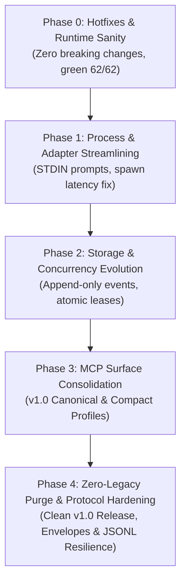

# CoAgent v1.0 Architecture & Greenfield Refactoring Roadmap

> **Status:** Approved Architecture Plan  
> **Target Release:** v1.0.0  
> **Auditors:** Codex Sol (`gpt-6.1-sol`), Google Antigravity (`agy 1.2.16`), Antigravity Lead Architect  
> **Verification Gate:** 100% pass on test suite (currently 62/62), TypeScript strict mode, Author–Reviewer audit.

---

## 🎯 Executive Summary & Architectural Vision

CoAgent serves as a high-integrity, cross-agent CLI bridge MCP server connecting orchestrator agents (Antigravity, Cursor, Claude) to local reasoning and execution CLIs (OpenAI Codex, Google Antigravity `agy`, Claude Code).

Following an extensive zero-base greenfield review by independent audit engines, the codebase will be transitioned from its transitional prototype state to a clean, minimal v1.0 architecture:
1. **Zero Fake Metrics**: Retire "smart quota" marketing and replace it with transparent priority fallbacks and exponential backoff.
2. **Robust Concurrency**: Replace custom Lamport Bakery directories (`.claims/`) and monolithic JSON rewriting with atomic leasing and append-only event persistence (SQLite WAL or JSONL).
3. **True Process Safety**: Transmit prompts strictly via `stdin` to eliminate Windows 8KB/32KB command line limits; remove on-the-fly C# PowerShell compilation.
4. **Structured Errors**: Eliminate false-positive rate-limit lockouts caused by regex matching on user code reviews.
5. **Streamlined Surface**: Consolidate 23 duplicate tools down to 4 canonical MCP tools plus native MCP Resources.

---

## 🗺️ Staged Implementation Phases



---

## 📋 Phase 0: Hotfixes & Runtime Sanity (Zero Breaking Changes)
*Goal: Fix Windows path resolution, stop false-positive provider lockouts, and remove filesystem thrashing without altering public MCP schemas.*

### Tasks:
1. **Native Executable Resolver for Windows Shims:**
   - In [`src/services/cli-resolver.service.ts`](file:///c:/Users/Oktawian/Home/oki.dev/coagent8/src/services/cli-resolver.service.ts), support `.cmd`/`.bat` wrappers pointing directly to binary `.exe` files (e.g. `agy.exe`), not exclusively npm `.js` entrypoints.
2. **Structured Error Extraction:**
   - In [`src/adapters/gemini.adapter.ts`](file:///c:/Users/Oktawian/Home/oki.dev/coagent8/src/adapters/gemini.adapter.ts) and [`src/adapters/codex.adapter.ts`](file:///c:/Users/Oktawian/Home/oki.dev/coagent8/src/adapters/codex.adapter.ts), inspect typed error envelopes (`result.error`, `turn.failed`, HTTP status fields).
   - Only apply regex fallback against unstructured `stderr`. Never match against user code content in prompts or diffs.
3. **Adaptive Rate-Limit Cooldown Backoff:**
   - In [`src/services/quota.service.ts`](file:///c:/Users/Oktawian/Home/oki.dev/coagent8/src/services/quota.service.ts) and [`src/tools/common.ts`](file:///c:/Users/Oktawian/Home/oki.dev/coagent8/src/tools/common.ts), replace the static 15-minute lockout with exponential backoff (15s -> 45s -> 180s) and automatic probe recovery.
4. **Remove 250ms Directory-Wide `fs.readdir` Scan:**
   - In [`src/services/history.service.ts`](file:///c:/Users/Oktawian/Home/oki.dev/coagent8/src/services/history.service.ts), eliminate directory-wide capacity calculations from the 250ms streaming write tick. Move directory retention checks to session initialization and close.

---

## 📋 Phase 1: Process & Adapter Streamlining
*Goal: Eliminate Windows command-line truncation crashes and reduce process launch overhead.*

### Tasks:
1. **STDIN Prompt Delivery for Antigravity (`agy`):**
   - Refactor `gemini.adapter.ts` to stream the user prompt via standard input (`--input-format stream-json`) rather than passing it via `-p <prompt>` in command arguments.
   - Prevents Windows 32KB `CreateProcessW` command line overflow on large diffs and architectural plans.
2. **Clean Windows Process Lifecycle:**
   - Eliminate runtime C# compilation via PowerShell `Add-Type` in `windows-job.ps1`.
   - Use standard Node `child_process.spawn` with process-tree termination (`taskkill /PID <pid> /T /F` on Windows, process group kill `-pid` on POSIX).
3. **Decouple Base Models from Reasoning Effort:**
   - Separate model names from `--effort` flags in `gemini.adapter.ts`. Do not pass synthetic suffixes (e.g. `gemini-3.8-flash-high`) when `--effort` is explicitly specified.
4. **Unified Stream Reducer:**
   - Unify response assembly, terminal answer replacement, and UTF-8 byte bounds across Codex, agy, and Claude adapters into a shared reducer module.

---

## 📋 Phase 2: Storage & Concurrency Evolution
*Goal: Replace custom Lamport Bakery lock files and monolithic JSON rewriting with transactional persistence.*

### Tasks:
1. **Append-Only Event Store (SQLite WAL or JSONL):**
   - Replace monolithic JSON rewriting (`JSON.parse` + `JSON.stringify` every 250ms) with append-only event logging.
   - Appending a streaming chunk becomes $O(1)$ without locking or re-reading historical events.
2. **Atomic Session Leases:**
   - Replace `.claims/*.json` directory polling with atomic lease tokens (e.g. SQLite row lock or atomic file locking).
3. **Stable Pagination & MCP Resources:**
   - Retire string-halving math (`truncateToByteLength`) and fragile revision cursors.
   - Implement MCP Resources: `coagent8://sessions` and `coagent8://sessions/{id}/history`.

---

## 📋 Phase 3: MCP Surface Consolidation & Token Optimization (v1.0 API)
*Goal: Eliminate double-prefix redundancy (`coagent8 / coagent8_consult` in host UIs), reduce LLM system prompt token overhead by 65–75%, and establish a clean, unified command architecture.*

### 🔍 Architectural Problem Statement
1. **Redundant Namespacing in Host UIs**: MCP clients display tools as `<server> / <tool_name>`. Because the MCP server is named `coagent8`, prefixing tools with `coagent8_` causes stuttering in IDEs (`coagent8 / coagent8_consult`, `coagent8 / coagent8_review`).
2. **Token Bloat in Context Window**: Currently, CoAgent exposes 23 separate tools (including triple-aliased wrappers: `coagent8_*`, `omniagent_*`, `codex_*`). All 23 JSON schemas are serialized into the LLM system prompt / tool definitions on every turn, causing severe token waste and model confusion.
3. **Backend Binding Quirks**: Legacy `codex_*` tools are not merely aliases—they force `backend: "codex"`. Any refactoring must preserve this behavioral binding without polluting the advertised toolset.

### 🎯 Target Architecture & Dual-Profile Design:

#### Profile A: Canonical Unprefixed Domain Tools (Default Standard Profile)
Drops the redundant `coagent8_` prefix so host UIs render clean pairs: `coagent8 / consult`, `coagent8 / review`, `coagent8 / doctor`.
| Canonical Tool | Parameters | Purpose |
|---|---|---|
| `consult` | `proposal`, `specific_questions?`, `backend?`, `model?`, `reasoning_effort?`, `workspace_path?`, `session_handle?` | Second opinion on architecture, design, and technical trade-offs. |
| `review` | `instructions?`, `scope?`, `target?`, `backend?`, `model?`, `reasoning_effort?`, `workspace_path?`, `session_handle?` | Git diff and code quality review. |
| `analyze` | `task`, `file_paths?`, `backend?`, `model?`, `reasoning_effort?`, `workspace_path?`, `session_handle?` | Deep codebase and architectural analysis. |
| `debug` | `error_message`, `context?`, `backend?`, `model?`, `reasoning_effort?`, `workspace_path?`, `session_handle?` | Root cause error analysis and debugging. |
| `implement` | `specification`, `backend?`, `model?`, `reasoning_effort?`, `workspace_path?`, `session_handle?` | Code generation and implementation strategy. |
| `doctor` | `repair?: boolean` | Health diagnostics, auth evidence, and CLI version probes. |
| `session` | `action`: `list` \| `history` \| `close`, `session_handle?`, `cursor?`, `limit?` | Unified session lifecycle & history management. |
| `cancel` | `session_handle` | Explicit subprocess teardown and lock recovery. |

#### Profile B: Compact Subcommand Gateway (`run` - Ultra-Low Token Profile)
For token-constrained environments, offer an optional gateway tool `run` where actions are subcommands:
- `run`:
  - `action`: `consult` | `review` | `analyze` | `debug` | `implement`
  - Action-specific payload fields validated via strict per-action dispatch.
- Accompanied only by `doctor`, `session`, and `cancel` (Total: 4 tools, reducing tool schema tokens by ~75%).

### 🛠️ Migration & Backward Compatibility:
1. **Configurable Tool Advertisement (`compat.enableLegacyAliases`)**:
   - `compat.enableLegacyAliases: false` (default for v1.0): Only canonical tools (8 tools) are advertised in `tools/list`.
   - `compat.enableLegacyAliases: true`: Re-enables legacy alias discovery (`coagent8_*`, `omniagent_*`, `codex_*`) for legacy host configurations.
2. **Universal Dispatch Compatibility**:
   - Server request handler for `tools/call` continues to handle legacy tool names (`coagent8_consult`, `codex_review_code`, etc.) regardless of whether they are advertised in `tools/list`, preserving zero-breakage upgrades for existing scripts and sessions.
   - `codex_*` calls continue to strictly bind `backend: "codex"`.

### 📋 Phase 3 Implementation Tasks:
1. **Task 3.1 – Canonical Unprefixed Tool Definitions & Schema Cleanup:**
   - Register unprefixed core tools in `src/server.ts` and `src/tools/`.
   - Consolidate session tools (`coagent8_session_history`, `coagent8_close_session`) into unified `session` tool.
   - Implement explicit `cancel` tool with session handle termination.
2. **Task 3.2 – Subcommand Gateway (`run` Profile) & Action Dispatcher:**
   - Implement optional `run(action, ...)` gateway tool with per-action schema validation.
   - Configure profile selection via `config.json` (`toolProfile: "canonical" | "compact"`).
3. **Task 3.3 – Legacy Compatibility Layer & Configuration Flag:**
   - Add `compat.enableLegacyAliases` configuration toggle in `config.service.ts`.
   - Ensure legacy calls in `src/server.ts` map to canonical execution services without behavioral regressions.
4. **Task 3.4 – Professional Tool Output & Telemetry (No-Emoji Standard):**
   - Eliminate whimsical emojis (`⏱️`, `💬`, `📜`, `⚠️`) across `src/tools/common.ts` and related tools.
   - Standardize clean, enterprise-grade demarcation between raw tool output and CoAgent execution metadata (Markdown blockquotes or monospace key-value badges).
5. **Task 3.5 – Integration Updates & Documentation:**
   - Update integration skills (`coagent8-assistant/SKILL.md`), rule definitions (`AGENTS.md`), and schemas.

---

## 📋 Phase 4: Zero-Legacy Purge & Protocol Hardening (Target: v1.0.0 Clean Release) [COMPLETED]
*Goal: Completely eliminate prototype legacy debt (`omniagent`, dual/triple aliases, `.claims`, `.lock`), harden JSONL streaming resilience against mid-write crashes, and implement the high-ROI State Envelope contract for Author–Reviewer AI-to-AI communication.*

### 🔍 Architectural Problem & Rationale
1. **SemVer & Public Contract**: Transitioning from `0.9.0-dev` to `1.0.0` establishes the first stable, production-grade public API contract. Maintaining dual/triple alias mappings (`coagent8_*`, `omniagent_*`, `codex_*`), dead `.claims` Lamport directory polling, and cross-version `.lock` fallback mechanisms creates technical drag, fragile test surfaces, and architectural ambiguity.
2. **Deterministic Single Execution Path**: CoAgent v1.0 will feature strictly one canonical execution surface (8 unprefixed domain tools + 1 optional `run` subcommand gateway) with zero legacy aliases in either `tools/list` or `tools/call`.
3. **JSONL Crash Resilience**: As uncovered during the Codex Sol audit, `src/services/history.service.ts` line 99 parses JSONL line-by-line without catching corrupt trailing lines from aborted processes. Robustness against partial trailing records is required before general availability.
4. **Token Optimization via State Envelopes**: Replace verbose conversational review essays with structured, minimal-token State Envelopes (`REVIEW / SNAPSHOT / COVERAGE / VERDICT: READY | BLOCKED / [P1/P2/P3: Problem -> Evidence -> Fix]`) with server-side gate evaluation.

### 📋 Phase 4 Implementation Tasks:

#### Task 4.1 – Comprehensive Brand & CLI Purge (`omniagent`)
- **Package & Binaries**:
  - Remove `"omniagent": "./dist/index.cjs"` binary mapping from `package.json`.
  - Remove `omniagent` runner checks from `scripts/consumer-smoke.cjs`.
- **Constants & Type Aliases**:
  - Remove `LEGACY_DIR_NAME`, `LEGACY_ENV_*`, and `LEGACY_PREFIX` from `src/constants/index.ts`.
  - Remove `export type OmniAgentConfig = CoAgentConfig` from `src/types/config.types.ts`.
- **Paths & Services Cleanup**:
  - Remove fallback to `process.env.OMNIAGENT_DIR` and `legacyDataFile()` from `src/services/paths.service.ts`.
  - Remove fallback to `OMNIAGENT_CONFIG` and `LEGACY_CONFIG_FILE` from `src/services/config.service.ts`.
  - Remove fallback to `OMNIAGENT_QUOTA_CACHE` and legacy quota cache files from `src/services/quota.service.ts`.
  - Remove fallback to `OMNIAGENT_SESSIONS*`, `omni_sess_*` regex handling, and `legacySessionFile()` from `src/services/session.service.ts`.
- **Rules & Governance Documentation**:
  - Update `.agents/rules/cross-platform.md` and `.agents/rules/author-reviewer.md` to reference strictly `CoAgent`.

#### Task 4.2 – Universal Tool Alias Purge & Server Streamlining
- **Configuration & Types**:
  - Remove `compat.enableLegacyAliases` and `compat` block from `CoAgentConfig` in `src/types/config.types.ts` and `src/services/config.service.ts`.
- **Tool Definitions & Constants**:
  - Delete `LEGACY_TOOL_NAMES` and remove all legacy aliases from `src/constants/index.ts`.
  - Remove all deprecated alias tool handlers and definition exports across `src/tools/` (`doctor.tool.ts`, `config.tool.ts`, `quota.tool.ts`, `issue.tool.ts`, `session.tool.ts`, `review.tool.ts`, `consult.tool.ts`, `analyze.tool.ts`, `debug.tool.ts`, `implement.tool.ts`).
- **Server Dispatch (`src/server.ts`)**:
  - Remove `getAllToolDefinitions()` multi-alias registry; align server dispatch exclusively with canonical advertised tools.
  - Purge legacy aliases from `executionNames` and `CallToolRequestSchema` handler.
  - Retain strictly the 8 canonical tools (`consult`, `review`, `analyze`, `debug`, `implement`, `doctor`, `session`, `cancel`) and compact gateway `run`.

#### Task 4.3 – Dead Concurrency & Lock Mechanism Elimination
- **`.claims` Directory Sweeping**:
  - Remove legacy Lamport `.claims` directory iteration and deletion from `src/services/lock.service.ts` (`withFileLock`).
  - Remove `.claims` regex match and cleanup from `src/services/session.service.ts` (`sweepExpiredSessions`).
- **Legacy `.lock` and `.busy` Checks**:
  - Remove `.lock` checks (`file + '.lock'`, `legacy + '.lock'`) from `withSessionLock` in `src/services/session.service.ts`.
  - Remove obsolete `getBusyLockPath` helper.

#### Task 4.4 – JSONL Stream Resilience & Deterministic Compression
- **JSONL Parsing Fault-Tolerance**:
  - In `src/services/history.service.ts`, wrap line parsing in safe record validation. Ignore corrupted or incomplete trailing lines resulting from abrupt process termination.
- **Deterministic Output Compression**:
  - Strip ANSI escape sequences and npm/npx cli update banners from subprocess outputs.
  - Default git diff generation to `--unified=1` with on-demand expansion.

#### Task 4.5 – State Envelope Agent-to-Agent Protocol
- **Adapter Prompt Templates**:
  - Update review and consultation system instructions for Codex, Claude, and Gemini adapters to require the structured State Envelope format:
    ```text
    REVIEW: <turn>
    SNAPSHOT: <hash>
    COVERAGE: COMPLETE | PARTIAL
    VERDICT: READY | BLOCKED

    [P1/P2/P3] <file>:<line>
    Problem: <concise statement>
    Evidence: <reproducible detail>
    Fix: <actionable remedy>

    CHECKS: typecheck=<PASS|FAIL>; tests=<PASS|FAIL|NOT_RUN>
    END_REVIEW
    ```
- **Server-Side Gate Validation**:
  - Ensure the execution pipeline programmatically evaluates `VERDICT` based on reported severity (`P1`/`P2` must force `BLOCKED`, response truncation sets `BLOCKED`).

#### Task 4.6 – Test Suite Modernization & Verification
- **Test Removal & Refactoring**:
  - Remove obsolete `test/migration.test.js`.
  - Refactor `test/session_and_issue.test.js`, `test/history_and_pipeline.test.js`, and `test/v1_phase3.test.js` to assert purely on canonical behavior, atomic leases, and isolated directory configurations.
- **Quality Gate**:
  - Maintain 100% test pass rate with 0 TypeScript compiler errors.

---

## 🛡️ Author–Reviewer Verification Protocol

Every phase must strictly follow the repository governance:
1. **Branch Protection**: Work must take place on dedicated feature branches (`feat/v1-phase0-hotfixes`, etc.).
2. **Quality Gate**: Run the 4-step verification gate before opening a PR:
   ```bash
   npm run typecheck
   npm run build
   npm test
   npm pack --dry-run
   ```
3. **Independent Audit**: Before merging any phase, invoke Codex Sol (`gpt-6.1-sol`) in read-only sandbox mode via `codex_consult` (or `coagent8_consult` with `backend: "codex"`) to review the uncommitted diff. All P1/P2 audit findings must be remediated.
